#  Briefbote

Druckformate für alle Geschäftsdokumente deutscher Unternehmen in ERPNext, nach DIN 5008 und mit den Angaben, die das Gesetz verlangt: vom Angebot über Auftragsbestätigung, Lieferschein, Rechnung, Rechnungskorrektur, Gutschrift, Zahlungserinnerung und Mahnung bis zur Anfrage und Bestellung, dazu Leistungsnachweise, Kontoauszüge, Belege und der freie Geschäftsbrief. Ziel ist alles, was ein deutsches Unternehmen aus ERPNext druckt oder versendet, in einem Gestaltungssystem: Briefe mit Anschriftfeld für den Fensterumschlag, Informationsblock und Pflichtangaben im Fuß, und Listen mit Positionstabellen über viele Seiten.

> **Status: in Entwicklung, noch nicht einsatzfähig.** Version 0.3.0 bringt die Druckformate [Rechnung](docs/rechnung.md) (Rechnung, Rechnungskorrektur, Stornorechnung und kaufmännische Gutschrift aus der Ausgangsrechnung), [Gutschrift](docs/gutschrift.md) (Gutschrift im Gutschriftsverfahren aus der Eingangsrechnung), [Leistungsnachweis](docs/leistungsnachweis.md) (die Stunden einer Rechnung aus ihren Stundenzetteln), [Angebot](docs/angebot.md), [Auftragsbestätigung](docs/auftragsbestaetigung.md), [Lieferschein](docs/lieferschein.md), [Zahlungserinnerung und Mahnung](docs/mahnung.md) mit Verzugszinsen und Pauschale nur, wo sie rechtmäßig sind, [Zahlungsbestätigung und Quittung](docs/zahlungsbestaetigung.md) und [Bestellung](docs/bestellung.md), neu den [Geschäftsbrief](docs/geschaeftsbrief-format.md) für den Business Letter von erpnext_germany, die Schlussrechnung mit [Anzahlungsrechnung](docs/anzahlungsrechnung.md) und [Proforma-Rechnung](docs/proforma-rechnung.md), das [Zahlungsavis](docs/zahlungsavis.md), [Anfrage](docs/anfrage.md), [Lieferantenrücksendung](docs/lieferantenruecksendung.md) und [Packliste](docs/packliste.md), dazu das Gestaltungssystem nach DIN 5008 mit der Gestaltung je Unternehmen und die Einrichtung ohne Oberfläche. „Drucken“ in der Druckansicht druckt dasselbe PDF wie „PDF“; Entwürfe und stornierte Belege tragen auf jeder Seite ihr Wasserzeichen, und ein Beleg, dem eine Pflichtangabe fehlt, sagt oben, was fehlt. Die Wortlaute der Pflichthinweise warten auf die Prüfung durch eine Steuerberatung (siehe „Offen für die fachliche Prüfung“ in der Dokumentation [Rechnung](docs/rechnung.md#offen-für-die-fachliche-prüfung) und auf der Seite jedes Druckformats). Für Mahnungen empfiehlt sich die Einrichtung [Mahnarten ohne Zinsen und Gebühr](docs/mahnung.md#empfohlene-einrichtung-mahnarten-ohne-zinsen-und-gebühr). Die übrigen Dokumente folgen in der Reihenfolge der [Roadmap](docs/roadmap.md); welche es geben soll, zählt der [Katalog](docs/katalog.md) auf.

## Was Briefbote macht

- **Ein Gestaltungssystem für alle Dokumente.** Ein Stylesheet und ein Satz Bausteine für Briefe nach DIN 5008, Form A und Form B, mit Anschriftfeld, Informationsblock, Betreff, Falz- und Lochmarken, und für Dokumente mit Positionstabellen, deren Kopf auf jeder Seite wiederkehrt, Summen, die bei ihrer Tabelle bleiben, Anlagen und „Seite n von N“.
- **Die Angaben, die das Gesetz verlangt.** Jedes Druckformat druckt die Pflichtangaben seines Dokuments, für die Rechnung die des § 14 Abs. 4 UStG mit den Hinweisen des § 14a UStG, und im Fuß jedes Briefs die Angaben zum Unternehmen nach § 35a GmbHG, § 37a HGB oder § 80 AktG. Jede Regel steht mit Quelle auf der Seite ihres Druckformats.
- **Mit und ohne Briefpapier.** Auf leeres Papier druckt Briefbote Kopf und Fuß selbst, auf vorgedrucktes Briefpapier nur den Inhalt an die Stellen der Norm.
- **Deutsch und Englisch.** Ein Dokument druckt in seiner Sprache, die Hinweise im Wortlaut, den das Gesetz vorgibt.
- **Nichts fest im Code, nichts aus dem Netz.** Was gedruckt wird, kommt aus dem Beleg, den Stammdaten und den Einstellungen Geschäftspost je Unternehmen. Ein Druckformat lädt nichts nach und druckt mit beiden PDF-Generatoren von Frappe denselben Inhalt; lange Tabellen können mit wkhtmltopdf anders umbrechen.
- **Bewiesen auf Papier.** Die CI druckt jedes Format mit beiden PDF-Generatoren für Belege, die das Layout fordern, und prüft jede Seite: Seitenzahlen, Ränder, nichts übereinander, Tabellenkopf wiederholt, Summen bei ihrer Tabelle, Pflichtangaben vorhanden, Anschrift im Fenster.

## Beispiele

Die Beispiele druckt die CI aus den erfundenen Daten ihres Nachweises (Beispiel GmbH mit Musterlogo, Kunde Muster AG und andere), mit dem PDF-Generator auf Chromium-Basis auf leerem Papier; sie zeigen den Stand von `main`. Ein Klick auf ein Bild öffnet die Seite in voller Größe.

<table>
  <tr>
    <td align="center" valign="top" width="25%">
      <a href="docs/bilder/beispiele/angebot.png">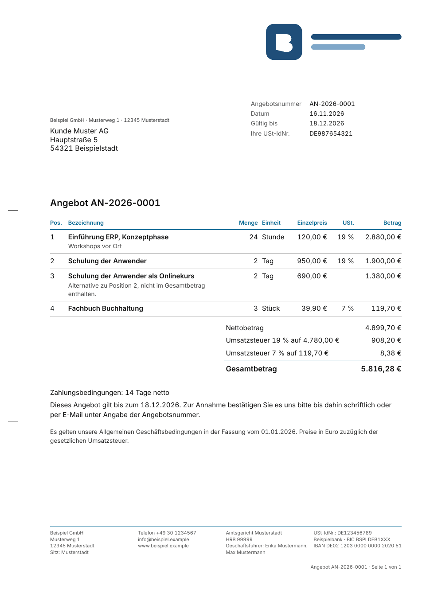</a><br>
      <a href="docs/angebot.md">Angebot</a><br>
      <a href="docs/beispiele/angebot.pdf">PDF</a>
    </td>
    <td align="center" valign="top" width="25%">
      <a href="docs/bilder/beispiele/auftragsbestaetigung.png">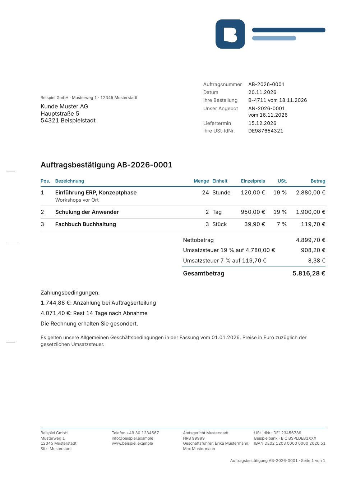</a><br>
      <a href="docs/auftragsbestaetigung.md">Auftragsbestätigung</a><br>
      <a href="docs/beispiele/auftragsbestaetigung.pdf">PDF</a>
    </td>
    <td align="center" valign="top" width="25%">
      <a href="docs/bilder/beispiele/lieferschein.png">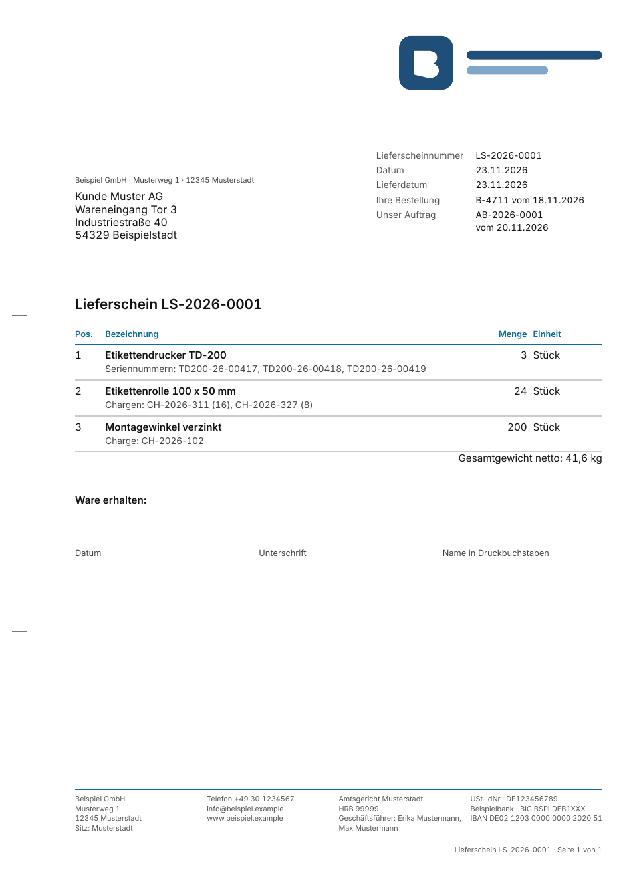</a><br>
      <a href="docs/lieferschein.md">Lieferschein</a><br>
      <a href="docs/beispiele/lieferschein.pdf">PDF</a>
    </td>
    <td align="center" valign="top" width="25%">
      <a href="docs/bilder/beispiele/rechnung.png">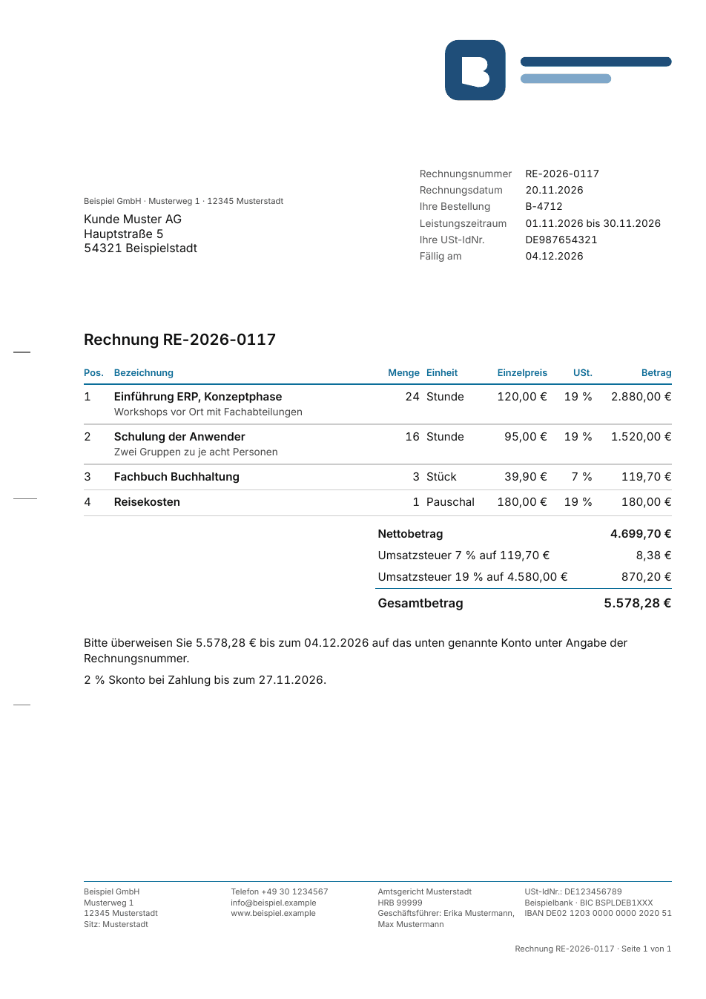</a><br>
      <a href="docs/rechnung.md">Rechnung</a><br>
      <a href="docs/beispiele/rechnung.pdf">PDF</a>
    </td>
  </tr>
  <tr>
    <td align="center" valign="top" width="25%">
      <a href="docs/bilder/beispiele/leistungsnachweis.png">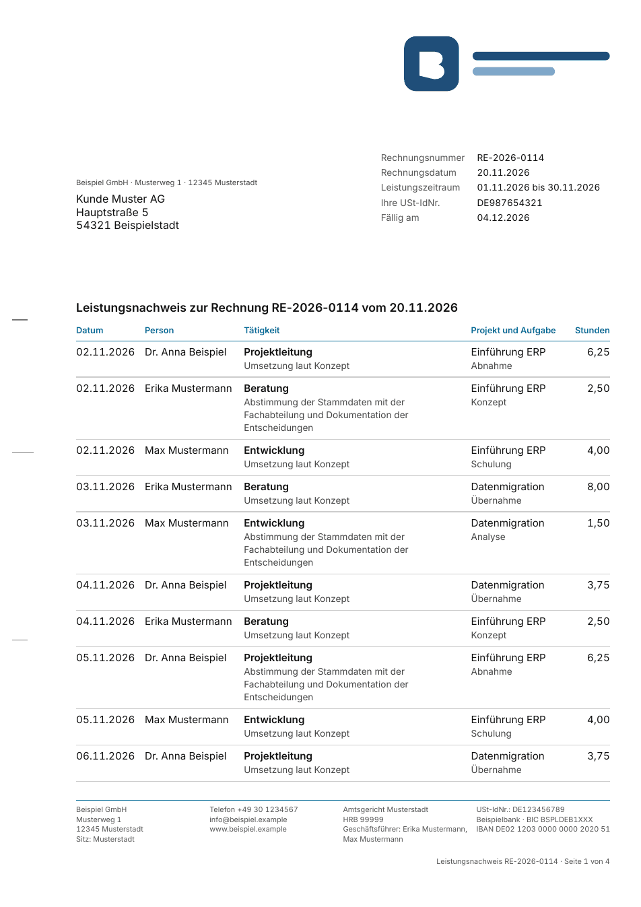</a><br>
      <a href="docs/leistungsnachweis.md">Leistungsnachweis</a><br>
      <a href="docs/beispiele/leistungsnachweis.pdf">PDF</a>
    </td>
    <td align="center" valign="top" width="25%">
      <a href="docs/bilder/beispiele/gutschrift.png">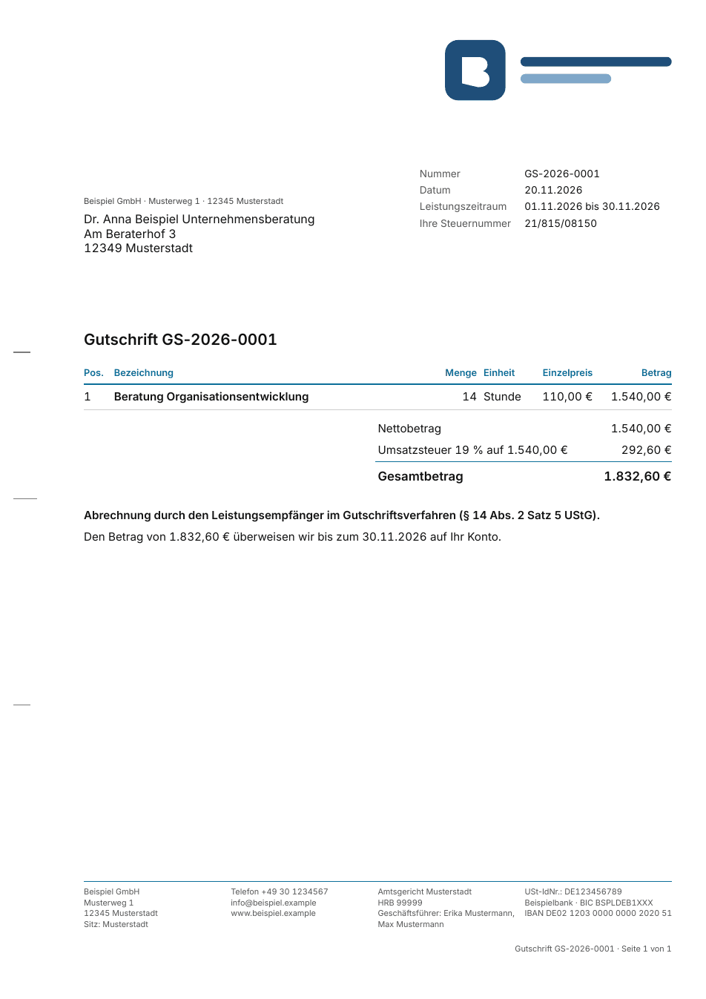</a><br>
      <a href="docs/gutschrift.md">Gutschrift</a><br>
      <a href="docs/beispiele/gutschrift.pdf">PDF</a>
    </td>
    <td align="center" valign="top" width="25%">
      <a href="docs/bilder/beispiele/mahnung.png">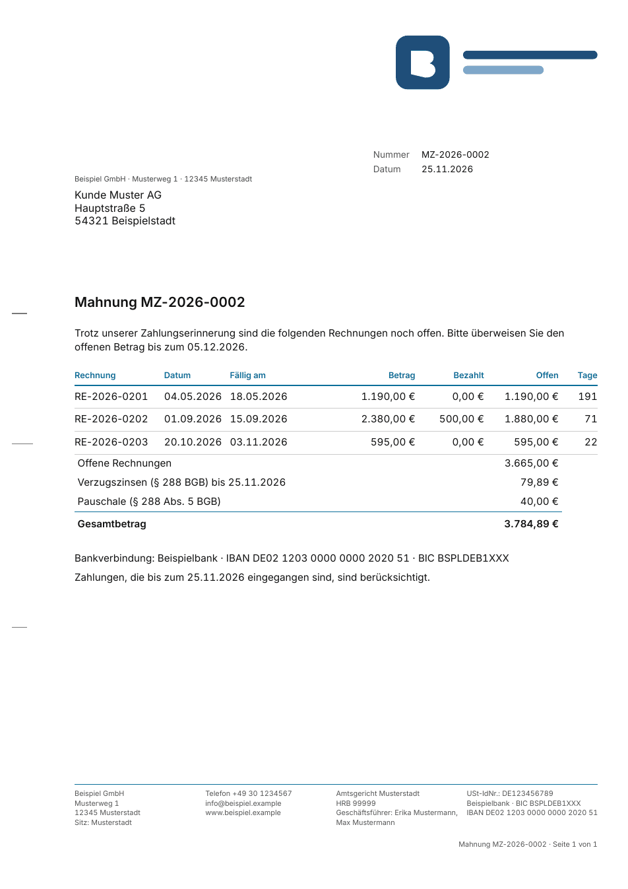</a><br>
      <a href="docs/mahnung.md">Mahnung</a><br>
      <a href="docs/beispiele/mahnung.pdf">PDF</a>
    </td>
    <td align="center" valign="top" width="25%">
      <a href="docs/bilder/beispiele/zahlungsbestaetigung.png">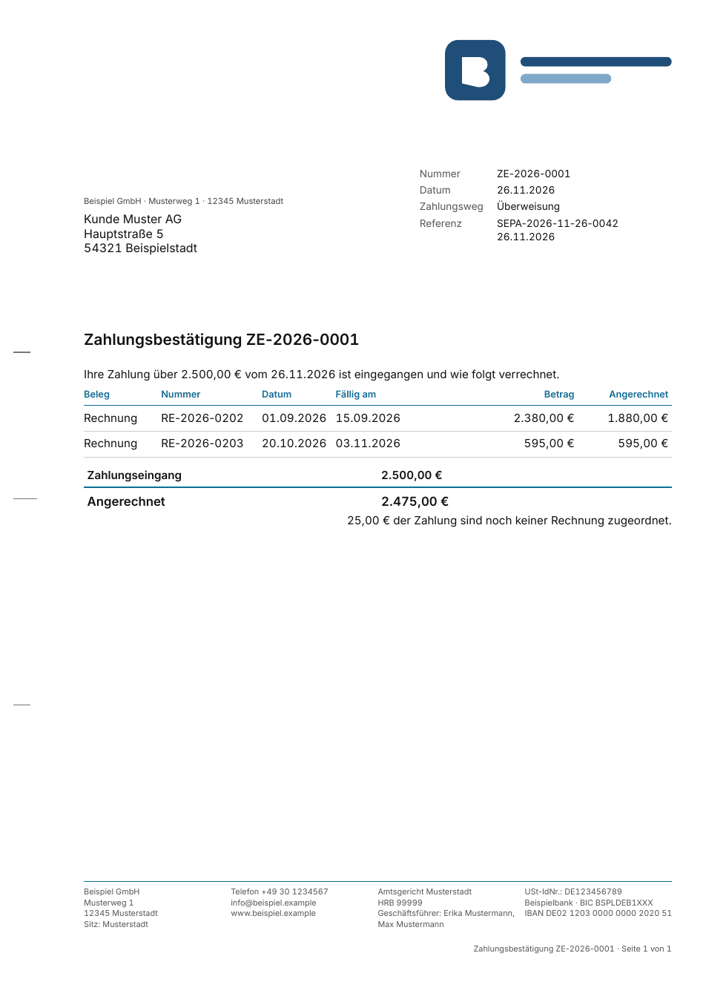</a><br>
      <a href="docs/zahlungsbestaetigung.md">Zahlungsbestätigung</a><br>
      <a href="docs/beispiele/zahlungsbestaetigung.pdf">PDF</a>
    </td>
  </tr>
  <tr>
    <td align="center" valign="top" width="25%">
      <a href="docs/bilder/beispiele/quittung.png">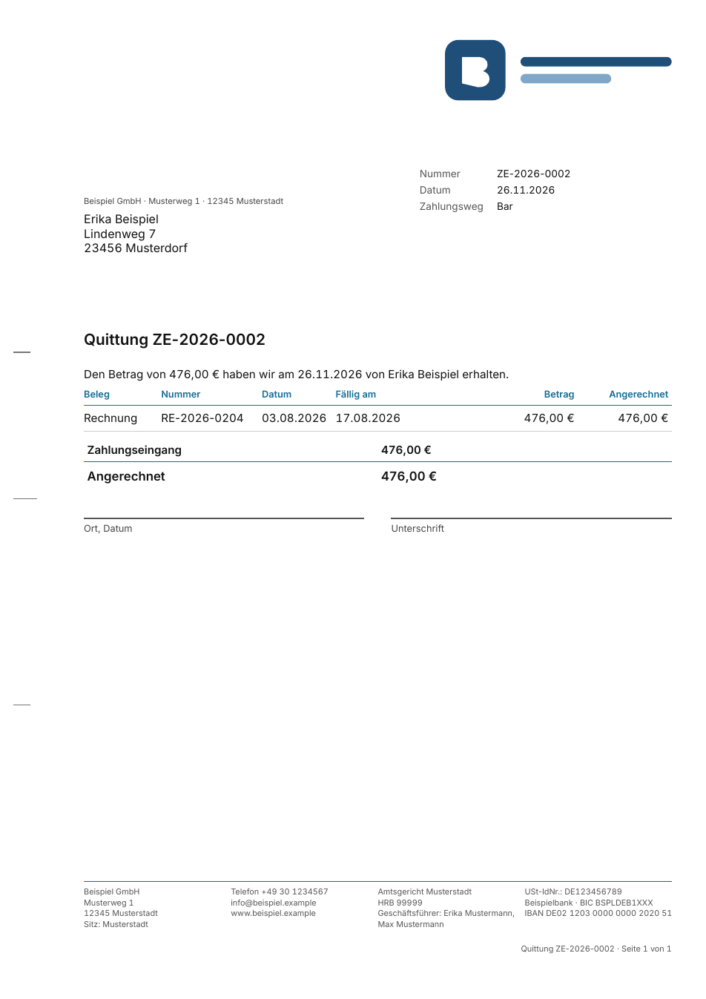</a><br>
      <a href="docs/zahlungsbestaetigung.md">Quittung</a><br>
      <a href="docs/beispiele/quittung.pdf">PDF</a>
    </td>
    <td align="center" valign="top" width="25%">
      <a href="docs/bilder/beispiele/bestellung.png">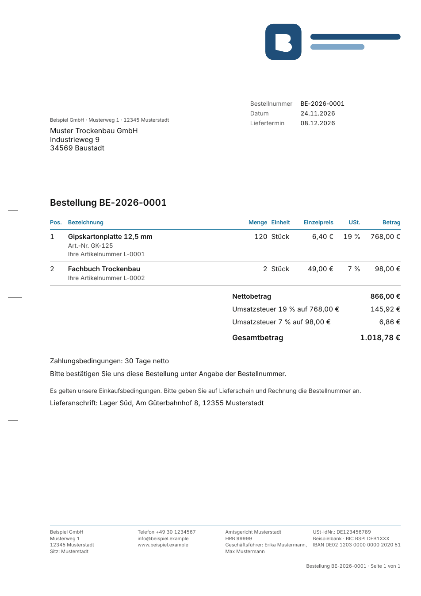</a><br>
      <a href="docs/bestellung.md">Bestellung</a><br>
      <a href="docs/beispiele/bestellung.pdf">PDF</a>
    </td>
    <td align="center" valign="top" width="25%">
      <a href="docs/bilder/beispiele/anfrage.png">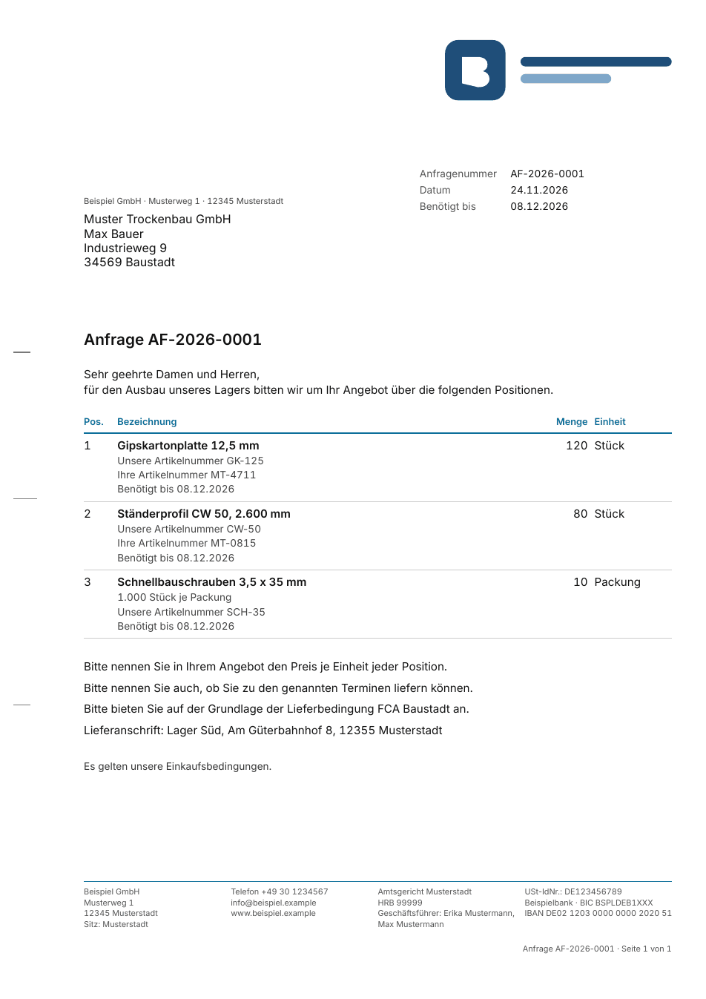</a><br>
      <a href="docs/anfrage.md">Anfrage</a><br>
      <a href="docs/beispiele/anfrage.pdf">PDF</a>
    </td>
    <td align="center" valign="top" width="25%">
      <a href="docs/bilder/beispiele/lieferantenruecksendung.png">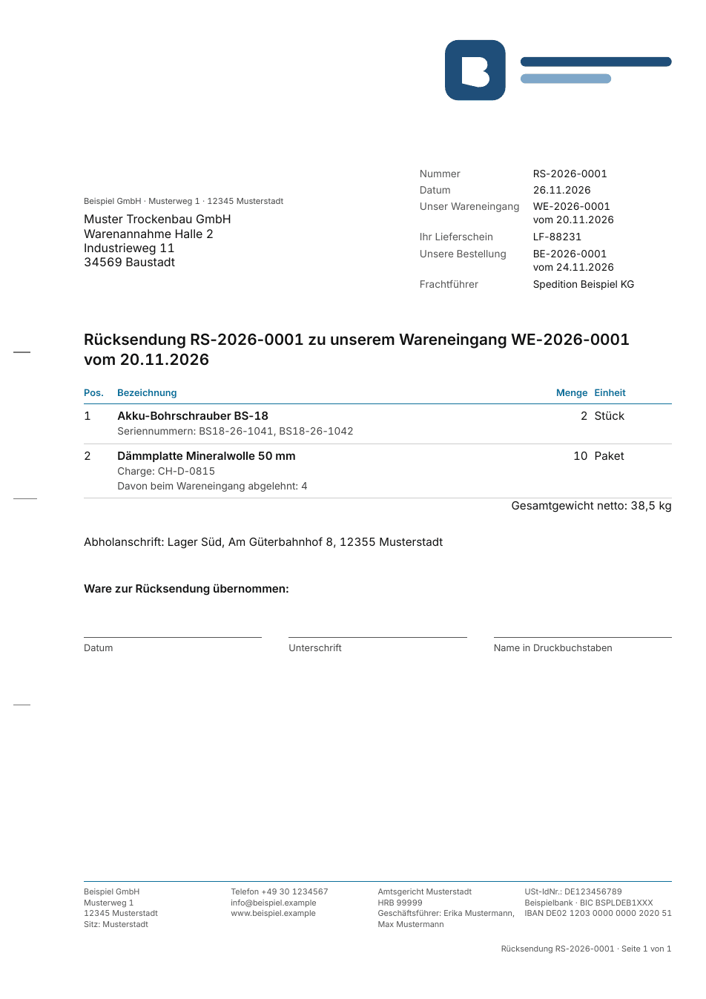</a><br>
      <a href="docs/lieferantenruecksendung.md">Lieferantenrücksendung</a><br>
      <a href="docs/beispiele/lieferantenruecksendung.pdf">PDF</a>
    </td>
  </tr>
  <tr>
    <td align="center" valign="top" width="25%">
      <a href="docs/bilder/beispiele/packliste.png">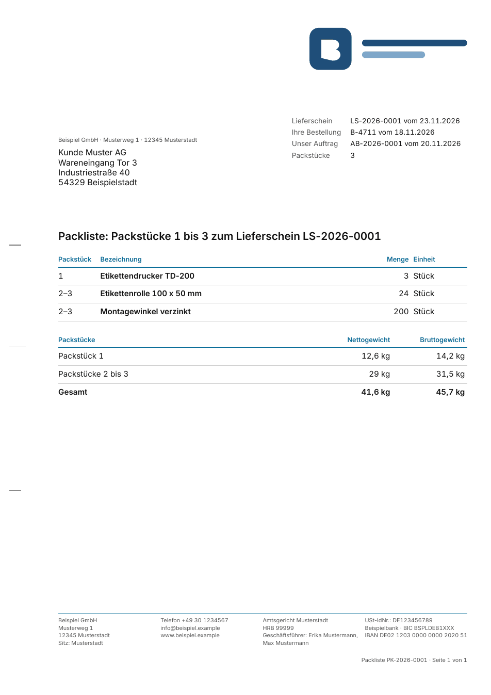</a><br>
      <a href="docs/packliste.md">Packliste</a><br>
      <a href="docs/beispiele/packliste.pdf">PDF</a>
    </td>
    <td align="center" valign="top" width="25%">
      <a href="docs/bilder/beispiele/zahlungsavis.png">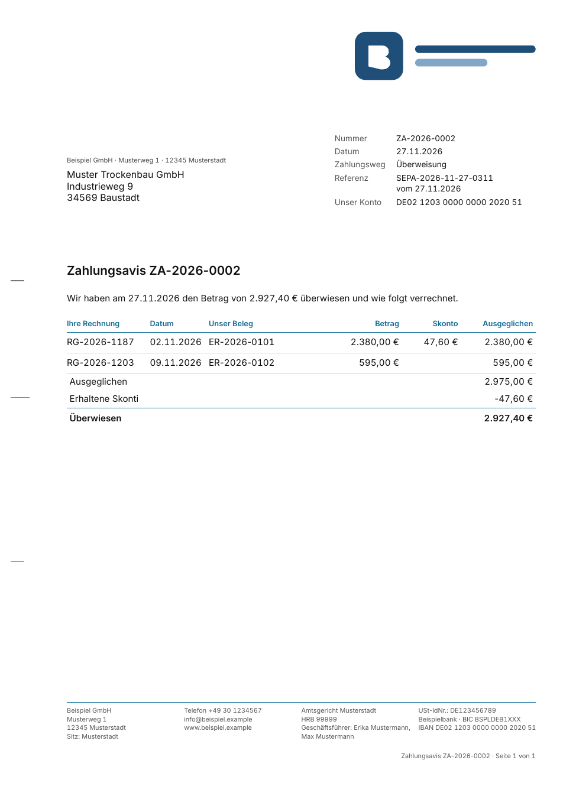</a><br>
      <a href="docs/zahlungsavis.md">Zahlungsavis</a><br>
      <a href="docs/beispiele/zahlungsavis.pdf">PDF</a>
    </td>
    <td align="center" valign="top" width="25%">
      <a href="docs/bilder/beispiele/geschaeftsbrief.png">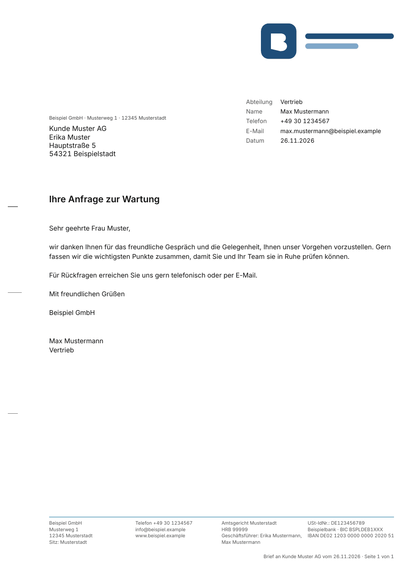</a><br>
      <a href="docs/geschaeftsbrief-format.md">Geschäftsbrief</a><br>
      <a href="docs/beispiele/geschaeftsbrief.pdf">PDF</a>
    </td>
    <td align="center" valign="top" width="25%">
      <a href="docs/bilder/beispiele/anzahlungsrechnung.png">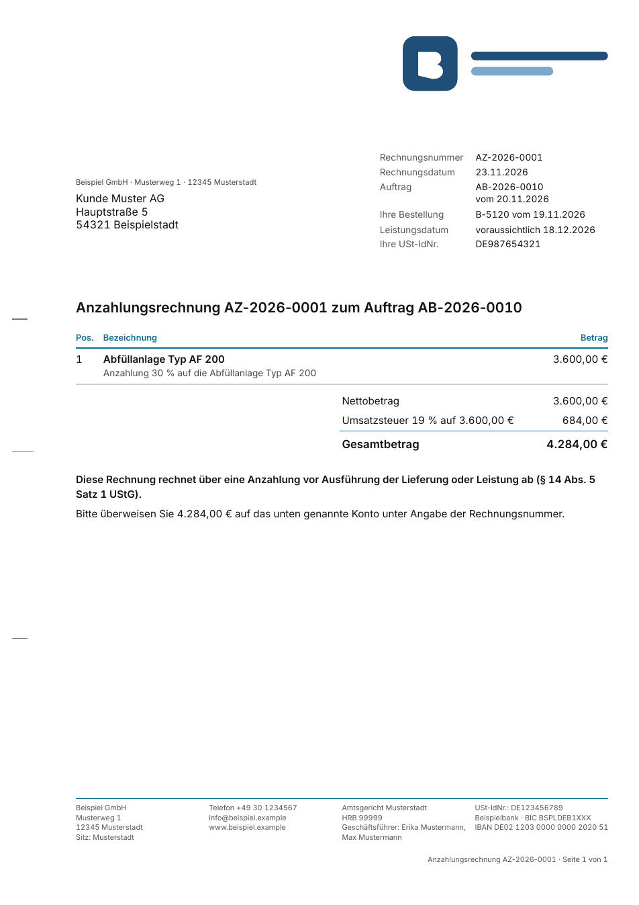</a><br>
      <a href="docs/anzahlungsrechnung.md">Anzahlungsrechnung</a><br>
      <a href="docs/beispiele/anzahlungsrechnung.pdf">PDF</a>
    </td>
  </tr>
  <tr>
    <td align="center" valign="top" width="25%">
      <a href="docs/bilder/beispiele/proforma_rechnung.png">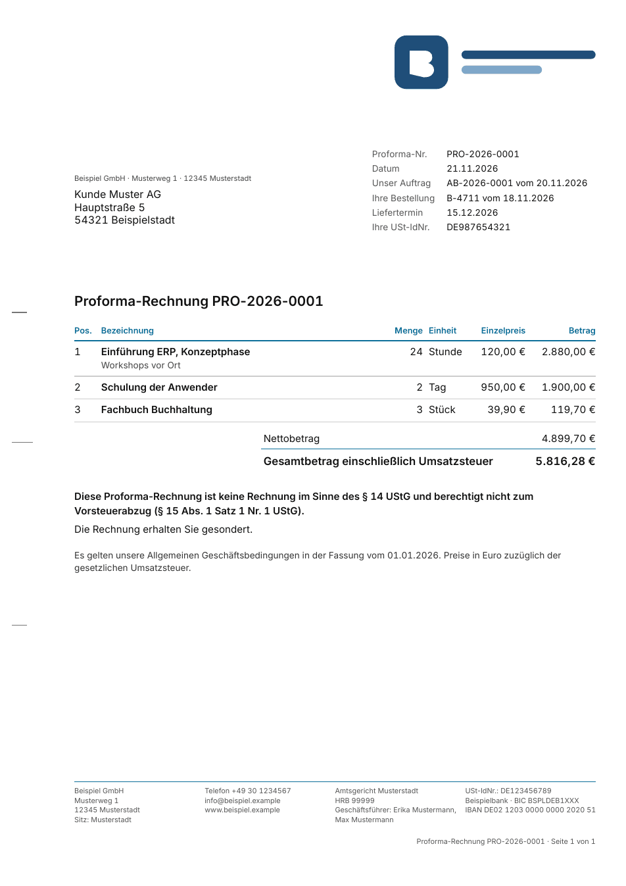</a><br>
      <a href="docs/proforma-rechnung.md">Proforma-Rechnung</a><br>
      <a href="docs/beispiele/proforma_rechnung.pdf">PDF</a>
    </td>
  </tr>
  <tr>
    <th colspan="4">Entwurf, Folgeseite, Englisch und Schlussrechnung</th>
  </tr>
  <tr>
    <td align="center" valign="top" width="25%">
      <a href="docs/bilder/beispiele/rechnung-entwurf.png">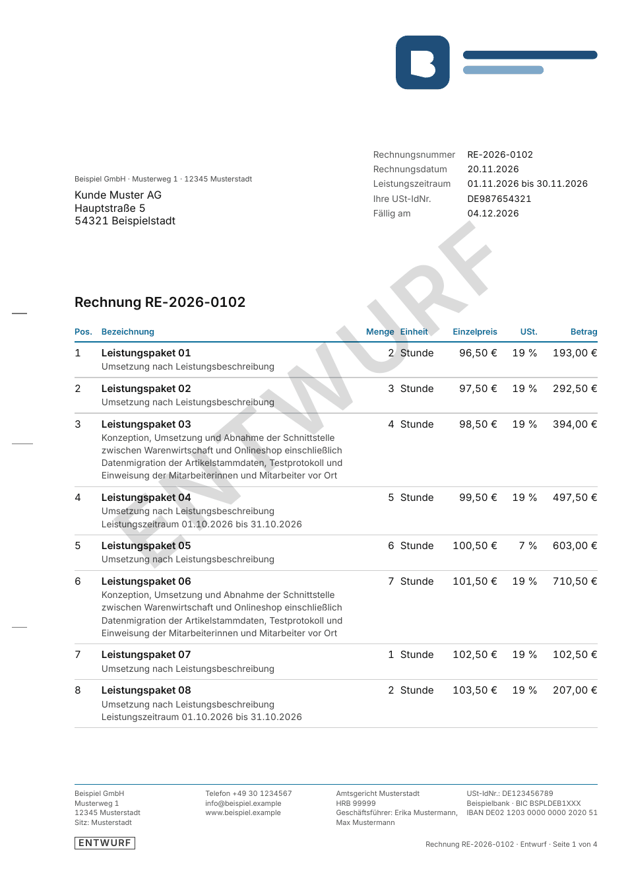</a><br>
      <a href="docs/rechnung.md">Rechnung als Entwurf</a><br>
      <a href="docs/beispiele/rechnung-entwurf.pdf">PDF</a>
    </td>
    <td align="center" valign="top" width="25%">
      <a href="docs/bilder/beispiele/rechnung-mehrseitig.png">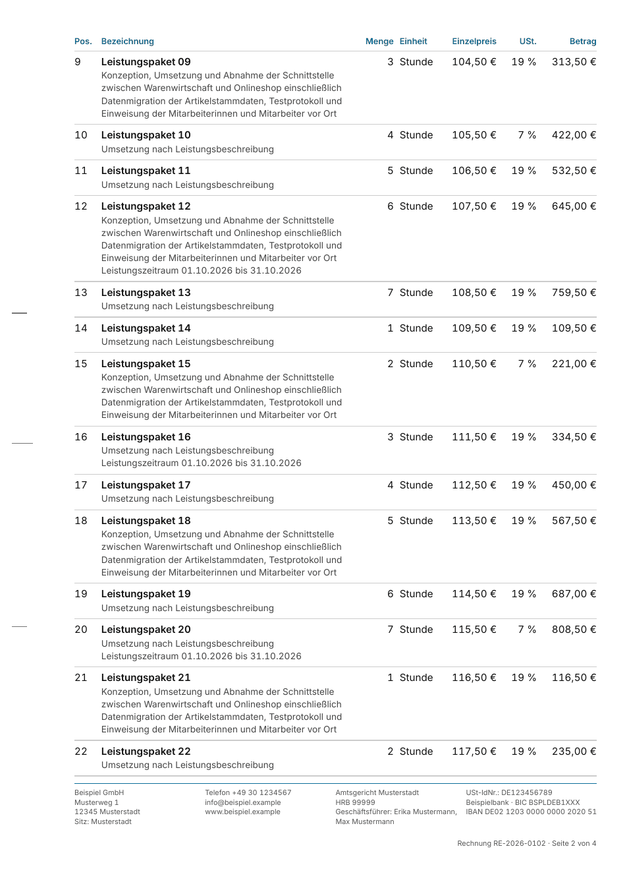</a><br>
      <a href="docs/rechnung.md">Rechnung, Seite 2</a><br>
      <a href="docs/beispiele/rechnung-mehrseitig.pdf">PDF</a>
    </td>
    <td align="center" valign="top" width="25%">
      <a href="docs/bilder/beispiele/rechnung-englisch.png">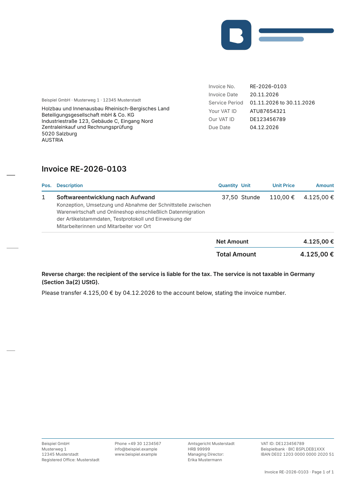</a><br>
      <a href="docs/rechnung.md">Rechnung auf Englisch</a><br>
      <a href="docs/beispiele/rechnung-englisch.pdf">PDF</a>
    </td>
    <td align="center" valign="top" width="25%">
      <a href="docs/bilder/beispiele/rechnung-schluss.png">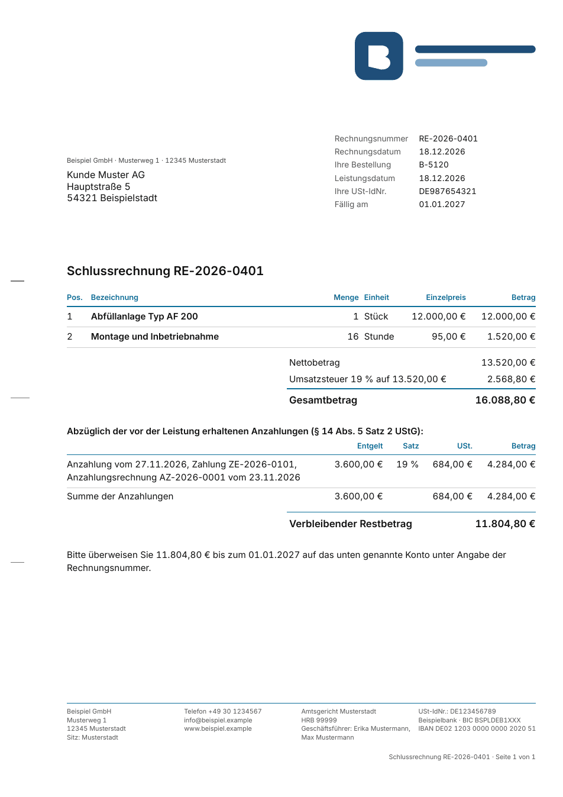</a><br>
      <a href="docs/rechnung.md#anzahlungen-und-schlussrechnung">Schlussrechnung</a><br>
      <a href="docs/beispiele/rechnung-schluss.pdf">PDF</a>
    </td>
  </tr>
</table>

## Voraussetzungen

- Frappe und ERPNext ab Version 16. Unterstützt wird nur die jeweils aktuelle Hauptversion.
- Python 3.14.

## Installation

```bash
cd $PATH_TO_YOUR_BENCH
bench get-app https://github.com/encircle360-oss/briefbote
bench --site <site> install-app briefbote
```

Danach steht in der Leiste von ERPNext „Geschäftspost“ mit den Einstellungen je Unternehmen. Die Druckformate „Rechnung“, „Leistungsnachweis“ (Ausgangsrechnung), „Gutschrift“ (Eingangsrechnung), „Angebot“ (Angebot), „Auftragsbestätigung“ (Kundenauftrag), „Lieferschein“ (Lieferschein), „Mahnung“ (Mahnung), „Zahlungsbestätigung“ und „Quittung“ (Zahlungseingang), „Zahlungsavis“ (Zahlungsausgang), „Bestellung“ (Bestellung), „Anfrage“ (Anfrage), „Lieferantenrücksendung“ (Wareneingang mit Rücksendung), „Packliste“ (Packzettel) sowie „Proforma-Rechnung“ und „Anzahlungsrechnung“ (Kundenauftrag, gedruckt über die Proforma-Rechnung von ERPNext) stehen zur Wahl; zum Standard macht sie erst, wer es einstellt. Wie das ohne Oberfläche geht, mit Steuerfällen nach Regel und der Prüfung, was einem Unternehmen fehlt, steht unter [Einrichtung](docs/einrichtung.md).

## Zusammenspiel

Briefbote setzt nur ERPNext voraus und ergänzt, was andere Apps für deutsche Unternehmen schon tun:

- **[Steuerbote](https://github.com/encircle360-oss/steuerbote)** meldet die Steuern an ELSTER. Beide Apps kommen von denselben Maintainern und folgen denselben Regeln; die Rechnungen, die Briefbote druckt, sind die Belege, aus denen Steuerbote meldet.
- **[erpnext_germanized](https://github.com/encircle360-oss/erpnext_germanized)** ist ein fertiges Container-Image mit ERPNext 16 und den gängigen deutschen Apps. Briefbote ist seit der Version 16.60.0-16 des Images darin enthalten.
- **E-Rechnung:** Die elektronische Rechnung (XRechnung, ZUGFeRD) erzeugt eine eigene App wie eu_einvoice; sie bettet ihr XML auch in das PDF eines Druckformats von Briefbote ein. Briefbote gestaltet das Dokument, das ein Mensch liest.
- **erpnext_germany:** Registerangaben des Unternehmens und den Grund einer Steuerbefreiung nimmt Briefbote von dort, wenn die App installiert ist. Für ihren Geschäftsbrief (Business Letter) bringt Briefbote dann das Druckformat [Geschäftsbrief](docs/geschaeftsbrief-format.md) mit, ohne die App vorauszusetzen. Was die Apps im Einzelnen tun, steht in der [Architektur](docs/architektur.md#zusammenspiel-mit-anderen-apps).

## Dokumentation

- [Katalog](docs/katalog.md): jedes Geschäftsdokument mit DocType, Stand in ERPNext, Anforderungen und Priorität
- [Roadmap](docs/roadmap.md): was es gibt, was als Nächstes kommt und wann ein Druckformat fertig ist
- [Einrichtung](docs/einrichtung.md): Einstellungen Geschäftspost, Druckformat wählen, was die Rechnung aus dem Beleg liest
- [Rechnung](docs/rechnung.md): Rechnung, Rechnungskorrektur, Stornorechnung und kaufmännische Gutschrift mit Pflichtangaben, Steuerfällen, Leistungsdatum und Quellen
- [Leistungsnachweis](docs/leistungsnachweis.md): die Stunden einer Rechnung aus ihren Stundenzetteln als Anlage oder eigenes Dokument, wie ERPNext Zeit und Rechnung verbindet und was eine fremde Zeiterfassung füllen muss
- [Angebot](docs/angebot.md): das Angebot mit Gültigkeit, Alternativen, Preisen je Einheit, Umsatzsteuer nach Satz und Annahme
- [Auftragsbestätigung](docs/auftragsbestaetigung.md): die Auftragsbestätigung mit Angebot, Bestellung des Kunden, Lieferterminen und Zahlungsbedingungen
- [Lieferschein](docs/lieferschein.md): der Lieferschein an die Lieferanschrift mit Lieferdatum, Seriennummern und Chargen, Preisen und Empfangsbestätigung nach den Einstellungen
- [Zahlungserinnerung und Mahnung](docs/mahnung.md): Mahnstufen, Verzug, Verzugszinsen und Pauschale nur, wo sie rechtmäßig sind, Basiszinssätze in den Einstellungen
- [Zahlungsbestätigung und Quittung](docs/zahlungsbestaetigung.md): der gebuchte Zahlungseingang eines Kunden mit den Belegen, auf die er angerechnet ist, als Bestätigung oder Quittung nach § 368 BGB
- [Bestellung](docs/bestellung.md): die Bestellung beim Lieferanten mit Lieferterminen, Lieferanschrift und der Umsatzsteuer des Lieferanten
- [Zahlungsavis](docs/zahlungsavis.md): der gebuchte Zahlungsausgang an einen Lieferanten mit seinen Rechnungsnummern, Skonto je Rechnung und dem gezahlten Betrag
- [Anfrage](docs/anfrage.md): die Anfrage an einen Lieferanten ohne Preise, mit Artikelnummern, Bedarfsterminen und Lieferbedingung
- [Lieferantenrücksendung](docs/lieferantenruecksendung.md): die Rücksendung an den Lieferanten mit Bezug auf Wareneingang und Lieferschein, abgelehntem Teil und Übernahme
- [Packliste](docs/packliste.md): die Packzettel eines Lieferscheins mit Packstücken, Inhalt und Gewichten
- [Anzahlungsrechnung](docs/anzahlungsrechnung.md): die Rechnung über eine Anzahlung vor der Leistung aus der Proforma-Rechnung von ERPNext, mit ihren Grenzen; die Schlussrechnung steht unter [Rechnung](docs/rechnung.md#anzahlungen-und-schlussrechnung)
- [Proforma-Rechnung](docs/proforma-rechnung.md): die Proforma-Rechnung aus dem Kundenauftrag, die keine Rechnung ist und keine Steuer ausweist
- [Gutschrift](docs/gutschrift.md): die Gutschrift im Gutschriftsverfahren aus der Eingangsrechnung mit Pflichtangaben, Steuerfällen im Einkauf und Quellen
- [Geschäftsbrief (Druckformat)](docs/geschaeftsbrief-format.md): freie Korrespondenz aus dem Business Letter von erpnext_germany, mit Anschrift, Informationsblock, Text in der Schrift des Briefs und Vorlagen zum Einfügen
- [Angaben im Geschäftsbrief](docs/geschaeftsbrief.md): Angaben zum Unternehmen nach Rechtsform, Fuß, Rücksendeangabe und Anschrift
- [DIN 5008](docs/din-5008.md): die Maße des Briefs und ihre Quellen
- [Architektur](docs/architektur.md): Kerne und Frappe-Schicht, Gestaltungssystem, die beiden PDF-Generatoren, Schrift, Zusammenspiel mit anderen Apps
- [Entwicklung](docs/entwicklung.md): Einrichtung, Tests, Nachweis der Ausdrucke, ein Druckformat hinzufügen, Stil und CI
- [Haftungsausschluss](docs/haftungsausschluss.md): ohne Gewähr, keine Rechts- oder Steuerberatung, Verantwortung für jedes Dokument
- [Mitwirken](CONTRIBUTING.md), [Hinweise für Coding-Agenten](AGENTS.md), [Sicherheit](SECURITY.md)

## Mitwirken und Community

### Beiträge sind willkommen

Briefbote lebt davon, dass Menschen mit unterschiedlichen Branchen, Dokumenten und Steuerfällen mitmachen. Du kannst

- **Maintainer werden**, für ein Dokument oder das ganze Projekt,
- **Pull Requests** für Fehlerbehebungen, Druckformate und Dokumentation stellen,
- **testen**, besonders mit anderen Steuerfällen, Sprachen und Briefpapieren als unseren,
- **Dokumentation und Beispiele** verbessern,
- **Fehler melden** oder Dokumente vorschlagen.

Jeder Beitrag zählt. Du musst kein Steuerprofi sein, wir helfen beim Einstieg.

### So geht es

1. Repository forken und einen Branch anlegen
2. Änderung samt Tests schreiben (Test zuerst, siehe [Mitwirken](CONTRIBUTING.md))
3. Lokal prüfen: `pre-commit run --all-files` und `pytest`
4. Pull Request mit kurzer Beschreibung und Quelle der fachlichen Regel stellen
5. Review gemeinsam durchgehen, bis es passt

### Maintainer werden

Wer dauerhaft Verantwortung übernehmen möchte, zeigt das am einfachsten durch Pull Requests und Hilfe in Issues und Discussions und schreibt dann an **oss@encircle360.com**. Ein Dokument reicht, es muss nicht das ganze Projekt sein.

## Support und professionelle Dienstleistungen

### Community-Support

- **Matrix:** [#oss:encircle360.com](https://matrix.to/#/#oss:encircle360.com) für den direkten Austausch mit Maintainern und Nutzern
- **Issues:** [Fehler und Wünsche zu Briefbote](https://github.com/encircle360-oss/briefbote/issues)
- **Discussions:** [Fragen und fachlicher Austausch](https://github.com/encircle360-oss/briefbote/discussions)
- **Fehler in ERPNext oder Frappe selbst** bitte beim jeweiligen Projekt melden: [frappe/erpnext](https://github.com/frappe/erpnext/issues), [frappe/frappe](https://github.com/frappe/frappe/issues)

### Professioneller Support

Für Einführung, Gestaltung nach dem eigenen Erscheinungsbild, Betrieb, Schulung oder die Abstimmung der Dokumente mit deiner Steuerberatung: **hello@encircle360.com**

## Haftungsausschluss

Briefbote wird ohne jede Gewährleistung und, soweit das Gesetz es erlaubt, ohne Haftung bereitgestellt (Abschnitte 15 und 16 der [Lizenz](LICENSE)). Briefbote ist Software, keine Rechts- oder Steuerberatung. Wer ein Dokument ausstellt, bleibt für seinen Inhalt verantwortlich und prüft die ersten Dokumente jedes Falls vor dem Versand. Was das im Einzelnen heißt, steht im [Haftungsausschluss](docs/haftungsausschluss.md).

Briefbote ist weder ein Angebot der Frappe Technologies Pvt. Ltd. noch des DIN Deutsches Institut für Normung e. V. ERPNext ist eine Marke der Frappe Technologies Pvt. Ltd. Briefbote steht mit keinem davon in Verbindung.

Für den Einsatz mit zugesichertem Support und Reaktionszeiten sprich uns an: **hello@encircle360.com**

## Lizenz

Briefbote steht unter der [GNU Affero General Public License v3.0 oder später](LICENSE) (AGPL-3.0-or-later). Sie ist mit der GPL-3.0 von ERPNext kompatibel.

## Maintainer

Briefbote wird von der **[encircle360 GmbH](https://encircle360.com/?ref=github-briefbote)** entwickelt und gepflegt, zusammen mit allen Mitwirkenden. Für Einführung, Betrieb und Unterstützung ist die encircle360 GmbH unter [encircle360.com](https://encircle360.com/?ref=github-briefbote) erreichbar. Briefbote sendet keine Telemetrie, und kein Ausdruck trägt einen Hinweis auf die Software.

## Credits und Mitwirkende

Danke an alle Mitwirkenden, Partner und die Open-Source-Community, insbesondere an das [Frappe/ERPNext-Projekt](https://github.com/frappe/erpnext), auf dem Briefbote aufsetzt. Alle Mitwirkenden stehen in der [Contributors-Liste](https://github.com/encircle360-oss/briefbote/graphs/contributors).
