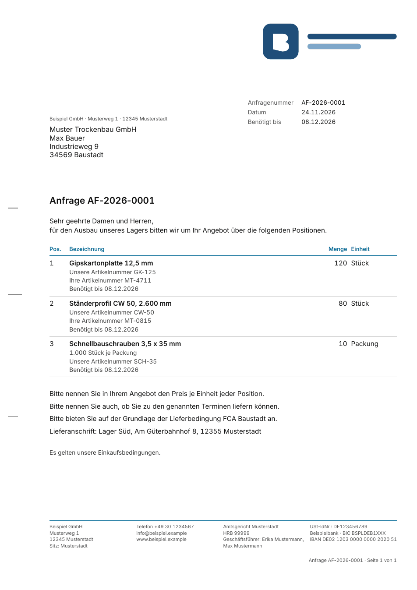

# Anfrage

Beispiel aus den erfundenen Daten des Nachweises: [Anfrage als PDF](beispiele/anfrage.pdf).

Das Druckformat „Anfrage“ druckt eine Anfrage (Request for Quotation) von ERPNext als Brief nach DIN 5008 an einen Lieferanten: Anfragenummer, Datum, Lieferantennummer und Bedarfstermin im Informationsblock, die Nachricht an den Lieferanten, die Positionen mit Menge und Einheit, ohne Preise, mit unserer Artikelnummer, der des Lieferanten, wo ERPNext sie kennt, und dem Tag, bis zu dem jede Position benötigt wird, dann die Bitte, im Angebot zu nennen, wozu die Anfrage Angaben hat, die Lieferanschrift und die Einkaufsbedingungen des Belegs.

Die Regeln stehen in `briefbote/purchase/request.py`, das Lesen des Belegs in `briefbote/briefbote/purchase.py` (`briefbote_request_letter`, `briefbote_request_for_quotation`), das Layout in `briefbote/briefbote/print_format/anfrage/anfrage.html` mit den Teilen `delivery_positions.html` und `receipt.html`, die auch der [Lieferschein](lieferschein.md) nutzt.

Die Quellen sind Gesetze in der Fassung von [gesetze-im-internet.de](https://www.gesetze-im-internet.de/), gelesen am 26.11.2026, und der Code von ERPNext im Zweig `version-16` (Commit `d770a3a`, 25.11.2026).

## Was eine Anfrage ist

Kein Gesetz schreibt den Inhalt einer Anfrage vor; was sie enthält, ist kaufmännische Übung. Sie bittet um ein Angebot und bietet selbst nichts an: Gebunden ist erst, wer einem anderen den Abschluss eines Vertrags anträgt ([§ 145 BGB](https://www.gesetze-im-internet.de/bgb/__145.html)), hier der Lieferant mit seinem Angebot. Die Anfrage ist ein Geschäftsbrief an einen bestimmten Empfänger und trägt deshalb die Angaben zum Unternehmen ([§ 35a Abs. 1 GmbHG](https://www.gesetze-im-internet.de/gmbhg/__35a.html)), auf leerem Papier im Fuß jeder Seite, siehe [Geschäftsbrief](geschaeftsbrief.md). Sie rechnet über nichts ab und nennt keine Preise, keine Summen und keine Steuer.

## An welchen Lieferanten

Eine Anfrage von ERPNext nennt in ihrer Tabelle `suppliers` mehrere Lieferanten und wird für jeden von ihnen einzeln gedruckt. ERPNext setzt dafür das verborgene Feld `vendor` und liest zu jeder Position die Artikelnummer dieses Lieferanten aus dem Artikel (`update_supplier_part_no` in `erpnext/buying/doctype/request_for_quotation/request_for_quotation.py`):

- **„Download PDF“ im Menü „Tools“** des Formulars (in ERPNext englisch benannt, die Übersetzung kann abweichen) fragt nach einem Lieferanten der Liste und ruft `get_pdf` mit ihm auf (`request_for_quotation.js`).
- **Versand per E-Mail** (beim Buchen oder mit „Send Emails to Suppliers“) setzt jeden Lieferanten nacheinander und hängt mit „Send Document Print“ den Ausdruck im Standard-Druckformat der Anfrage an (`send_to_supplier`, `supplier_rfq_mail`). Mit „Anfrage“ als Standard-Druckformat bekommt jeder Lieferant seinen eigenen Brief.
- **Druckansicht, „PDF“ und „Drucken“ ohne Auswahl:** Ist `vendor` leer, nimmt ERPNext den ersten Lieferanten der Liste (`before_print`).

Das Druckformat adressiert genau den Lieferanten in `vendor`: den Namen aus dem Lieferanten, als Ansprechpartner den Kontakt seiner Zeile der Tabelle und die Anschrift, die ERPNext für ihn als Standard führt (`get_default_address`, die Hauptanschrift zuerst). Nennt die Anfrage keinen Lieferanten, oder einen, der nicht in ihrer Liste steht, druckt sie keinen Brief, sondern nur den Befund „Diese Anfrage kann so nicht versandt werden:“ mit dem Grund, statt niemanden oder alle anzuschreiben.

## Angaben

| Angabe | Woher sie kommt | Wo sie steht |
|---|---|---|
| Angaben zum Unternehmen | Unternehmen und Einstellungen Geschäftspost | Fuß jeder Seite auf leerem Papier |
| Empfänger | `vendor` mit dem Namen des Lieferanten, dem Kontakt seiner Zeile (`contact`) und seiner Standardanschrift | Anschriftfeld |
| Anfragenummer, Datum | Name, `transaction_date` | Informationsblock, Betreff, Fuß |
| Lieferantennummer | `vendor`, wenn er vom Namen abweicht | Informationsblock |
| Benötigt bis, Bedarfstermine | `schedule_date` der Positionen: ein Tag, sonst „Bedarfstermine“ als Spanne; ohne Tage der Positionen `schedule_date` der Anfrage | Informationsblock |
| Nachricht an den Lieferanten | `message_for_supplier` als Text, siehe unten | unter dem Betreff |
| Positionen | Bezeichnung, Beschreibung, „Unsere Artikelnummer …“ aus `item_code`, wenn er vom Namen abweicht, „Ihre Artikelnummer …“ aus `supplier_part_no`, Menge, Einheit, „Benötigt bis …“ aus `schedule_date` der Position | Positionstabelle |
| Position ohne Menge | „Bitte nennen Sie den Preis je Einheit; die Menge steht noch nicht fest.“, wenn die Einkaufseinstellungen die Menge 0 erlauben (`allow_zero_qty_in_request_for_quotation`, `set_has_unit_price_items`) | unter der Position, Menge leer |
| Bitte um Angaben im Angebot | „Bitte nennen Sie in Ihrem Angebot den Preis je Einheit jeder Position.“; mit Bedarfsterminen „Bitte nennen Sie auch, ob Sie zu den genannten Terminen liefern können.“; mit Lieferbedingung „Bitte bieten Sie auf der Grundlage der Lieferbedingung FCA Baustadt an.“ aus `incoterm` und `named_place` | nach der letzten Position |
| Lieferanschrift | `shipping_address` (Lieferanschrift des Unternehmens) | nach der Bitte |
| Einkaufsbedingungen | `terms` | am Schluss |

Eine Angabe ohne Wert fehlt ganz, kein Feld steht leer. Eine Anfrage, die noch nicht gebucht oder storniert ist, trägt die Markierung „ENTWURF“ oder „STORNIERT“ und druckt weder die Nachricht noch die Bitte um Angaben: Sie bittet niemanden um ein Angebot.

## Die Nachricht an den Lieferanten

ERPNext führt die Nachricht (`message_for_supplier`, Vorgabe „Please supply the specified items at the best possible rates“) als Text der E-Mail und rendert sie dort als Jinja-Vorlage mit Platzhaltern wie `{{ supplier_name }}` oder `{{ portal_link }}` (`supplier_rfq_mail`). Auf Papier gäbe es für einen Link zum Portal nichts zu klicken, und eine Vorlage zu rendern hieße, Code aus einem Beleg auszuführen. Briefbote druckt die Nachricht deshalb nur als schlichten Text: ohne Platzhalter (`{{ … }}`, ``) und nur, wenn sie nicht als HTML (`mfs_html`, „Use HTML“) geführt wird; sonst druckt die Anfrage keine Nachricht. Wer seinen Text gedruckt haben will, schreibt ihn ohne Platzhalter in das Feld „Message for Supplier“ der Anfrage oder in die E-Mail-Vorlage, aus der ERPNext es füllt; die Anrede steht dann ohne Namen („Sehr geehrte Damen und Herren“), den Namen des Lieferanten trägt das Anschriftfeld. Die englische Vorgabe von ERPNext druckt, solange niemand sie ändert, auch auf einer deutschen Anfrage englisch.

## Was ERPNext nicht abbildet

- **Antwortfrist:** Die Anfrage von ERPNext 16 hat kein Feld für den Tag, bis zu dem der Lieferant antworten soll; `schedule_date` ist der Tag, bis zu dem die Ware benötigt wird. Briefbote druckt deshalb keine Antwortfrist und erfindet keine.
- **Rechnungsanschrift:** `billing_address` druckt die Anfrage nicht; sie gehört auf die Bestellung.
- **Betreff der E-Mail:** `subject` ist der Betreff der E-Mail; der Brief trägt „Anfrage“ mit der Nummer.

## Seiten

Jede Seite nennt im Fuß „Anfrage AF-2026-0001 · Seite 1 von 2“; der Kopf der Positionstabelle kehrt auf jeder Seite wieder, und die letzte Position steht mit der Bitte um Angaben und der Lieferanschrift auf einer Seite.

## Offen für die fachliche Prüfung

| Punkt | Was Briefbote druckt | Frage |
|---|---|---|
| Bitte um Angaben | Preis je Einheit, Einhaltung der Bedarfstermine, Angebot zur Lieferbedingung, jeweils nur, wenn die Anfrage dazu Daten hat | Fehlt eine übliche Bitte, etwa um Lieferzeit, Zahlungsbedingungen oder Gültigkeit des Angebots, obwohl die Anfrage dafür keine Daten hat? |
| Nachricht | nur als schlichter Text, nie gerendert | Genügt das, oder sollen Platzhalter ohne Links (Name des Lieferanten) auf Papier gefüllt werden? |
| Lieferant außerhalb der Liste | Befund statt Brief | Ist der Befund richtig, wenn jemand über die API eine Anfrage für einen Lieferanten druckt, den sie nicht nennt? |
| Geschäftsbrief | Angaben zum Unternehmen im Fuß | Keine Frage; Anfragen sind keine Mitteilungen in Vordrucken nach § 35a Abs. 2 GmbHG, die Angaben stehen in jedem Fall darauf. |

## Nachweis

`briefbote/tests/print_documents_goods.py` schreibt Anfragen, `briefbote/tests/print_proof_goods.py` druckt und prüft sie mit beiden Generatoren: AF-2026-0001 an zwei Lieferanten mit Artikelnummern, Lieferbedingung, Nachricht und Lieferanschrift, gedruckt für den ersten auf leerem und vorgedrucktem Papier und für den zweiten wie aus „Download PDF“; AF-2026-0002 mit 36 Positionen über mehrere Seiten und drei Bedarfsterminen; AF-2026-0003 englisch mit einer Position ohne Menge; AF-2026-0004 ohne Lieferanten, die nur den Befund druckt; dazu Entwurf und Storno. Keiner der Ausdrucke darf einen Preis oder eine Summe tragen.
