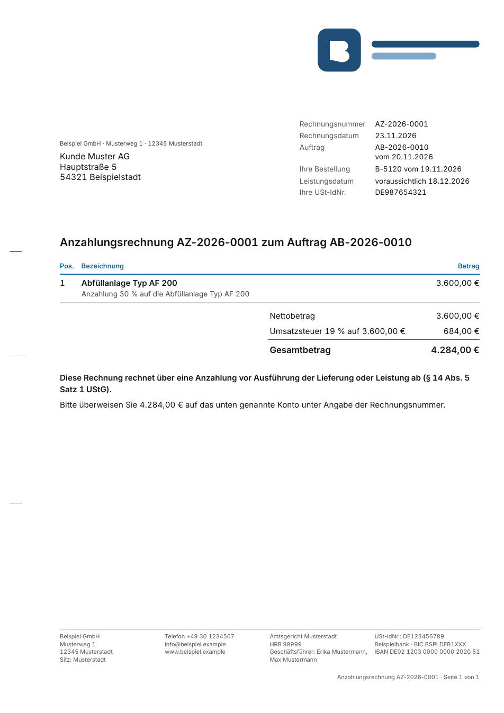

# Anzahlungsrechnung

Beispiel aus den erfundenen Daten des Nachweises: [Anzahlungsrechnung als PDF](beispiele/anzahlungsrechnung.pdf). Die [Schlussrechnung](rechnung.md#anzahlungen-und-schlussrechnung) zu dieser Anzahlung ist RE-2026-0401.

> **Warnung: Die Umsatzsteuer einer Anzahlung steht in ERPNext doppelt in den Büchern.** Gelesen in ERPNext 16.61 (Zweig `version-16`, Commit `d770a3a`): Ein Zahlungseingang (Payment Entry) mit „Advance Taxes and Charges“ bucht die Umsatzsteuer der Anzahlung bei Eingang auf das Steuerkonto (`add_tax_gl_entries` in `erpnext/accounts/doctype/payment_entry/payment_entry.py`) und schreibt dem Kunden nur den Betrag ohne diese Steuer gut (`get_base_unallocated_amount`, `get_included_taxes`). Die Ausgangsrechnung über die ganze Leistung bucht die Umsatzsteuer der ganzen Leistung noch einmal (`make_tax_gl_entries` in `erpnext/accounts/doctype/sales_invoice/sales_invoice.py`). Das Zuordnen der Anzahlung bucht nichts am Steuerkonto um und ordnet nur den Betrag ohne Steuer zu (`reconcile_against_document` in `erpnext/accounts/utils.py`, `make_advance_gl_entries` in `payment_entry.py`, `calculate_outstanding_amount` in `erpnext/controllers/taxes_and_totals.py`). Bis eine Korrektur gebucht ist, steht die Umsatzsteuer der Anzahlung zweimal im Hauptbuch, und ERPNext führt die Schlussrechnung um sie zu hoch offen. Eine Umsatzsteuer-Voranmeldung, die aus dem Hauptbuch entsteht, zählt die Umsatzsteuer der Anzahlung ohne Korrektur doppelt. Briefbote druckt, was § 14 Abs. 5 UStG verlangt, und bittet um den richtigen Restbetrag; die Bücher korrigiert es nicht. Wie die Korrektur zu buchen ist, klärt die Steuerberatung; Briefbote hat dazu nichts geprüft.

Das Druckformat „Anzahlungsrechnung“ druckt eine Rechnung über eine Zahlung vor Ausführung der Leistung (§ 14 Abs. 5 Satz 1 UStG). ERPNext 16 hat keinen Beleg dafür; Briefbote nutzt die **Proforma-Rechnung von ERPNext 16** (DocType Proforma Invoice): Sie hat eine eigene Nummer aus einem Nummernkreis, ein Datum, wird gebucht und hält ihr PDF beim Buchen fest, ohne selbst etwas zu buchen. Die Umsatzsteuer der Anzahlung bucht der Zahlungseingang, wenn das Geld kommt.

Die Regeln stehen in `briefbote/invoice/advance_invoice.py`, das Lesen in `briefbote/briefbote/sales.py` (`briefbote_advance_invoice`), das Layout in `briefbote/briefbote/print_format/anzahlungsrechnung/anzahlungsrechnung.html`. Die Quellen sind Gesetz und Verordnung in der Fassung von [gesetze-im-internet.de](https://www.gesetze-im-internet.de/), gelesen am 26.11.2026, und der [Umsatzsteuer-Anwendungserlass](https://www.bundesfinanzministerium.de/Content/DE/Downloads/BMF_Schreiben/Steuerarten/Umsatzsteuer/Umsatzsteuer-Anwendungserlass/Umsatzsteuer-Anwendungserlass-aktuell.pdf) (UStAE) im Stand vom 13.11.2026. Was ERPNext tut, ist im Code von ERPNext im Zweig `version-16` nachgelesen (Commit `d770a3a`, gleich dem Release 16.61.0).

## Grenzen

Diese Grenzen gelten für jede Anzahlungsrechnung aus Briefbote; wer sie nicht hinnehmen kann, nutzt diesen Weg nicht.

1. **Keine Verbindung zur Zahlung.** ERPNext verknüpft die Proforma-Rechnung nicht mit dem Zahlungseingang, der später kommt. Die Schlussrechnung setzt die *Zahlungen* ab, die ihr zugeordnet sind (Tabelle `advances` der Ausgangsrechnung), nicht die Anzahlungsrechnungen. Damit die Schlussrechnung die Anzahlungsrechnung nennt, bucht das Unternehmen den Zahlungseingang gegen denselben Kundenauftrag (Referenz „Sales Order“ im Zahlungseingang), über genau den Betrag der Anzahlungsrechnung und mit ihrer Umsatzsteuer in „Advance Taxes and Charges“; dann findet Briefbote die eine gebuchte Proforma-Rechnung mit dem Druckformat „Anzahlungsrechnung“ zu diesem Auftrag und diesem Betrag und druckt ihre Nummer in der Schlussrechnung. Gibt es keine oder mehrere, nennt die Schlussrechnung nur die Zahlung.
2. **Keine E-Rechnung.** Eine Anzahlungsrechnung an ein Unternehmen im Inland ist eine Rechnung nach § 14 UStG und fällt unter die Pflicht zur elektronischen Rechnung (§ 14 Abs. 2 Satz 2 Nr. 1 UStG). § 27 Abs. 38 UStG erlaubt Papier oder ein anderes elektronisches Format nur noch im Übergang: Nr. 1 für Umsätze nach dem 31.12.2024 und vor dem 01.01.2027, übermittelt bis zum 31.12.2026; Nr. 2 für Umsätze im Jahr 2027, übermittelt bis zum 31.12.2027, wenn der Gesamtumsatz des Ausstellers im Vorjahr 800.000 Euro nicht überstiegen hat; Nr. 3 ebenso lange für EDI-Verfahren. Dieser Weg erzeugt nur ein PDF: Die Apps für die E-Rechnung arbeiten mit der Ausgangsrechnung, nicht mit der Proforma-Rechnung. **Ein Unternehmen, das E-Rechnungen ausstellen muss, kann diesen Weg für Kunden im Inland, die Unternehmer sind, nach dem Ende seines Übergangs nicht nutzen.** Welches Datum bei einer Anzahlung als Zeitpunkt des Umsatzes für den Übergang zählt, regelt das BMF-Schreiben vom 15.10.2024 (Rn. 47 und 48, auf die UStAE 14.8 Abs. 7 Satz 5 verweist); Briefbote hat es nicht gelesen, siehe [Offen](#offen-für-die-fachliche-prüfung).
3. **Das festgehaltene PDF ist die Kopie, die aufbewahrt wird** (§ 14b Abs. 1 UStG). ERPNext druckt es beim Buchen der Proforma-Rechnung und hängt es privat an sie an (Feld `proforma_pdf`, `generate_and_attach_pdf` in `erpnext/selling/doctype/proforma_invoice/proforma_invoice.py`); im Kundenauftrag zeigt der Reiter „Proforma“ die Liste mit „View PDF“. Ein späterer Druck aus dem Formular kann davon abweichen, etwa nach geänderten Einstellungen. ERPNext druckt das PDF ohne die Sprache des Auftrags (`attach_print` ohne `lang`), also in der Sprache des Benutzers, der bucht.
4. **Wird die Proforma-Rechnung storniert,** bleibt ihr PDF, wie es ist; ERPNext druckt es nicht neu. Eine stornierte Anzahlungsrechnung braucht eine Berichtigung gegenüber dem Kunden, die Briefbote nicht druckt.
5. **Keine Fälligkeit.** Die Proforma-Rechnung hat kein Fälligkeitsdatum; die Bitte um Überweisung nennt keinen Tag.

## Einrichtung

1. In den Selling Settings „Enable Proforma Invoice“ einschalten; „Default Proforma Print Format“ kann „Proforma-Rechnung“ sein, die Anzahlungsrechnung wählt man im Dialog. „Einstellungen prüfen“ in den Einstellungen Geschäftspost weist dann auf die Warnungen dieser Seite hin.
2. **Eigener Nummernkreis.** Die Rechnungsnummern der Anzahlungsrechnungen sollen einen eigenen, lückenlos fortlaufenden Kreis bilden, getrennt von den Proforma-Rechnungen, die keine Rechnungen sind. § 14 Abs. 4 Satz 1 Nr. 4 UStG verlangt eine fortlaufende Nummer aus einer oder mehreren Zahlenreihen, die zur Identifizierung einmalig vergeben wird. Der DocType Proforma Invoice hat das Feld `naming_series` mit der Vorgabe `PRO-.YYYY.-`; in den Document Naming Settings von Frappe lässt sich eine zweite Reihe wie `AZ-.YYYY.-` hinzufügen (`update_series` in `frappe/core/doctype/document_naming_settings/document_naming_settings.py` schreibt die Optionen als Property Setter), und der Dialog im Kundenauftrag bietet jede Reihe des Felds an (`erpnext/public/js/sales_order_proforma.js`).
3. **Anzahlungsrechnung ausstellen:** im gebuchten Kundenauftrag Reiter „Proforma“, „New Proforma Invoice“, Reihe `AZ-.YYYY.-`, Druckformat „Anzahlungsrechnung“, „Based On“ „Amount“ und je Position der Betrag der Anzahlung, „Hide Item Quantity in Print“ an. ERPNext rechnet die Steuer der Beträge mit der Steuervorlage des Auftrags (`get_sales_order_copy` mit `calculate_taxes_and_totals`) und druckt beim Buchen.
4. **Zahlung buchen:** Zahlungseingang gegen den Kundenauftrag über den Gesamtbetrag der Anzahlungsrechnung, in „Advance Taxes and Charges“ eine Zeile „On Paid Amount“ mit dem Steuersatz und „Considered In Paid Amount“, siehe [Rechnung](rechnung.md#anzahlungen-und-schlussrechnung).

## Was eine Anzahlungsrechnung ist

§ 14 Abs. 5 Satz 1 UStG: Vereinnahmt der Unternehmer ein Entgelt oder einen Teil davon für eine noch nicht ausgeführte Leistung, gelten die Absätze 1 bis 4 sinngemäß. Die Anzahlungsrechnung ist also eine Rechnung, mit allen Angaben des § 14 Abs. 4 UStG in der Form, die UStAE 14.8 für sie beschreibt:

- Sie macht kenntlich, dass sie eine Voraus- oder Anzahlung abrechnet, etwa durch den voraussichtlichen Zeitpunkt der Leistung (UStAE 14.8 Abs. 1 Satz 1), gleich ob über das ganze Entgelt oder einen Teil (Satz 2).
- Statt des Zeitpunkts der Leistung nennt sie den voraussichtlichen Zeitpunkt oder Kalendermonat der Leistung (UStAE 14.8 Abs. 4 Satz 3, § 31 Abs. 4 UStDV), einen vereinbarten Zeitraum oder Zeitpunkt (Satz 4), oder, wenn keiner vereinbart ist, dass das aus der Rechnung hervorgeht (Satz 5).
- Statt des Entgelts der Leistung steht das vor der Leistung vereinnahmte Entgelt oder Teilentgelt (Satz 6) und die Umsatzsteuer darauf (Satz 7).
- Die Gegenstände oder die Art der Leistung müssen zum Zeitpunkt der Anzahlung genau bestimmt sein (Satz 2, mit Verweis auf BFH-Urteil vom 24.08.2006, V R 16/05).
- Den Zeitpunkt der Vereinnahmung nennt sie, wenn er feststeht und nicht mit dem Ausstellungsdatum übereinstimmt (§ 14 Abs. 4 Satz 1 Nr. 6 UStG, zweiter Halbsatz).
- Sie darf mit Steuerausweis vor der Zahlung ausgestellt werden (UStAE 14.8 Abs. 5 Satz 3). Die Steuer entsteht nur, soweit gezahlt wird (Satz 4, § 13 Abs. 1 Nr. 1 Buchst. a Satz 4 UStG: mit Ablauf des Voranmeldungszeitraums der Vereinnahmung); wird nicht gezahlt, tritt § 14c Abs. 2 UStG nicht ein (UStAE 14.8 Abs. 2 Satz 1, 14c.2 Abs. 2 Nr. 2 Satz 5).
- Der Kunde zieht die Vorsteuer daraus ab, wenn die Rechnung vorliegt und die Zahlung geleistet ist (§ 15 Abs. 1 Satz 1 Nr. 1 Satz 3 UStG).
- Bei Zahlungen vor der Leistung ist die Rechnung innerhalb von sechs Monaten nach der Vereinnahmung auszustellen, wo eine Pflicht zur Rechnung besteht (UStAE 14.1 Abs. 3 Satz 4).

## Angaben

| Angabe | Woher sie kommt | Wo sie steht |
|---|---|---|
| Titel und Betreff | „Anzahlungsrechnung AZ-… zum Auftrag AB-…“ | Betreff, Fuß jeder Seite |
| Rechnungsnummer (§ 14 Abs. 4 Satz 1 Nr. 4 UStG) | Nummer der Proforma-Rechnung (`proforma_no` der Kopie) | Informationsblock, Betreff, Fuß |
| Rechnungsdatum (Nr. 3) | Datum der Proforma-Rechnung (`proforma_date`) | Informationsblock |
| Auftrag | Name und Datum des Kundenauftrags | Informationsblock |
| Voraussichtlicher Zeitpunkt der Leistung, als „Leistungsdatum voraussichtlich …“ oder „Leistungszeitraum voraussichtlich … bis …“ | Zeitraum `from_date` bis `to_date` des Auftrags; sonst der Liefertermin aller Positionen oder die Spanne ihrer Termine; sonst `delivery_date` des Auftrags; ohne jeden Termin der Satz „Der Zeitpunkt der Lieferung oder Leistung ist noch nicht vereinbart.“ | Informationsblock, Hinweis |
| Vereinnahmt am (Nr. 6) | der eine gebuchte Zahlungseingang gegen den Auftrag über den Gesamtbetrag, gebucht vor dem Rechnungsdatum | Informationsblock, nur dann |
| Ihre USt-IdNr., Unsere USt-IdNr. | wie bei der [Rechnung](rechnung.md#steuerfälle-und-hinweise) | Informationsblock |
| Positionen (Nr. 5) | die Zeilen der Proforma-Rechnung mit Bezeichnung und Beschreibung; bei „Hide Item Quantity in Print“ ohne Menge, Einheit und Einzelpreis | Positionstabelle |
| Teilentgelt, Steuersatz und Steuerbetrag (Nr. 7, 8) | Nettobetrag und Steuerzeilen der Kopie, je Steuerzeile Satz und Bemessungsgrundlage aus den Steuerdetails | Summen |
| Hinweis | „Diese Rechnung rechnet über eine Anzahlung vor Ausführung der Lieferung oder Leistung ab (§ 14 Abs. 5 Satz 1 UStG).“ und die Hinweise des Steuerfalls | unter den Summen |
| Zahlung | „Bitte überweisen Sie … auf das unten genannte Konto unter Angabe der Rechnungsnummer.“ | Schluss |

Die Steuerdetails einer Kopie, die ERPNext nur im Speicher rechnet und nie speichert, stehen nicht in der Tabelle `item_wise_tax_details`, sondern in den Zeilen, die `calculate_taxes_and_totals` vor dem Speichern sammelt (`_item_wise_tax_details` in `erpnext/controllers/taxes_and_totals.py`); Briefbote liest beide.

## Unvollständige Dokumente

Die Anzahlungsrechnung bekommt dieselben [Befunde](rechnung.md#unvollständige-dokumente) wie die Rechnung (`briefbote/invoice/completeness.py`): Anschrift des Empfängers, Steuernummer oder USt-IdNr. des Unternehmens, Steuer bei steuerpflichtiger Leistung, Bemessungsgrundlage je Steuersatz, beide USt-IdNrn. in den Fällen des § 14a UStG, Bankkonto für die Bitte um Überweisung. Dazu kommt ein eigener: Wird das Format direkt aus dem Kundenauftrag gedruckt, nicht aus einer Proforma-Rechnung, fehlt die eigene Rechnungsnummer (§ 14 Abs. 4 Satz 1 Nr. 4 UStG). Dann druckt es „Dieses Dokument hat keine eigene Rechnungsnummer …“ und bittet nicht um Zahlung.

Ein Entwurf oder ein stornierter Auftrag trägt die Markierung „ENTWURF“ oder „STORNIERT“ und keine Bitte um Zahlung, siehe [Architektur](architektur.md#entwurf-und-storno).

## Was ERPNext nicht abbildet

- Keine Verbindung von der Proforma-Rechnung zum Zahlungseingang, siehe [Grenzen](#grenzen).
- Keine Fälligkeit und kein Zahlungsplan der Proforma-Rechnung.
- Keine Berichtigung einer Anzahlungsrechnung: Eine Rückgabe gibt es für die Proforma-Rechnung nicht.

## Seiten

Jede Seite nennt im Fuß „Anzahlungsrechnung AZ-2026-0001 · Seite 1 von 1“.

## Offen für die fachliche Prüfung

| Punkt | Was Briefbote druckt oder tut | Frage |
|---|---|---|
| Kennzeichnung | Titel „Anzahlungsrechnung“, Betreff „… zum Auftrag …“, „voraussichtlich“ beim Leistungsdatum und „Diese Rechnung rechnet über eine Anzahlung vor Ausführung der Lieferung oder Leistung ab (§ 14 Abs. 5 Satz 1 UStG).“ | Genügt das als Kenntlichmachung nach UStAE 14.8 Abs. 1? |
| Zeitpunkt der Leistung | „Leistungsdatum voraussichtlich …“ aus dem Liefertermin des Auftrags | Ist der geplante Liefertermin der „voraussichtliche Zeitpunkt“ im Sinne des UStAE 14.8 Abs. 4 Satz 3? |
| Vereinnahmt am | nur, wenn genau ein Zahlungseingang über den Betrag gegen den Auftrag vor dem Rechnungsdatum gebucht ist | Genügt diese Regel für § 14 Abs. 4 Satz 1 Nr. 6 UStG, zweiter Halbsatz? |
| Beschreibung der Leistung | Bezeichnung und Beschreibung der Zeilen des Auftrags, ohne Menge, wenn ausgeblendet | Genügt das für die genaue Bestimmung nach UStAE 14.8 Abs. 4 Satz 2? |
| E-Rechnung | nur PDF | Welcher Zeitpunkt zählt bei einer Anzahlung für den Übergang nach § 27 Abs. 38 UStG (BMF-Schreiben vom 15.10.2024, Rn. 47 und 48, nicht gelesen)? |
| Zwei Zwecke eines DocTypes | Proforma-Rechnung und Anzahlungsrechnung aus demselben DocType, unterschieden durch das Druckformat und den Nummernkreis | Genügt die Trennung für die fortlaufende Nummer nach § 14 Abs. 4 Satz 1 Nr. 4 UStG, wenn beide aus dem DocType Proforma Invoice kommen? |
| Verbraucher | kein Hinweis nach § 286 Abs. 3 BGB, weil die Anzahlungsrechnung keine Fälligkeit nennt | Braucht eine Anzahlungsrechnung an Verbraucher den Hinweis? |

## Nachweis

`briefbote/tests/print_documents_sales.py` schreibt den Auftrag AB-2026-0010, die Proforma-Rechnungen AZ-2026-0001 (Betrag der Anzahlung, Menge ausgeblendet), AZ-2026-0002 (alle 30 Positionen von AB-2026-0002, mehrere Seiten) und AZ-2026-0003 (englisch) mit dem Druckformat „Anzahlungsrechnung“ und den Zahlungseingang ZE-2026-0101 über 4.284,00 € mit 684,00 € Umsatzsteuer gegen AB-2026-0010. `briefbote/tests/print_proof_sales.py` druckt die Kopien des Auftrags, wie ERPNext sie druckt, mit beiden Generatoren, AZ-2026-0001 auch auf vorgedrucktem Papier und als Entwurf, und AB-2026-0010 direkt aus dem Auftrag mit dem Befund der fehlenden Nummer. `briefbote/tests/test_advance_printing.py` prüft die Angaben auf einer Site.
