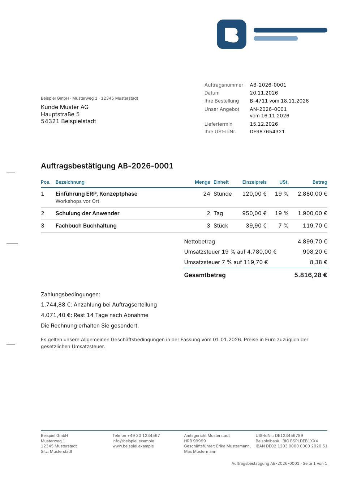

# Auftragsbestätigung

Beispiel aus den erfundenen Daten des Nachweises: [Auftragsbestätigung als PDF](beispiele/auftragsbestaetigung.pdf).

Das Druckformat „Auftragsbestätigung“ druckt einen Kundenauftrag (Sales Order) von ERPNext als Brief nach DIN 5008: Auftragsnummer und Datum, die Bestellung des Kunden und das Angebot, auf das der Auftrag zurückgeht, und den Liefertermin oder Leistungszeitraum im Informationsblock, die Positionen, die Summen mit der Umsatzsteuer nach Satz und Bemessungsgrundlage, die Hinweise des Steuerfalls, die vereinbarten Zahlungsbedingungen und die Geschäftsbedingungen.

Die Regeln stehen in `briefbote/sales/order.py`, das Lesen des Belegs in `briefbote/briefbote/sales.py` (`briefbote_sales_order`), das Layout in `briefbote/briefbote/print_format/auftragsbestätigung/auftragsbestätigung.html`. Positionen, Summen und Umsatzsteuer druckt es wie das [Angebot](angebot.md#umsatzsteuer-und-preisangaben).

Die Quellen sind Gesetz und Verordnung in der Fassung von [gesetze-im-internet.de](https://www.gesetze-im-internet.de/), gelesen am 25.11.2026, und der UStAE im Stand vom 13.11.2026.

## Was eine Auftragsbestätigung ist

Die Auftragsbestätigung nimmt die Bestellung des Kunden an oder bestätigt einen geschlossenen Vertrag. Kam die Bestellung auf ein Angebot zu spät oder mit Änderungen, ist sie selbst ein neues Angebot ([§ 150 BGB](https://www.gesetze-im-internet.de/bgb/__150.html)), das die Auftragsbestätigung annimmt. Kein Gesetz schreibt ihren Inhalt vor; was im Einzelfall ein Vertrag wird, entscheidet nicht das Druckformat.

Sie ist keine Rechnung: Sie rechnet über keine Leistung ab ([§ 14 Abs. 1 Satz 1 UStG](https://www.gesetze-im-internet.de/ustg_1980/__14.html)), nennt kein Leistungsdatum und keine Rechnungsnummer und bittet nicht um Überweisung. Weil auch ein Vertrag mit allen Angaben des § 14 Abs. 4 UStG als Rechnung gelten kann (UStAE 14.1 Abs. 17 Satz 1), schließt sie mit „Die Rechnung erhalten Sie gesondert.“ Ein Entwurf oder eine stornierte Auftragsbestätigung trägt die Markierung „ENTWURF“ oder „STORNIERT“ und diesen Satz nicht.

## Angaben

| Angabe | Woher sie kommt | Wo sie steht |
|---|---|---|
| Angaben zum Unternehmen | Unternehmen und Einstellungen Geschäftspost | Fuß jeder Seite auf leerem Papier, siehe [Geschäftsbrief](geschaeftsbrief.md) |
| Auftragsnummer, Datum | Name des Belegs, `transaction_date` | Informationsblock, Betreff, Fuß |
| Kundennummer | `customer`, wenn sie vom Namen abweicht | Informationsblock |
| Ihre Bestellung | `po_no` und `po_date` | Informationsblock |
| Unser Angebot | die Angebote der Positionen (`prevdoc_docname`) mit ihrem Datum | Informationsblock |
| Liefertermin | siehe unten | Informationsblock, bei verschiedenen Terminen auch an jeder Position |
| Ihre USt-IdNr., Unsere USt-IdNr. | `tax_id` des Auftrags; die eigene aus dem Unternehmen | Informationsblock |
| Positionen, Summen, Hinweise des Steuerfalls | wie beim [Angebot](angebot.md#angaben) | Positionstabelle und darunter |
| Zahlungsbedingungen | Zahlungsplan, siehe unten | Schluss |
| Geschäftsbedingungen | `terms` | Ende |

Eine Angabe ohne Wert fehlt ganz, kein Feld steht leer. Die USt-IdNrn. folgen der Regel der [Rechnung](rechnung.md#steuerfälle-und-hinweise): die des Kunden, wann immer sie bekannt ist, und daneben die eigene, wo der Steuerfall beide verlangt (§ 14a Abs. 1 Satz 3 und Abs. 3 Satz 2 UStG). Angebot, Auftragsbestätigung und Rechnung eines Kunden nennen so dieselben Nummern. „… vom …“ bricht im Informationsblock höchstens vor „vom“, nie zwischen „vom“ und dem Datum.

## Liefertermin

In dieser Reihenfolge:

1. **Leistungszeitraum:** Hat der Auftrag `from_date` und `to_date`, etwa für eine wiederkehrende Leistung, steht „Leistungszeitraum 01.01.2027 bis 31.12.2027“.
2. **Ein Termin aller Positionen:** Haben alle Positionen dasselbe Lieferdatum (`delivery_date` der Position), steht „Liefertermin“ mit diesem Tag.
3. **Verschiedene Termine:** „Liefertermine 01.12.2026 bis 22.12.2026“ und an jeder Position „Liefertermin …“.
4. **Termin des Auftrags:** sonst `delivery_date` des Auftrags.

„Liefertermin“ heißt es, weil der Auftrag einen geplanten Tag nennt, nicht den Tag der Leistung, den erst Lieferschein und Rechnung kennen.

## Zahlungsbedingungen

Der Zahlungsplan des Auftrags (Payment Schedule) hat Fälligkeiten, die ERPNext vom Datum des Auftrags aus rechnet; die Rechnung rechnet sie neu von ihrem Datum aus. Briefbote druckt deshalb den Text der Zahlungsbedingung, nicht ihr Datum:

- **eine Zahlungsbedingung:** „Zahlungsbedingungen: 14 Tage netto“ aus der Beschreibung, sonst dem Namen der Zahlungsbedingung; ohne beides nichts;
- **mehrere:** „Zahlungsbedingungen:“ und je Zeile Betrag und Text, „1.744,88 €: Anzahlung bei Auftragserteilung“; eine Zeile ohne Text nennt Betrag und Tag, „4.071,40 € bis zum 15.01.2027“.

Skonto druckt die Auftragsbestätigung nicht eigens; es gehört in den Text der Zahlungsbedingung und steht auf der Rechnung mit seinem Datum.

## Was ERPNext nicht abbildet

- **Bestellung des Kunden als Datei:** ERPNext kennt nur Nummer und Datum (`po_no`, `po_date`).
- **Abweichungen vom Angebot:** ERPNext vermerkt nicht, welche Position vom Angebot abweicht. Wer die Bestellung abweichend annimmt, schreibt es in die Geschäftsbedingungen oder die Beschreibung der Position.
- **Proforma-Rechnung und Anzahlungsrechnung:** ERPNext 16 druckt sie aus dem Auftrag; Briefbote hat dafür die Druckformate [Proforma-Rechnung](proforma-rechnung.md) und [Anzahlungsrechnung](anzahlungsrechnung.md).

## Seiten

Jede Seite nennt im Fuß „Auftragsbestätigung AB-2026-0001 · Seite 1 von 2“.

## Offen für die fachliche Prüfung

| Punkt | Was Briefbote druckt | Frage |
|---|---|---|
| Keine Rechnung | „Die Rechnung erhalten Sie gesondert.“, kein Leistungsdatum, keine Fälligkeit | Genügt das, damit die Auftragsbestätigung mit ausgewiesener Steuer nicht als Rechnung gilt (UStAE 14.1 Abs. 17, § 14c UStG)? |
| Zahlungsbedingungen | Text der Zahlungsbedingung statt der Fälligkeit des Auftrags | Richtig so, oder sollen Fälligkeiten gedruckt werden? |
| Liefertermin | „Liefertermin“ als geplanter Tag | Wird der Termin so als verbindlicher Liefertermin gelesen (§ 286 Abs. 2 Nr. 1 BGB), und ist das gewollt? |

## Nachweis

`briefbote/tests/print_documents_sales.py` schreibt Aufträge mit den deutschen Steuervorlagen, `briefbote/tests/print_proof_sales.py` druckt und prüft sie wie das Angebot: AB-2026-0001 aus dem Angebot AN-2026-0001 mit Bestellung des Kunden, einem Liefertermin und zwei Zahlungsbedingungen, auf leerem und vorgedrucktem Papier; AB-2026-0002 mit 30 Positionen und vier Lieferterminen über mehrere Seiten; AB-2026-0003 englisch mit Leistungszeitraum.
