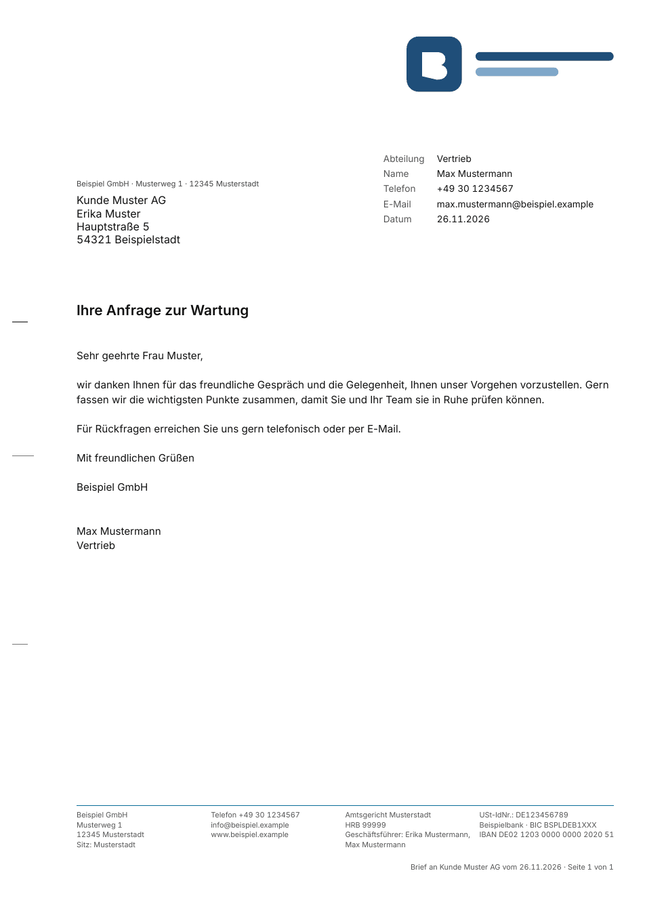

# Geschäftsbrief (Druckformat)

<a href="bilder/beispiele/geschaeftsbrief.png"></a>

Beispiel aus den erfundenen Daten des Nachweises: [Geschäftsbrief als PDF](beispiele/geschaeftsbrief.pdf).

Das Druckformat „Geschäftsbrief“ druckt freie Korrespondenz als Brief nach [DIN 5008](din-5008.md): einen Geschäftsbrief (Business Letter) der App erpnext_germany mit Briefkopf, Rücksendeangabe und Anschrift im Fenster, Informationsblock, Betreff, dem Text des Briefs und im Fuß jeder Seite den [Angaben zum Unternehmen](geschaeftsbrief.md), die jeder Geschäftsbrief braucht. Deutsch und englisch, mit beiden PDF-Generatoren, auf leerem und auf vorgedrucktem Papier.

Briefbote bringt keinen eigenen DocType für Briefe und setzt erpnext_germany nicht voraus. Den DocType Business Letter und die Vorlagen (Business Letter Template) bringt erpnext_germany mit, ohne Druckformat; gelesen in Version 16.2.2 (`erpnext_germany/erpnext_germany/doctype/business_letter/`).

Die Regeln stehen in `briefbote/correspondence/` (Text, Anschrift, Informationsblock, Befunde), das Lesen des Briefs in `briefbote/briefbote/correspondence.py`, das Layout in `briefbote/briefbote/print_format/geschäftsbrief/geschäftsbrief.html` mit den gemeinsamen Teilen.

## Nur mit erpnext_germany

Das Druckformat und seine Einträge im Menü gibt es auf einer Site genau dann, wenn sie den DocType Business Letter hat (`briefbote/briefbote/optional/`):

- **Ohne erpnext_germany** hat die Site weder das Druckformat noch einen Eintrag in Seitenleiste oder Arbeitsbereich, der ins Leere führt. `bench install-app briefbote` und `bench migrate` laufen wie bisher.
- **Wird erpnext_germany installiert**, legt Briefbote danach das Druckformat „Geschäftsbrief“ an, in der Seitenleiste die Gruppe „Korrespondenz“ mit „Geschäftsbriefe“ und „Briefvorlagen“ und im Arbeitsbereich „Geschäftspost“ dieselben zwei Listen. Auf einer Site, die erpnext_germany schon hat, tut das das nächste `bench migrate` nach der Aktualisierung von Briefbote.
- **Wird erpnext_germany deinstalliert**, nimmt Briefbote Druckformat und Einträge vorher weg.

Briefbote ändert dafür nur seine eigene Seitenleiste und seinen eigenen Arbeitsbereich. Ein Eintrag, der schon da ist, bleibt, wo er steht; ein zweites `migrate` ändert nichts. Eine Site passt Seitenleiste und Arbeitsbereich über „Custom Sidebar“ und „Custom Workspace“ von Frappe an; diese Anpassungen bleiben unberührt, ein dort ausgeblendeter Eintrag bleibt ausgeblendet. Den Druckformaten von erpnext_germany selbst und seinem eigenen Menü (Arbeitsbereich „Germany“, der den Business Letter ohnehin verlinkt) fügt Briefbote nichts hinzu.

Wie alle Druckformate von Briefbote macht sich der Geschäftsbrief nicht selbst zum Standard. Man wählt ihn in der Druckansicht oder setzt ihn als Default Print Format des Business Letter, wie unter [Druckformat wählen](einrichtung.md#druckformat-wählen) für die Rechnung beschrieben, mit `"doc_type": "Business Letter"` und `"value": "Geschäftsbrief"`.

## Was der Brief druckt

| Teil | Woher es kommt |
|---|---|
| Briefkopf, Rücksendeangabe, Fuß, Form A oder B, Falz- und Lochmarke | der Rahmen jedes Briefs von Briefbote aus den [Einstellungen Geschäftspost](einrichtung.md) des Unternehmens (`company`); ohne Unternehmen das Standardunternehmen der Site |
| Anschrift | die Adresse (`address`) und der Kontakt (`contact`) des Briefs, siehe [Anschrift](#anschrift) |
| Informationsblock | siehe [Informationsblock](#informationsblock) |
| Betreff | `subject_preview`, ohne das Wort „Betreff“, fett |
| Text | `content_preview`, siehe [Der Text](#der-text) |

Betreff und Text druckt Briefbote so, wie erpnext_germany sie gerendert hat: Der Business Letter rendert beim Speichern `subject` und `content` als Jinja mit den Variablen `address`, `contact` und `reference` (der verknüpfte Beleg) in `subject_preview` und `content_preview` (`business_letter.py`, `set_subject_preview`, `set_content_preview`). Briefbote rendert nichts davon ein zweites Mal und wertet keinen Inhalt eines Briefs als Vorlage aus; was nach dem Rendern noch wie ein Platzhalter aussieht, druckt als Text.

### Anschrift

Im Anschriftfeld steht die Organisation in der ersten Zeile und die Person darunter, dann Straße, Postleitzahl und Ort, bei einer Anschrift im Ausland der Staat in Großbuchstaben in der letzten Zeile. Leerzeilen gibt es im Feld nicht.

| Zeile | Woher sie kommt |
|---|---|
| Organisation | Titel der Adresse (`address_title`, bei einer Adresse eines Kunden dessen Name), sonst die Firma des Kontakts (`company_name`) |
| Person | Name des Kontakts (Vor-, zweiter und Nachname), wenn er von der Organisation abweicht; ohne Organisation steht die Person in der ersten Zeile |
| Straße, Postleitzahl und Ort, Staat | die Adresse; der Staat nur im Ausland, in der Sprache des Briefs und in Großbuchstaben |

Briefbote liest die Adresse selbst und nicht das Feld `address_display` des Briefs: Dort steht, was die Adressvorlage des Landes in ERPNext ausgibt, und die deutsche Vorlage druckt den Staat „GERMANY“ auch im Inland, die allgemeine von Frappe Telefon und E-Mail. Außerdem füllt erst das Formular im Browser dieses Feld; ein Brief, der über die API entsteht, hat es leer. Nur wenn die Adresse nicht mehr zu lesen ist, nimmt Briefbote die Zeilen aus `address_display`.

Hat der Brief keine Adresse mit Straße und Postleitzahl oder Ort, bleibt das Fenster leer, und der Brief trägt oben den Befund „Der Brief hat keine Postanschrift des Empfängers“. Ein Name allein im Fenster käme nicht an.

Quellen: Die Reihenfolge Firma, dann Person zeigen [din5008.net](https://din5008.net/) und [gruendung.de](https://www.gruendung.de/din-5008/); dass kein „z. Hd.“ mehr nötig ist, weil die Reihenfolge der Zeilen das leistet, und dass ein Brief mit dem Namen in der ersten Zeile als persönlich gilt, sagt [briefmarkenmesse-essen.de](https://www.briefmarkenmesse-essen.de/?p=109). Keine Leerzeilen im Feld: [din5008.net](https://din5008.net/). Das Land in Großbuchstaben in der letzten Zeile: [brief-wechsel.de](https://www.brief-wechsel.de/posts/brief-nach-din-5008) und [din5008.net](https://din5008.net/); deutsch, französisch oder englisch nach der [Deutschen Post](https://www.deutschepost.de/de/b/briefe-ins-ausland/brief-beschriften.html). Die Aufteilung des Felds steht unter [DIN 5008](din-5008.md).

### Informationsblock

DIN 5008 sieht im Informationsblock „Ihr Zeichen“, „Ihre Nachricht vom“, „Unser Zeichen“, „Unsere Nachricht vom“, „Name“, „Telefon“, „E-Mail“ und das „Datum“ vor, in dieser Reihenfolge; Zeilen, die ein Brief nicht braucht, entfallen ([din5008.net](https://din5008.net/)), weitere wie eine Kundennummer sind möglich ([brief-wechsel.de](https://www.brief-wechsel.de/posts/brief-nach-din-5008)). Der Geschäftsbrief druckt, was der Business Letter dafür hat:

| Zeile | Woher sie kommt |
|---|---|
| Unser Zeichen | der verknüpfte Beleg (`link_document_type`, `link_name`): Name des DocTypes in der Sprache des Briefs und Nummer, etwa „Ausgangsrechnung RE-2026-0101“ |
| Abteilung | `department`, mit dem Namen der Abteilung ohne das Kürzel des Unternehmens |
| Name | `employee_name`, der Mitarbeiter, der den Brief schreibt |
| Telefon | die Telefonnummer des Unternehmens; der Mitarbeiter (Employee) hat in ERPNext kein Feld für eine dienstliche Durchwahl |
| E-Mail | die geschäftliche E-Mail-Adresse des Mitarbeiters (`company_email`), sonst die des Unternehmens |
| Datum | `date` |

Telefon und E-Mail stehen nur mit einem Namen im Block: Sie gehören dort zu der Person, die man erreicht; die des Unternehmens stehen im Fuß. Ein Brief ohne Mitarbeiter druckt also nur Unser Zeichen, Abteilung und Datum, soweit er sie hat.

„Unser Zeichen“ für den verknüpften Beleg: Der Business Letter verknüpft einen beliebigen Beleg der Site, etwa eine Rechnung, ein Angebot oder eine Bestellung. Das ist das Zeichen des Absenders, unter dem der Vorgang bei ihm läuft; „Ihr Zeichen“ und „Ihre Nachricht vom“ bezeichnen das Zeichen und den Brief des Empfängers, und dafür hat der Business Letter kein Feld.

### Betreff

Der Betreff steht zwei Zeilen unter dem Anschriftfeld, fett und ohne das Wort „Betreff“ davor; bis zur Anrede folgen zwei Leerzeilen ([din5008.net](https://din5008.net/), [brief-wechsel.de](https://www.brief-wechsel.de/posts/brief-nach-din-5008)). Fett ist üblich, nicht vorgeschrieben ([din5008.net](https://din5008.net/)). Keine der Quellen nennt den Betreff Pflicht; ein Brief ohne Betreff druckt deshalb ohne Befund und ohne Betreffzeile, und beim Speichern weist Briefbote darauf hin, dass er fehlt.

## Der Text

Was in den Text gehört, bestimmt erpnext_germany: Der Business Letter hat außer dem Betreff nur das eine Feld `content`, und seine Hilfe im Formular nennt nur die Variablen `address`, `contact` und `reference` (`business_letter.js`). Anrede, Text, Grußformel, Name und Unterschrift stehen also im Inhalt, wie in den [Vorlagen](#vorlagen-zum-einfügen) unten. Briefbote fügt nichts hinzu: Ein Text ohne Grußformel druckt ohne Grußformel, ohne erfundenes „Mit freundlichen Grüßen“.

Der Inhalt ist Text aus dem Editor von Frappe (Quill 2) oder aus einer Textverarbeitung eingefügt. Briefbote druckt ihn in der Schrift des Briefs (`briefbote/correspondence/body.py`):

- **bleibt:** Absätze, leere Zeilen, Fett, Kursiv, Unterstrichen, Durchgestrichen, Hoch- und Tiefstellung, Ausrichtung zentriert und rechts, Einzug, Überschriften (als fette Zeile in der Größe des Texts), Listen mit Punkten und Nummern in bis zu vier Ebenen, einfache Tabellen mit wiederholtem Kopf, Bilder;
- **entfällt:** Schriftart, Schriftgröße, Farbe, Hintergrund, Blocksatz und jedes andere Attribut des Inhalts, die Stile und Formatierungen einer Textverarbeitung, Skripte, Stylesheets und eingebettete Inhalte samt dem, was sie enthalten;
- **Links** drucken ihren Text und dahinter in Klammern, wohin sie führen, wenn das nicht schon der Text ist; ein Link per E-Mail ohne „mailto:“;
- **Bilder** drucken nur aus den Dateien der Site (`/files/…`) oder als Data-URL, als PNG, JPEG, GIF oder WebP, höchstens so breit wie der Text. Ein Bild von einer anderen Adresse druckt nicht: Ein Ausdruck lädt nichts nach.

Absätze trennt DIN 5008 durch eine Leerzeile ([brief-wechsel.de](https://www.brief-wechsel.de/posts/brief-nach-din-5008), [din5008.net](https://din5008.net/)). Der Geschäftsbrief druckt die Zeilen so, wie der Editor sie zeigt: eine leere Zeile im Editor ist eine Leerzeile im Brief, zwei Absätze ohne leere Zeile dazwischen stehen ohne Abstand untereinander. Wer einen Text aus einer Textverarbeitung einfügt, setzt die Leerzeilen im Editor.

### Seitenumbrüche

Ein langer Brief läuft über mehrere Seiten, jede mit dem Fuß und „Seite n von N“. Ein Absatz, ein Listenpunkt und eine Zeile einer Tabelle brechen nie; der Kopf einer Tabelle steht auf jeder Seite, über die sie läuft. Eine Überschrift (oder eine Zeile nur aus fettem Text bis 60 Zeichen) bleibt mit dem, was ihr folgt, auf einer Seite. Die letzten Zeilen eines Briefs, bis zu acht, bleiben zusammen, und sind es nur kurze Zeilen wie Grußformel, Firma und Name, mit dem letzten Absatz davor: Keine Seite hält die Grußformel allein, wie bei den Schlusstexten der anderen Formate seit 0.2.1 (siehe [Architektur](architektur.md#die-beiden-pdf-generatoren)).

## Entwurf und Storno

Der Business Letter ist buchbar. Ein Entwurf und ein stornierter Brief tragen das Wasserzeichen „ENTWURF“ oder „STORNIERT“ und den Vermerk in der Seitenzeile wie jedes Format von Briefbote (siehe [Architektur](architektur.md#entwurf-und-storno)). Ein Entwurf ist zum Korrekturlesen da: Er druckt alle Teile des Briefs.

## Befunde

Ein Brief, dem etwas fehlt, trägt oben einen roten Rahmen „Dieser Brief ist unvollständig und darf so nicht versandt werden:“ mit dem, was fehlt:

- **keine Postanschrift:** keine Adresse mit Straße und Postleitzahl oder Ort; das Fenster bleibt leer;
- **kein Text:** der Inhalt ist leer.

Ein fehlender Betreff ist kein Befund, siehe [Betreff](#betreff). Steuer- und Rechnungsangaben prüft der Geschäftsbrief nicht: Er ist keine Rechnung und fordert keine Zahlung.

## Vorlagen zum Einfügen

Briefbote legt keine Vorlagen an. Diese drei kann man als Business Letter Template anlegen: den Betreff in „Subject“, den Inhalt in „Content“, Zeile für Zeile in den Editor. Die Variablen sind die, die erpnext_germany beim Rendern gibt: `address` (die Adresse), `contact` (der Kontakt) und `reference` (der verknüpfte Beleg); jede kann leer sein. In eckigen Klammern steht, was man im Brief selbst ausfüllt; Name und Funktion am Ende ersetzt man durch die eigenen.

Die Anrede schreibt jede Vorlage aus dem Geschlecht des Kontakts (`gender` mit den Werten „Female“ und „Male“ einer Site von Frappe), sonst „Sehr geehrte Damen und Herren,“:

```jinja
Sehr geehrte Frau {{ contact.last_name }},Sehr geehrter Herr {{ contact.last_name }},Sehr geehrte Damen und Herren,
```

### Allgemeiner Brief

Betreff: `[Betreff]`

```jinja
Sehr geehrte Frau {{ contact.last_name }},Sehr geehrter Herr {{ contact.last_name }},Sehr geehrte Damen und Herren,

[Text des Briefs]

Für Rückfragen stehen wir Ihnen gern zur Verfügung.

Mit freundlichen Grüßen

[Firma]


[Vorname Name]
[Funktion]
```

### Anschreiben zu Unterlagen

Betreff: `Unterlagen zu {{ reference.name if reference else "[Vorgang]" }}`

```jinja
Sehr geehrte Frau {{ contact.last_name }},Sehr geehrter Herr {{ contact.last_name }},Sehr geehrte Damen und Herren,

anbei erhalten Sie die Unterlagen zu {{ reference.name if reference else "[Vorgang]" }}:

- [Unterlage 1]
- [Unterlage 2]

Bitte prüfen Sie die Unterlagen und geben Sie uns bis zum [Datum] Bescheid, ob alles vollständig ist.

Mit freundlichen Grüßen

[Firma]


[Vorname Name]
[Funktion]
```

### Reklamation beim Lieferanten

Den Wareneingang (Purchase Receipt) oder die Bestellung (Purchase Order) als verknüpften Beleg wählen.

Betreff: `Mängelrüge zu {{ reference.name if reference else "[Lieferung]" }}`

```jinja
Sehr geehrte Frau {{ contact.last_name }},Sehr geehrter Herr {{ contact.last_name }},Sehr geehrte Damen und Herren,

die Ware zu {{ reference.name if reference else "[Lieferung]" }} haben wir am [Datum des Eingangs] erhalten und geprüft. Dabei haben wir folgende Mängel festgestellt:

- [Artikel, Menge und Mangel]
- [Artikel, Menge und Mangel]

Wir rügen diese Mängel hiermit und bitten Sie, uns bis zum [Datum] mangelfreie Ware zu liefern. Die beanstandete Ware halten wir für Sie zur Abholung bereit.

Bitte bestätigen Sie uns den Eingang dieses Schreibens.

Mit freundlichen Grüßen

[Firma]


[Vorname Name]
[Funktion]
```

Unter Kaufleuten muss der Käufer einen Mangel, der sich bei der Untersuchung der Ware zeigt, dem Verkäufer unverzüglich anzeigen; sonst gilt die Ware als genehmigt ([§ 377 Abs. 1 und 2 HGB](https://www.gesetze-im-internet.de/hgb/__377.html)). Als Nacherfüllung kann der Käufer nach seiner Wahl die Beseitigung des Mangels oder die Lieferung einer mangelfreien Sache verlangen ([§ 439 Abs. 1 BGB](https://www.gesetze-im-internet.de/bgb/__439.html)); die Vorlage verlangt die Lieferung mangelfreier Ware und lässt sich dafür anpassen. Ob eine Rüge im Einzelfall rechtzeitig ist und was sie enthalten muss, ist eine Frage für die rechtliche Beratung.

## Grenzen

- **Anlagen und Verteiler:** DIN 5008 setzt den Anlagen- und den Verteilvermerk unter die Unterschrift ([din5008.net](https://din5008.net/)). Der Business Letter hat dafür keine Felder; wer sie braucht, schreibt sie an das Ende des Inhalts.
- **Ihr Zeichen, Ihre Nachricht vom:** keine Felder im Business Letter, siehe [Informationsblock](#informationsblock).
- **Vermerke wie „Einschreiben“** in der Zusatz- und Vermerkzone: kein Feld; die Zone hält nur die Rücksendeangabe.
- **Anrede in der Anschrift:** „Frau“ oder „Herrn“ vor dem Namen druckt der Geschäftsbrief nicht; der Kontakt hat dafür nur eine Anrede wie „Ms“ oder „Mr“, deren Übersetzung nicht der Form „Herrn“ der Anschrift entspricht. Die Abteilung des Kontakts (`department`) steht ebenfalls nicht im Feld.
- **Später geänderte Adresse:** Der Geschäftsbrief liest die Adresse beim Drucken, wie jedes Format von Briefbote. Wer die Adresse nach dem Versand ändert, druckt den Brief danach mit der neuen.
- **Durchwahl:** Der Mitarbeiter hat in ERPNext kein Feld für eine dienstliche Telefonnummer; der Informationsblock nennt die des Unternehmens.
- **Unterschrift als Bild:** nur, wenn sie als Bild im Inhalt steht.

## Offen für die fachliche Prüfung

Die Norm DIN 5008:2020 ist kostenpflichtig; was oben steht, stammt aus den genannten Darstellungen. Nicht an der Norm selbst geprüft ist:

| Punkt | Was Briefbote druckt | Frage |
|---|---|---|
| Reihenfolge im Anschriftfeld | Organisation, dann Person; Privatperson in der ersten Zeile | Entspricht das DIN 5008:2020? Die Quellen zeigen es an Beispielen, sagen es nicht als Regel. |
| „Frau“/„Herrn“ in der Anschrift | nicht gedruckt | Verlangt DIN 5008 die Anrede in der Anschrift, und in derselben Zeile wie der Name? Die Quellen widersprechen sich. |
| Postleitzahl und Ort im Ausland | wie in der Adresse, nur der Staat in Großbuchstaben | Die Deutsche Post empfiehlt auch den Ort in Großbuchstaben; gilt das nach DIN 5008 für den Ort? |
| Unser Zeichen | DocType und Nummer des verknüpften Belegs | Ist „Unser Zeichen“ die richtige Zeile für einen verknüpften Beleg, oder gehört er in den Betreff? |
| Name im Informationsblock | „Name“ wie bei din5008.net | Oder „Ansprechpartner“, wie brief-wechsel.de es nennt? |
| Betreff | keine Pflicht, Warnung beim Speichern | Kennt DIN 5008 einen Brief ohne Betreff? Keine Quelle sagt es ausdrücklich. |
| Absätze | eine leere Zeile im Editor ist eine Leerzeile im Brief | Reicht das, oder soll der Geschäftsbrief Absätze selbst durch eine Leerzeile trennen? |
| Seitenzahl | „Seite n von N“ auf jeder Seite, auch der ersten | din5008.net nennt die Seitenzahl ab Seite 2 üblich, brief-wechsel.de „Seite 1 von 2“ auf der ersten; wie bei allen Formaten von Briefbote. |
| Mängelrüge | Vorlage mit Bitte um mangelfreie Ware | Ist der Wortlaut für eine Rüge nach § 377 HGB tauglich? |

## Nachweis

`briefbote/tests/print_documents_letters.py` schreibt auf einer Site mit erpnext_germany Geschäftsbriefe, gespeichert und gebucht über den Business Letter selbst, damit erpnext_germany Betreff und Inhalt rendert; `briefbote/tests/print_proof_letters.py` druckt sie mit beiden Generatoren:

- GB-2026-0001: eine Seite an eine Person in einem Unternehmen, auf leerem und vorgedrucktem Papier, als Entwurf;
- GB-2026-0002: drei Seiten mit Überschriften, einer Liste mit zwei Ebenen und einer Tabelle; jede Überschrift auf der Seite ihres Texts, die Grußformel mit dem letzten Absatz; storniert;
- GB-2026-0003: an eine Privatperson;
- GB-2026-0004: ins Ausland, nach Österreich;
- GB-2026-0005: mit verknüpfter Rechnung als „Unser Zeichen“ und Variablen von erpnext_germany im Betreff und im Text; was nach dem Rendern wie ein Platzhalter aussieht, druckt als Text;
- GB-2026-0006: englisch, in die USA;
- GB-2026-0007: aus einer Textverarbeitung eingefügt, mit Schriftarten, Größen, Farben und einem Bild, das breiter ist als der Text;
- GB-2026-0008: ohne Betreff und ohne Text (Befund);
- GB-2026-0009: nur mit Kontakt, ohne Adresse (Befund, leeres Fenster).

Neben den Prüfungen aller Formate (Seiten, „Seite n von N“, nichts über dem Rand, nichts übereinander, Anschrift im Fenster, Pflichtangaben, Markierung gemalt) misst der Nachweis auf den Seiten als Bild: kein Pixel links und rechts neben dem Text, kein Wort des Texts im Fuß, kein farbiges Pixel im Text des eingefügten Briefs und dieselbe Höhe für die Wörter, die die Textverarbeitung groß gesetzt hatte. Die CI druckt die Briefe nach den Prüfungen der Site ohne erpnext_germany: Sie prüft vorher, dass die Site ohne die App weder Druckformat noch Einträge hat, auch nach `bench migrate`, installiert dann erpnext_germany 16.2.2, prüft Druckformat und Einträge, druckt und deinstalliert die App wieder.
