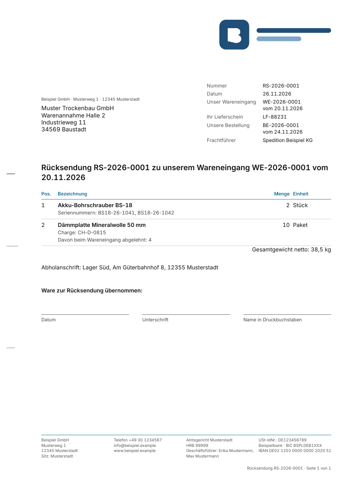

# Lieferantenrücksendung

Beispiel aus den erfundenen Daten des Nachweises: [Lieferantenrücksendung als PDF](beispiele/lieferantenruecksendung.pdf).

Das Druckformat „Lieferantenrücksendung“ druckt einen Wareneingang (Purchase Receipt) von ERPNext, der Ware an den Lieferanten zurückgibt (`is_return`), als Brief nach DIN 5008 mit dem Titel „Rücksendung“: an die Anschrift, an die die Ware zurückgeht, mit dem Wareneingang, den sie zurückgibt, dem Lieferschein des Lieferanten, unserer Bestellung und dem Frachtführer im Informationsblock, den Positionen mit der Menge, die zurückgeht, ihren Seriennummern und Chargen und dem Teil, der beim Wareneingang abgelehnt wurde, dem Gewicht, der Abholanschrift und einer Zeile, auf der der Frachtführer oder der Empfänger die Übernahme der Ware bestätigt.

Die Regeln stehen in `briefbote/purchase/returns.py`, das Lesen des Belegs in `briefbote/briefbote/purchase.py` (`briefbote_return_letter`, `briefbote_purchase_return`), das Layout in `briefbote/briefbote/print_format/lieferantenrücksendung/lieferantenrücksendung.html` mit den Teilen `delivery_positions.html` und `receipt.html` des [Lieferscheins](lieferschein.md); Seriennummern, Chargen und Gewicht liest es wie dieser, die Menge positiv wie der Rücklieferschein.

Die Quellen sind Gesetze in der Fassung von [gesetze-im-internet.de](https://www.gesetze-im-internet.de/), gelesen am 26.11.2026, und der Code von ERPNext im Zweig `version-16` (Commit `d770a3a`, 25.11.2026).

## Was eine Rücksendung ist

Kein Gesetz schreibt den Inhalt eines Begleitscheins für zurückgehende Ware vor; was er enthält, ist kaufmännische Übung. Er begleitet die Ware, rechnet über nichts ab und ist keine Rechnung ([§ 14 Abs. 1 Satz 1 UStG](https://www.gesetze-im-internet.de/ustg_1980/__14.html)). Wird eine Lieferung rückgängig gemacht, berichtigen Lieferant und Abnehmer Steuer und Vorsteuer ([§ 17 Abs. 2 Nr. 3, Abs. 1 UStG](https://www.gesetze-im-internet.de/ustg_1980/__17.html)); das geschieht über die Rechnungskorrektur oder Gutschrift zur Eingangsrechnung, nicht über diesen Brief. Er geht an einen bestimmten Empfänger und trägt die Angaben zum Unternehmen ([§ 35a Abs. 1 GmbHG](https://www.gesetze-im-internet.de/gmbhg/__35a.html)), auf leerem Papier im Fuß jeder Seite, siehe [Geschäftsbrief](geschaeftsbrief.md).

## Angaben

| Angabe | Woher sie kommt | Wo sie steht |
|---|---|---|
| Empfänger | die Versandanschrift des Lieferanten (`dispatch_address`), sonst seine Anschrift (`supplier_address`), mit dem Kontakt (`contact_display`) | Anschriftfeld |
| Nummer, Datum | Name, `posting_date` | Informationsblock, Betreff, Fuß |
| Lieferantennummer | `supplier`, wenn sie vom Namen abweicht | Informationsblock |
| Unser Wareneingang | `return_against` mit seinem Datum | Informationsblock, Betreff: „Rücksendung RS-2026-0001 zu unserem Wareneingang WE-2026-0001 vom 20.11.2026“ |
| Ihr Lieferschein | `supplier_delivery_note` der Rücksendung, sonst des Wareneingangs | Informationsblock |
| Unsere Bestellung | die Bestellungen der Positionen (`purchase_order`) mit ihrem Datum | Informationsblock |
| Frachtführer | `transporter_name` | Informationsblock |
| Positionen | Bezeichnung, Beschreibung, Menge, Einheit | Positionstabelle |
| Menge | die angenommene und die abgelehnte Menge zusammen (`qty` und `rejected_qty`), positiv, auch wenn ERPNext sie negativ führt | Positionstabelle |
| Abgelehnter Teil | „Davon beim Wareneingang abgelehnt: 4“, nur wenn `rejected_qty` nicht 0 ist; „Beim Wareneingang abgelehnt.“, wenn alles abgelehnt war oder aus dem Lager für abgelehnte Ware zurückgeht (`return_qty_from_rejected_warehouse`) | unter der Position |
| Seriennummern, Chargen | Serien- und Chargenbündel der Position und der abgelehnten Menge, sonst die Felder `serial_no`, `rejected_serial_no` und `batch_no` | unter der Position |
| Nettogewicht | `total_net_weight`, positiv, wenn alle Positionen mit Gewicht dieselbe Gewichtseinheit haben | unter der letzten Position |
| Abholanschrift | `shipping_address`, die Lieferanschrift des Unternehmens, an der die Ware abgeholt wird | nach dem Gewicht |
| Übernahme | „Ware zur Rücksendung übernommen:“ mit Linien für Datum, Unterschrift und Name in Druckbuchstaben | am Schluss, mit der letzten Position auf einer Seite |
| Einkaufsbedingungen | `terms` | am Schluss |

Wie ERPNext eine Rücksendung anlegt, steht in `make_return_doc` (`erpnext/controllers/sales_and_purchase_return.py`): Die Rücksendung übernimmt die Positionen des Wareneingangs mit negativer angenommener (`qty`) und abgelehnter Menge (`rejected_qty`); „Rücksendung gegen abgelehnte Menge“ legt die abgelehnte Menge in `qty` und setzt `return_qty_from_rejected_warehouse`. `supplier_delivery_note` ist kein Feld ohne Kopie und geht deshalb vom Wareneingang auf die Rücksendung über. Die Versandanschrift `dispatch_address` ist bei Einkaufsbelegen die Lieferanschrift des Lieferanten (`set_address_details` in `erpnext/accounts/party.py`), `shipping_address` die des eigenen Unternehmens.

Eine Rücksendung, die noch nicht gebucht oder storniert ist, trägt die Markierung „ENTWURF“ oder „STORNIERT“ und druckt keine Zeile zur Übernahme. Preise druckt die Rücksendung nicht.

## Ein Wareneingang ist kein Brief

Ein Wareneingang ohne `is_return` hält fest, was angekommen ist; das ist ein interner Beleg und kein Geschäftsbrief, er geht an keinen Empfänger außerhalb des Unternehmens (§ 35a Abs. 1 GmbHG verlangt die Angaben nur auf Briefen an einen bestimmten Empfänger). Er brauchte weder Anschriftfeld noch Angaben zum Unternehmen, also einen anderen Rahmen als die Briefe von Briefbote. Das Druckformat druckt ihn deshalb nicht als Wareneingangsschein, sondern nur den Befund „Dieses Dokument ist keine Rücksendung an den Lieferanten:“. Der Wareneingangsschein ist nicht gebaut; er steht im [Katalog](katalog.md) und in der [Roadmap](roadmap.md).

## Was ERPNext nicht abbildet

- **Grund der Rücksendung:** Der Wareneingang hat kein Feld für den Grund. Briefbote nennt nur, was der Beleg weiß: den Teil, der beim Wareneingang abgelehnt wurde. Einen weiteren Grund schreibt man in die Beschreibung der Position oder in die Einkaufsbedingungen des Belegs.
- **Prüfbericht:** Eine Qualitätsprüfung (`quality_inspection`) der Position nennt die Rücksendung nicht.

## Seiten

Jede Seite nennt im Fuß „Rücksendung RS-2026-0001 · Seite 1 von 2“; der Kopf der Positionstabelle kehrt auf jeder Seite wieder.

## Offen für die fachliche Prüfung

| Punkt | Was Briefbote druckt | Frage |
|---|---|---|
| Titel | „Rücksendung“ | Ist „Rücksendung“ oder „Rücklieferschein“ im Einkauf üblicher? |
| Übernahme | „Ware zur Rücksendung übernommen:“, Datum, Unterschrift, Name in Druckbuchstaben | Reicht der Wortlaut für Frachtführer und Lieferant, oder soll er Zahl der Packstücke oder Zustand einschließen? |
| Empfänger | Versandanschrift des Lieferanten, sonst seine Anschrift | Ist die Versandanschrift des Lieferanten die richtige Anschrift der Rücksendung? |
| Abgelehnter Teil | angenommene und abgelehnte Menge zusammen, der abgelehnte Teil darunter | Soll der angenommene Teil eigens genannt werden? |

## Nachweis

`briefbote/tests/print_documents_goods.py` schreibt Wareneingänge und Rücksendungen, `briefbote/tests/print_proof_goods.py` druckt und prüft sie mit beiden Generatoren: RS-2026-0001 an die Versandanschrift des Lieferanten mit Seriennummern, Charge, abgelehntem Teil, Gewicht, Frachtführer, Abholanschrift und Übernahme, auf leerem und vorgedrucktem Papier, mit den Linien zum Unterschreiben als bemalte Fläche gemessen; RS-2026-0002 mit 36 Positionen über mehrere Seiten; RS-2026-0003 englisch aus dem Lager für abgelehnte Ware; WE-2026-0001, ein Wareneingang ohne Rücksendung, der nur den Befund druckt; dazu eine stornierte Rücksendung ohne Zeile zur Übernahme.
