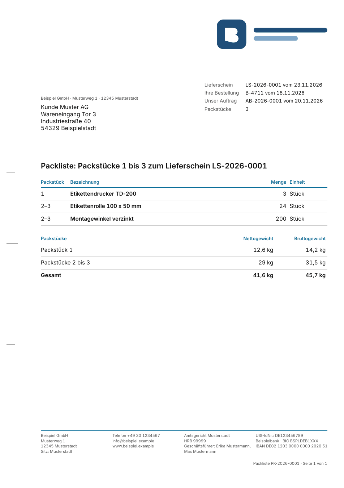

# Packliste

Beispiel aus den erfundenen Daten des Nachweises: [Packliste als PDF](beispiele/packliste.pdf).

Das Druckformat „Packliste“ druckt die Packzettel (Packing Slip) eines Lieferscheins von ERPNext als Brief nach DIN 5008 an dieselbe Anschrift wie der [Lieferschein](lieferschein.md): im Betreff die Packstücke, die die Liste umfasst („Packliste: Packstücke 1 bis 3 zum Lieferschein LS-2026-0001“), im Informationsblock Lieferschein, Kundennummer, Bestellung des Kunden, unsere Aufträge und die Zahl der Packstücke, in der Tabelle jede Position mit den Nummern ihrer Packstücke, Menge und Einheit und darunter das Netto- und Bruttogewicht jedes Packstücks und aller zusammen. Preise druckt sie nicht.

Die Regeln stehen in `briefbote/sales/packing.py`, das Lesen der Belege in `briefbote/briefbote/sales.py` (`briefbote_packing_letter`, `briefbote_packing_slip`), das Layout in `briefbote/briefbote/print_format/packliste/packliste.html` mit den Teilen `delivery_positions.html` und `receipt.html` des Lieferscheins.

Die Quellen sind Gesetze in der Fassung von [gesetze-im-internet.de](https://www.gesetze-im-internet.de/), gelesen am 26.11.2026, und der Code von ERPNext im Zweig `version-16` (Commit `d770a3a`, 25.11.2026).

## Was eine Packliste ist

Kein Gesetz schreibt den Inhalt einer Packliste vor; was sie enthält, ist kaufmännische Übung. Sie sagt, welche Ware in welchem Packstück liegt und was die Packstücke wiegen, begleitet die Lieferung neben dem Lieferschein und rechnet über nichts ab ([§ 14 Abs. 1 Satz 1 UStG](https://www.gesetze-im-internet.de/ustg_1980/__14.html)). Wie der Lieferschein geht sie an einen bestimmten Empfänger und trägt die Angaben zum Unternehmen ([§ 35a Abs. 1 GmbHG](https://www.gesetze-im-internet.de/gmbhg/__35a.html)). Ob sie als Mitteilung in einer bestehenden Geschäftsverbindung auf einem Vordruck ohne diese Angaben auskäme (§ 35a Abs. 2 GmbHG), entscheidet Briefbote nicht: Es druckt sie auf leerem Papier immer, wie auf jedem Dokument, siehe [Geschäftsbrief](geschaeftsbrief.md).

## Packzettel in ERPNext

ERPNext packt einen Lieferschein in Packzettel (`erpnext/stock/doctype/packing_slip/packing_slip.py`): Jeder nennt den Lieferschein (`delivery_note`), die Nummern seiner Packstücke von `from_case_no` bis `to_case_no`, die Positionen des Lieferscheins, die er packt (`dn_detail`), mit Menge und Gewicht je Einheit, und sein Netto- und Bruttogewicht (`net_weight_pkg`, `gross_weight_pkg`). Das Nettogewicht rechnet ERPNext aus den Positionen, das Bruttogewicht übernimmt es vom Nettogewicht, wenn niemand eines einträgt (`calculate_net_total_pkg`). Packzettel lassen sich nur zu einem Lieferschein im Entwurf anlegen, ihre Packstücke dürfen sich nicht überschneiden (`validate_delivery_note`, `validate_case_nos`).

Ein Packzettel allein ist selten die ganze Sendung. Die Packliste eines gebuchten Packzettels umfasst deshalb alle gebuchten Packzettel desselben Lieferscheins, nach ihren Packstücken geordnet; aus welchem davon man sie druckt, ändert nur die Nummer im Fuß. Ein Packzettel im Entwurf oder storniert druckt nur sich selbst, unter seiner Markierung „ENTWURF“ oder „STORNIERT“, und mischt sich nie in die Liste der gebuchten. Der Betreff sagt in jedem Fall, welche Packstücke die Liste umfasst.

## Angaben

| Angabe | Woher sie kommt | Wo sie steht |
|---|---|---|
| Empfänger | wie beim Lieferschein: Lieferanschrift des Lieferscheins, sonst die Anschrift des Kunden | Anschriftfeld |
| Packstücke der Liste | vom ersten `from_case_no` bis zum letzten `to_case_no` der Packzettel | Betreff |
| Lieferschein | `delivery_note` mit seinem Datum | Informationsblock, Betreff |
| Kundennummer, Ihre Bestellung, Unser Auftrag | aus dem Lieferschein, wie dort | Informationsblock |
| Packstücke | die Zahl der Packstücke aller Packzettel der Liste | Informationsblock |
| Positionen | je Position des Packzettels die Nummern seiner Packstücke („1“ oder „2–3“), Bezeichnung, Beschreibung, Charge (`batch_no`), Menge, Einheit | Positionstabelle |
| Gewichte | je Packzettel „Packstück 1“ oder „Packstücke 2 bis 3“ mit Netto- und Bruttogewicht in seiner Einheit, darunter „Gesamt“, wenn jeder Packzettel ein Gewicht in derselben Einheit nennt; bei einem einzigen Packzettel eine Zeile „Nettogewicht … · Bruttogewicht …“ ohne Summe | unter der letzten Position |

Eine Angabe ohne Wert fehlt ganz, kein Feld steht leer.

## Was ERPNext nicht abbildet

- **Inhalt je Packstück eines Bereichs:** Nennt ein Packzettel mehrere Packstücke („Packstücke 2 bis 3“), sagt ERPNext nicht, ob seine Mengen und Gewichte für jedes Packstück oder für alle zusammen gelten; das Feld `to_case_no` beschreibt ERPNext nur als „mehr als ein Packstück derselben Art“. Briefbote druckt Mengen und Gewichte, wie der Packzettel sie nennt, für den Bereich, und multipliziert nichts.
- **Maße und Art der Packstücke:** ERPNext kennt weder Maße noch Art (Karton, Palette) eines Packstücks.

## Seiten

Jede Seite nennt im Fuß „Packliste PK-2026-0001 · Seite 1 von 2“ mit der Nummer des gedruckten Packzettels; der Kopf der Tabelle kehrt auf jeder Seite wieder, die letzte Position steht mit den Gewichten auf einer Seite.

## Offen für die fachliche Prüfung

| Punkt | Was Briefbote druckt | Frage |
|---|---|---|
| Umfang | alle gebuchten Packzettel des Lieferscheins, ein Entwurf nur sich selbst | Ist das die Liste, die eine Sendung braucht? |
| Bereich von Packstücken | Mengen und Gewichte für den Bereich, wie der Packzettel sie nennt | Wie füllen Anwender `to_case_no`, je Packstück oder für alle? |
| Geschäftsbrief | Angaben zum Unternehmen im Fuß | Keine Frage; ob § 35a Abs. 2 GmbHG die Packliste ausnähme, ist offen, Briefbote druckt die Angaben in jedem Fall. |

## Nachweis

`briefbote/tests/print_documents_goods.py` schreibt Packzettel zu den Lieferscheinen des Nachweises, `briefbote/tests/print_proof_goods.py` druckt und prüft sie mit beiden Generatoren: PK-2026-0001 und PK-2026-0002 zu LS-2026-0001 mit drei Packstücken, Gewichten und Summe, auf leerem und vorgedrucktem Papier; PK-2026-0003 bis PK-2026-0006 zu LS-2026-0002 mit 40 Positionen in acht Packstücken über mehrere Seiten; PK-2026-0007 englisch mit einem einzigen Packzettel ohne Summe; PK-2026-0002 als Entwurf, der nur sich selbst druckt.
