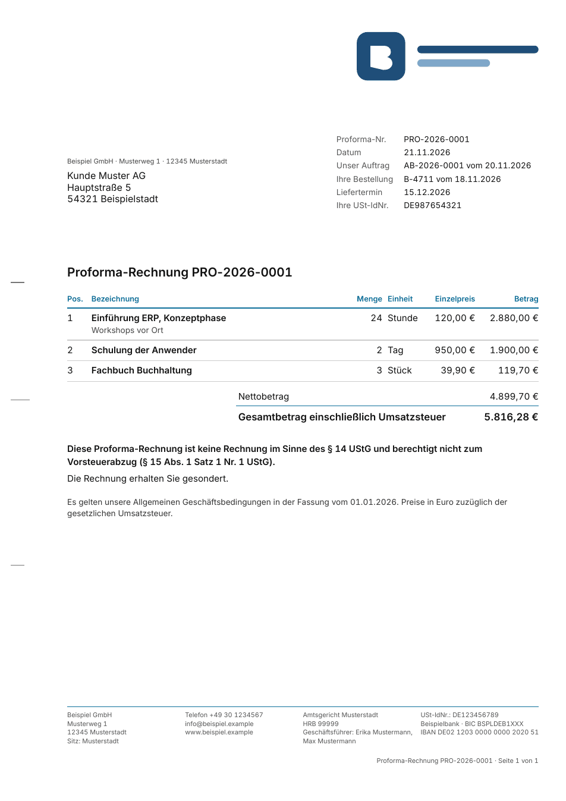

# Proforma-Rechnung

Beispiel aus den erfundenen Daten des Nachweises: [Proforma-Rechnung als PDF](beispiele/proforma_rechnung.pdf).

Das Druckformat „Proforma-Rechnung“ druckt, was ERPNext 16 als Proforma-Rechnung ausgibt: eine Aufstellung, zu welchem Preis ein Auftrag berechnet werden wird, etwa für den Zoll, eine Vorauskasse oder eine Freigabe beim Kunden. Sie ist **keine Rechnung** und sagt das.

Die Regeln stehen in `briefbote/sales/proforma.py`, das Lesen in `briefbote/briefbote/sales.py` (`briefbote_proforma`), das Layout in `briefbote/briefbote/print_format/proforma_rechnung/proforma_rechnung.html`. Die Quellen sind Gesetz in der Fassung von [gesetze-im-internet.de](https://www.gesetze-im-internet.de/), gelesen am 26.11.2026, und der [UStAE](https://www.bundesfinanzministerium.de/Content/DE/Downloads/BMF_Schreiben/Steuerarten/Umsatzsteuer/Umsatzsteuer-Anwendungserlass/Umsatzsteuer-Anwendungserlass-aktuell.pdf) im Stand vom 13.11.2026.

## Was ERPNext 16 druckt

ERPNext 16 bringt den DocType Proforma Invoice (`erpnext/selling/doctype/proforma_invoice/`), in den Selling Settings mit „Enable Proforma Invoice“ einzuschalten. Gelesen im Zweig `version-16` (Commit `d770a3a`, gleich dem Release 16.61.0):

- Eine Proforma-Rechnung entsteht im Reiter „Proforma“ eines **gebuchten** Kundenauftrags (`validate_sales_order`) über einen Dialog: Reihe des Nummernkreises (Vorgabe `PRO-.YYYY.-`), Druckformat (nur Formate des Kundenauftrags), Briefkopf und je Zeile des Auftrags eine Menge („Based On“ „Quantity“, zum Preis des Auftrags) oder einen Betrag („Amount“, wahlweise ohne Menge im Druck, `hide_item_qty`).
- Beim Buchen druckt ERPNext eine **Kopie des Kundenauftrags**, die es nie speichert: nur die gewählten Zeilen mit Menge und Betrag der Proforma-Rechnung, Steuern und Summen neu gerechnet, Rabatte und feste Kosten anteilig, dazu `proforma_no`, `proforma_date` und `hide_item_qty` (`get_sales_order_copy`, `render_pdf`). Das PDF hängt privat an der Proforma-Rechnung (`proforma_pdf`) und lässt sich aus dem Reiter per E-Mail senden. Die Proforma-Rechnung bucht nichts.
- Das mitgelieferte Format „Proforma Invoice“ hat die Überschrift „PROFORMA INVOICE“, englische Texte und druckt jede Steuerzeile mit ihrem Betrag.

Das Druckformat von Briefbote gehört deshalb zum Kundenauftrag. Aus einer Proforma-Rechnung gedruckt nennt es ihre Nummer und ihr Datum, direkt aus dem Auftrag gedruckt dessen Datum.

## Was eine Proforma-Rechnung steuerlich ist

Kein Gesetz definiert die Proforma-Rechnung. Eine Rechnung ist jedes Dokument, mit dem über eine Lieferung oder sonstige Leistung abgerechnet wird (§ 14 Abs. 1 Satz 1 UStG); die Proforma-Rechnung rechnet nicht ab, und ohne Rechnung nach §§ 14, 14a UStG gibt es keinen Vorsteuerabzug (§ 15 Abs. 1 Satz 1 Nr. 1 Satz 2 UStG). Der UStAE nennt die „sog. Pro-forma-Rechnung“ als Beleg beim innergemeinschaftlichen Verbringen, der keine Rechnung ist (UStAE 14a.1 Abs. 5).

Das Risiko liegt im **Steuerausweis**: Wer in einer Rechnung einen Steuerbetrag ausweist, obwohl er dazu nicht berechtigt ist, schuldet ihn (§ 14c Abs. 2 UStG). Dafür genügt ein Dokument mit Aussteller, Empfänger, Leistungsbeschreibung, Entgelt und gesondert ausgewiesener Umsatzsteuer, auch wenn ihm andere Angaben des § 14 Abs. 4 UStG fehlen (UStAE 14c.2 Abs. 1 Satz 3 bis 5); die Steuer ist gesondert ausgewiesen, sobald sie als Geldbetrag genannt und als Steuerbetrag gekennzeichnet ist, auch in einem erläuternden Hinweis, ohne besondere optische Form (Satz 6 bis 9). Eine Rechnung vor der Leistung, die nach Aufmachung oder Inhalt eindeutig als Vorausrechnung erkennbar ist, fällt nicht darunter (UStAE 14c.2 Abs. 2 Nr. 2 Satz 2) – darauf verlässt sich Briefbote bei der Proforma-Rechnung nicht. Bei Kleinbetragsrechnungen hat schon der angegebene Steuersatz die Wirkung eines gesonderten Ausweises (Satz 10).

Briefbote druckt die Proforma-Rechnung deshalb so:

- **Titel** „Proforma-Rechnung“, „Proforma-Nr.“ und „Datum“, keine „Rechnungsnummer“ und kein „Rechnungsdatum“.
- **Kein Steuerbetrag und kein Steuersatz:** Nettobetrag und „Gesamtbetrag einschließlich Umsatzsteuer“, ohne Steuerzeilen, ohne Spalte „USt.“; ohne Umsatzsteuer, etwa bei einer Ausfuhr, nur „Gesamtbetrag“. Die Hinweise des Steuerfalls (Ausfuhr, Reverse Charge, Kleinunternehmer) stehen wie in der Rechnung, weil sie keinen Steuerbetrag nennen.
- **Der Satz:** „Diese Proforma-Rechnung ist keine Rechnung im Sinne des § 14 UStG und berechtigt nicht zum Vorsteuerabzug (§ 15 Abs. 1 Satz 1 Nr. 1 UStG).“ und „Die Rechnung erhalten Sie gesondert.“
- **Keine Bitte um Zahlung,** keine Fälligkeit, kein Leistungsdatum, sondern der Liefertermin wie in der [Auftragsbestätigung](auftragsbestaetigung.md#liefertermin).
- Entwurf und Storno tragen die [Markierung](architektur.md#entwurf-und-storno) und den Satz, dass sie keine Rechnung sind, aber nicht „Die Rechnung erhalten Sie gesondert.“

Wer über eine Anzahlung abrechnen will, so dass der Kunde die Vorsteuer abziehen kann, nimmt die [Anzahlungsrechnung](anzahlungsrechnung.md), die eine Rechnung ist.

## Angaben

| Angabe | Woher sie kommt | Wo sie steht |
|---|---|---|
| Proforma-Nr., Datum | `proforma_no`, `proforma_date` der Kopie; direkt aus dem Auftrag nur dessen Datum | Informationsblock, Betreff, Fuß |
| Unser Auftrag | Name und Datum des Kundenauftrags | Informationsblock |
| Kundennummer, Ihre Bestellung, Liefertermin, USt-IdNrn. | wie in der [Auftragsbestätigung](auftragsbestaetigung.md#angaben) | Informationsblock |
| Positionen | Zeilen der Proforma-Rechnung; bei „Hide Item Quantity in Print“ ohne Menge, Einheit und Einzelpreis | Positionstabelle |
| Summen | Nettobetrag, Gesamtbetrag einschließlich Umsatzsteuer | unter den Positionen |
| Geschäftsbedingungen | `terms` des Auftrags | Ende |

## Seiten

Jede Seite nennt im Fuß „Proforma-Rechnung PRO-2026-0001 · Seite 1 von 1“.

## Offen für die fachliche Prüfung

| Punkt | Was Briefbote druckt | Frage |
|---|---|---|
| Kein Steuerausweis | Nettobetrag und „Gesamtbetrag einschließlich Umsatzsteuer“, kein Steuerbetrag, kein Satz | Schließt das § 14c Abs. 2 UStG aus, oder ist schon die Differenz von Netto und Brutto ein Ausweis? Ist der Weg nötig, oder schützt der Satz „keine Rechnung“ allein? Eine Entscheidung des BFH zur Proforma-Rechnung hat Briefbote nicht gefunden und nicht gelesen. |
| Satz zum Vorsteuerabzug | „Diese Proforma-Rechnung ist keine Rechnung im Sinne des § 14 UStG und berechtigt nicht zum Vorsteuerabzug (§ 15 Abs. 1 Satz 1 Nr. 1 UStG).“ | Wortlaut richtig und üblich? |
| Proforma für den Zoll | Werte des Auftrags, kein Zollwert, keine Warennummer | Welche Angaben braucht eine Proforma-Rechnung für die Ausfuhr, und gehören sie in dieses Format? |
| Verbringen | nicht vorgesehen | Soll das Format den Beleg beim innergemeinschaftlichen Verbringen nach UStAE 14a.1 Abs. 5 tragen (beide USt-IdNrn., Bemessungsgrundlagen)? |

## Nachweis

`briefbote/tests/print_documents_sales.py` schreibt die Proforma-Rechnungen PRO-2026-0001 (aus AB-2026-0001, drei Positionen zu 19 % und 7 %), PRO-2026-0002 (aus AB-2026-0002, 30 Positionen, mehrere Seiten) und PRO-2026-0003 (englisch, nach Betrag ohne Menge). `briefbote/tests/print_proof_sales.py` druckt sie mit beiden Generatoren, PRO-2026-0001 auch auf vorgedrucktem Papier und storniert, und prüft, dass kein Steuerbetrag, kein Steuersatz und keine Bitte um Zahlung im Ausdruck steht.
