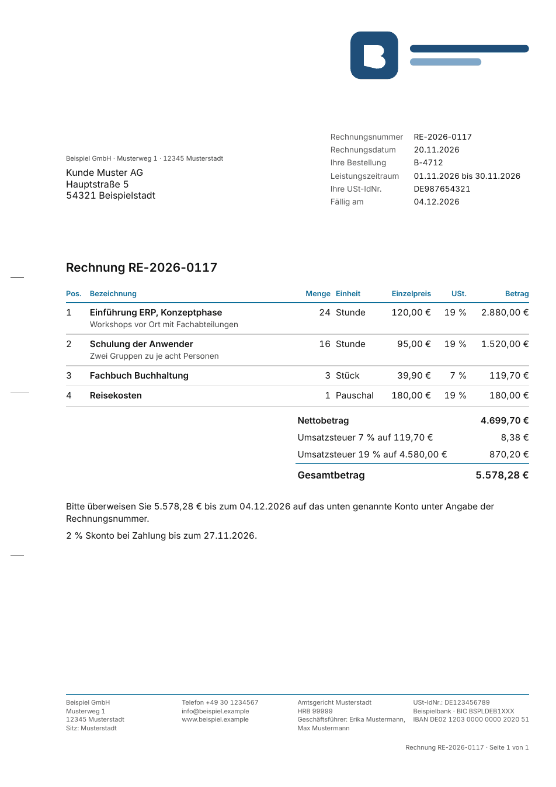

# Rechnung

Beispiel aus den erfundenen Daten des Nachweises: [Rechnung als PDF](beispiele/rechnung.pdf), dazu eine [Schlussrechnung](#anzahlungen-und-schlussrechnung): <a href="bilder/beispiele/rechnung-schluss.png">Bild</a>, [PDF](beispiele/rechnung-schluss.pdf).

Das Druckformat „Rechnung“ druckt eine Ausgangsrechnung (Sales Invoice) von ERPNext als Brief nach DIN 5008. Aus einer Vorlage entstehen fünf Dokumente, je nachdem, was der Beleg ist:

| Beleg in ERPNext | Dokument | Titel |
|---|---|---|
| Ausgangsrechnung ohne `is_return` | Rechnung | „Rechnung“ |
| Ausgangsrechnung mit zugeordneten Anzahlungen, die vor der Leistung eingingen | Schlussrechnung (Endrechnung nach § 14 Abs. 5 Satz 2 UStG) | „Schlussrechnung“, siehe [Anzahlungen](#anzahlungen-und-schlussrechnung) |
| Rückgabe mit `return_against`, die die Rechnung vollständig aufhebt | Stornorechnung | „Stornorechnung … zur Rechnung … vom …“ |
| Rückgabe mit `return_against` über einen Teil | Rechnungskorrektur | „Rechnungskorrektur … zur Rechnung … vom …“ |
| Rückgabe ohne `return_against` | kaufmännische Gutschrift | „Kaufmännische Gutschrift“ |

Die Regeln stehen in `briefbote/invoice/document.py`, das Lesen des Belegs in `briefbote/briefbote/printing.py`, das Layout in `briefbote/briefbote/print_format/rechnung/rechnung.html` und den gemeinsamen Teilen unter `briefbote/templates/includes/briefbote/`. Was ein Unternehmen dafür einstellt, steht unter [Einrichtung](einrichtung.md).

Die Quellen auf dieser Seite sind Gesetz und Verordnung in der Fassung von [gesetze-im-internet.de](https://www.gesetze-im-internet.de/) und der [Umsatzsteuer-Anwendungserlass](https://www.bundesfinanzministerium.de/Content/DE/Downloads/BMF_Schreiben/Steuerarten/Umsatzsteuer/Umsatzsteuer-Anwendungserlass/Umsatzsteuer-Anwendungserlass-aktuell.pdf) (UStAE) im Stand vom 13.11.2026, der das BMF-Schreiben zur E-Rechnung vom 15.10.2026 schon enthält.

## Pflichtangaben

§ 14 Abs. 4 Satz 1 UStG zählt auf, was eine Rechnung enthalten muss. So erfüllt das Druckformat jede Angabe:

| Nr. | Angabe | Woher sie kommt | Wo sie steht |
|---|---|---|---|
| 1 | vollständiger Name und vollständige Anschrift des leistenden Unternehmers und des Leistungsempfängers | Unternehmen und seine Anschrift (Einstellungen, sonst Hauptanschrift); Kunde und Rechnungsanschrift des Belegs | Rücksendeangabe und Fuß; Anschriftfeld |
| 2 | Steuernummer oder USt-IdNr. des leistenden Unternehmers | USt-IdNr. des Unternehmens, Steuernummer aus den Einstellungen | Fuß, beide, wenn es beide gibt |
| 3 | Ausstellungsdatum | Buchungsdatum | Informationsblock „Rechnungsdatum“ |
| 4 | fortlaufende, einmalige Rechnungsnummer | Name des Belegs (Nummernkreis von ERPNext) | Betreff, Informationsblock, Fuß jeder Seite |
| 5 | Menge und handelsübliche Bezeichnung, Umfang und Art der Leistung | Positionen: Bezeichnung, Beschreibung, Menge, Einheit | Positionstabelle |
| 6 | Zeitpunkt der Lieferung oder Leistung | siehe [Leistungsdatum](#leistungsdatum) | Informationsblock, bei Positionen mit eigenem Zeitraum auch dort |
| 7 | Entgelt nach Steuersätzen und Steuerbefreiungen aufgeschlüsselt, vereinbarte Minderungen | Nettobetrag, je Steuerzeile ihre Bemessungsgrundlage, Rabatt, Skonto des Zahlungsplans | Summen, Zahlungsaufforderung |
| 8 | Steuersatz und Steuerbetrag oder Hinweis auf die Steuerbefreiung | Steuerzeilen des Belegs; Steuerfall der Vorlage | Summen („Umsatzsteuer 19 % auf …“); Hinweis unter den Summen |
| 9 | Hinweis auf die Aufbewahrungspflicht des Empfängers (§ 14b Abs. 1 Satz 5 UStG) | nicht umgesetzt | – |
| 10 | „Gutschrift“ bei Abrechnung durch den Leistungsempfänger | gilt nicht für die Ausgangsrechnung, siehe [Gutschrift im Gutschriftsverfahren](roadmap.md) | – |

Nr. 9 betrifft steuerpflichtige Werklieferungen und sonstige Leistungen im Zusammenhang mit einem Grundstück an Empfänger, die weder Unternehmer für ihr Unternehmen noch juristische Personen sind (§ 14 Abs. 2 Satz 2 Nr. 3, § 14b Abs. 1 Satz 5 UStG); Briefbote druckt diesen Hinweis noch nicht, die [Roadmap](roadmap.md) führt ihn.

Jede Steuerzeile druckt das Format mit ihrem Satz und ihrer Bemessungsgrundlage, so dass das Entgelt nach Steuersätzen aufgeschlüsselt ist (Nr. 7): „Umsatzsteuer 19 % auf 5.292,00 €“, bei einem Steuersatz wie bei mehreren. Satz und Grundlage kommen aus den Steuerdetails der Positionen (Tabelle `item_wise_tax_details`): Eine Steuerzeile besteuert die Positionen, deren Detail auf ihr einen Satz über 0 hat, und ihre Grundlage ist deren Nettobetrag (`net_amount` der Position, nach Rabatten auf Position und Beleg, bei Preisen mit Steuer ohne die Steuer). Die eingerichteten deutschen Steuervorlagen von ERPNext haben Steuerzeilen mit dem Satz 0, den Satz trägt die Artikel-Steuervorlage jeder Position, die alle Steuerkonten nennt, das eigene mit seinem Satz und die anderen mit 0; der Nettobetrag, den ERPNext an der Steuerzeile selbst führt, umfasst dann alle Positionen (`get_current_tax_and_net_amount` in `erpnext/controllers/taxes_and_totals.py`) und taugt nicht als Grundlage. Eine Rechnung ohne Steuerdetails, etwa aus einer älteren Version, druckt Satz und Nettobetrag der Steuerzeile. Lässt sich eine Grundlage nicht bestimmen, druckt das Format den [Befund](#unvollständige-dokumente) statt einer unvollständigen Rechnung. Unterscheiden sich die Positionen im Satz, bekommt jede Position eine Spalte „USt.“ mit ihrem Satz; den Satz je Position nimmt Briefbote aus der Tabelle `item_wise_tax_details` der Ausgangsrechnung (DocType Item Wise Tax Detail in ERPNext 16), bei einer Rechnung ohne diese Tabelle den einen Satz aller Steuerzeilen (`briefbote/invoice/taxes.py`). Positionen ohne Umsatzsteuer neben besteuerten stehen in den Summen als „Entgelt ohne Umsatzsteuer“, damit auch das Entgelt nach der Steuerbefreiung aufgeschlüsselt ist (Nr. 7 und 8); den Grund der Befreiung nennt die Position, etwa „steuerfrei nach § 4 Nr. 10 Buchst. a UStG“. Der Steuerbetrag ist der der Steuerzeile; gerundet hat ERPNext beim Buchen, auf den Cent genau, wie UStAE 14.5 Abs. 20 Satz 2 verlangt.

### Kleinbetragsrechnung und Kleinunternehmer

Eine Rechnung bis 250 Euro brutto braucht nach § 33 UStDV weniger Angaben, eine Rechnung eines Kleinunternehmers nach § 34a UStDV ebenfalls. Das Druckformat druckt trotzdem alle Angaben des § 14 Abs. 4 UStG: Sie schaden nicht, und § 33 Satz 3 UStDV schließt die Vereinfachung für innergemeinschaftliche Lieferungen und § 13b UStG ohnehin aus.

## Unvollständige Dokumente

Fehlt einem Beleg eine Angabe, die das Gesetz für seinen Fall verlangt, druckt das Format oben im Dokument einen rot gerahmten Block „Dieses Dokument ist unvollständig und darf so nicht als Rechnung versandt werden:“ mit dem, was fehlt (`briefbote/invoice/completeness.py`). Ein Feld des Informationsblocks ohne Wert druckt es nie; eine fehlende Pflichtangabe wird zum Befund.

| Fehlt | Befund | Quelle | gilt für |
|---|---|---|---|
| vollständige Anschrift des Empfängers (Straße und Postleitzahl oder Ort) | „Die vollständige Anschrift des Leistungsempfängers fehlt“ | § 14 Abs. 4 Satz 1 Nr. 1 UStG | Rechnung |
| vollständige Anschrift des Lieferanten | „Die vollständige Anschrift des leistenden Unternehmers fehlt“: die Gutschrift ist die Rechnung des Lieferanten, der die Leistung erbringt (§ 14 Abs. 2 Satz 5 UStG) | § 14 Abs. 4 Satz 1 Nr. 1 UStG | Gutschrift |
| Steuernummer und USt-IdNr. des Unternehmens | „Die Steuernummer oder USt-IdNr. des Unternehmens fehlt“ | § 14 Abs. 4 Satz 1 Nr. 2 UStG | Rechnung |
| Steuernummer und USt-IdNr. des Lieferanten | „Die Steuernummer oder USt-IdNr. des Lieferanten fehlt“ | § 14 Abs. 4 Satz 1 Nr. 2 UStG | Gutschrift |
| Zeitpunkt der Lieferung oder Leistung | „Der Zeitpunkt der Lieferung oder Leistung fehlt“ | § 14 Abs. 4 Satz 1 Nr. 6 UStG | beide; das Format nimmt sonst das Rechnungsdatum ([Leistungsdatum](#leistungsdatum)), der Befund kommt also nur ohne jedes Datum |
| Steuerbetrag bei einer im Inland steuerpflichtigen Leistung, ohne Grund der Befreiung | „Die Leistung ist im Inland steuerpflichtig, das Dokument weist aber keine Umsatzsteuer und keinen Grund dafür aus“ | § 14 Abs. 4 Satz 1 Nr. 8 UStG | beide |
| Bemessungsgrundlage eines Steuersatzes | „Das Entgelt eines Steuersatzes lässt sich aus den Steuerdetails des Dokuments nicht bestimmen“ | § 14 Abs. 4 Satz 1 Nr. 7 und 8 UStG | beide |
| USt-IdNr. des Kunden bei innergemeinschaftlicher Lieferung oder sonstiger Leistung in der EU | „Die USt-IdNr. des Leistungsempfängers fehlt“ | § 14a Abs. 1 und 3 UStG | Rechnung |
| Bankkonto für die Bitte um Überweisung | „In den Einstellungen Geschäftspost ist kein Bankkonto gewählt; die Bitte um Überweisung kann nicht sagen, wohin.“ | keine Pflichtangabe; eine Zahlungsaufforderung ohne Konto lässt sich nicht befolgen | offene Rechnung, kein Entwurf, nicht storniert |
| eigene USt-IdNr. in denselben Fällen | „Die USt-IdNr. des Unternehmens fehlt“ | § 14a Abs. 1 und 3 UStG | Rechnung |
| Kennzeichen „Abrechnung im Gutschriftsverfahren“ an der Eingangsrechnung | „Diese Eingangsrechnung ist nicht als Gutschrift gekennzeichnet …“ | § 14 Abs. 2 Satz 5 UStG | Gutschrift |

Eine Rechnung bis 250 Euro braucht nach § 33 UStDV weder Anschrift des Empfängers noch Steuernummer noch Leistungsdatum; diese Befunde entfallen dort, außer in den Fällen des § 14a UStG (§ 33 Satz 3 UStDV). Eine kaufmännische Gutschrift ist keine Rechnung und bekommt keinen Befund. Eine Rechnungskorrektur und eine Stornorechnung verweisen auf die Rechnung, die sie berichtigen (§ 31 Abs. 5 UStDV); das Format druckt dazu Nummer und Datum der ursprünglichen Rechnung, eine Rückgabe ohne ursprüngliche Rechnung druckt es als kaufmännische Gutschrift. Die Prüfung der Einstellungen (`check`) warnt schon vor dem Druck, wenn dem Unternehmen Steuernummer und USt-IdNr. fehlen.

## Leistungsdatum

Die Rechnung nennt den Zeitpunkt der Lieferung oder Leistung immer ausdrücklich, als Datum oder Zeitraum (`document.service`), in dieser Reihenfolge:

1. **Leistungszeitraum der Rechnung:** die Felder `from_date` und `to_date` der Ausgangsrechnung. ERPNext 16 führt sie im Abschnitt „Subscription“; sie lassen sich auch nach dem Buchen setzen (`allow_on_submit`).
2. **Leistungszeiträume der Positionen:** Anfang und Ende der Leistung je Position (`service_start_date`, `service_end_date`), zusammen als Zeitraum vom frühesten Anfang bis zum spätesten Ende; jede Position druckt ihren Zeitraum zusätzlich.
3. **Lieferscheine:** das Datum des Lieferscheins der Positionen als „Lieferdatum“, bei mehreren als „Lieferzeitraum“.
4. **Rechnungsdatum:** sonst das Buchungsdatum als „Leistungsdatum“.

UStAE 14.5 Abs. 16 verlangt die Angabe auch, wenn das Leistungsdatum dem Rechnungsdatum entspricht. Ein Satz wie „Leistungsdatum entspricht Rechnungsdatum“ genügt nur bei Rechnungen, die keine E-Rechnung sind, und ersetzt in der E-Rechnung nicht das strukturierte Feld. Briefbote druckt deshalb stets das Datum selbst. Der ganze Leistungszeitraum genügt (UStAE 14.5 Abs. 16 Nr. 4), ebenso der Kalendermonat (§ 31 Abs. 4 UStDV).

## Steuerfälle und Hinweise

Welcher Steuerfall eine Rechnung ist, sagen die Einstellungen Geschäftspost: Jede Vorlage für Verkaufssteuern bekommt dort ihren Steuerfall. Eine Vorlage ohne Zeile ist ein im Inland steuerpflichtiger Umsatz. Der Hinweis steht fett unter den Summen, in der Sprache der Rechnung.

| Steuerfall | Hinweis (deutsch) | Quelle |
|---|---|---|
| Im Inland steuerpflichtig | keiner | – |
| Innergemeinschaftliche Lieferung | „Steuerfreie innergemeinschaftliche Lieferung (§ 4 Nr. 1 Buchst. b i. V. m. § 6a UStG).“ und beide USt-IdNrn. im Informationsblock | § 14 Abs. 4 Satz 1 Nr. 8, § 14a Abs. 3 UStG; UStAE 14a.1 Abs. 4 |
| Leistung an Unternehmen in einem anderen EU-Staat | „Steuerschuldnerschaft des Leistungsempfängers (Reverse Charge). Die Leistung ist im Inland nicht steuerbar (§ 3a Abs. 2 UStG).“ und beide USt-IdNrn. | § 14a Abs. 1 UStG; UStAE 14a.1 Abs. 2 Satz 3, Abs. 6 Satz 2 |
| Steuerschuldnerschaft des Leistungsempfängers im Inland | „Steuerschuldnerschaft des Leistungsempfängers (Reverse Charge, § 13b UStG).“ | § 13b Abs. 2, 5, § 14a Abs. 5 UStG; UStAE 13b.14 Abs. 1 |
| Ausfuhrlieferung | „Steuerfreie Ausfuhrlieferung (§ 4 Nr. 1 Buchst. a i. V. m. § 6 UStG).“ | § 14 Abs. 4 Satz 1 Nr. 8 UStG; UStAE 14.5 Abs. 20 |
| Leistung an Unternehmen außerhalb der EU | „Im Inland nicht steuerbare Leistung: Der Leistungsort liegt außerhalb der EU (§ 3a Abs. 2 UStG).“ | kein Pflichthinweis, siehe [Strittig](#strittig-und-vorsichtig-gelöst) |
| Steuerfrei | „Steuerfreie Leistung: “ und der Grund aus der Zeile des Steuerfalls oder dem Feld `tax_exemption_reason` des Belegs (erpnext_germany) | § 14 Abs. 4 Satz 1 Nr. 8 UStG; UStAE 14.5 Abs. 20 |
| Kleinunternehmer (Einstellung des Unternehmens) | „Gemäß § 19 UStG wird keine Umsatzsteuer berechnet (Steuerbefreiung für Kleinunternehmer).“, für jede Rechnung des Unternehmens | § 19 Abs. 1 UStG, § 34a Satz 1 Nr. 5 UStDV; UStAE 14.7a Abs. 1 |

Zum Wortlaut:

- **Steuerschuldnerschaft des Leistungsempfängers.** § 14a Abs. 1 und 5 UStG verlangen genau diese Angabe. Statt ihrer kommt die Formulierung der Amtssprache eines anderen Mitgliedstaats in Betracht, etwa „Reverse charge“ nach Art. 226 Nr. 11a der Mehrwertsteuer-Systemrichtlinie (UStAE 14a.1 Abs. 6 Satz 2, Anlage 8). Die deutsche Rechnung druckt beides, die englische „Reverse charge“ mit dem deutschen Begriff im Text. Eine Rechnung nach § 13b UStG weist keine Steuer aus; tut sie es, schuldet der leistende Unternehmer sie nach § 14c Abs. 1 UStG (UStAE 13b.14 Abs. 1). Der Nachweis der CI prüft, dass auf diesen Rechnungen kein Steuerbetrag steht.
- **Steuerbefreiungen.** Die Vorschrift muss nicht genannt werden, ein Hinweis in Worten genügt (UStAE 14.5 Abs. 20 Satz 4 bis 6). Briefbote nennt sie trotzdem, weil die Nennung den Grund eindeutig macht.
- **Beide USt-IdNrn.** verlangen § 14a Abs. 1 Satz 3 und Abs. 3 Satz 2 UStG bei der innergemeinschaftlichen Lieferung und der Leistung nach § 3a Abs. 2 UStG in einen anderen Mitgliedstaat. Der Informationsblock nennt dann „Ihre USt-IdNr.“ und „Unsere USt-IdNr.“; die USt-IdNr. des Kunden steht auch sonst dort, wenn der Beleg eine hat. Für einen Kleinunternehmer entfällt die Pflicht (§ 19 Abs. 1 Satz 2 UStG).
- **Verbraucher.** Ist der Kunde eine Privatperson (`customer_type` „Individual“), druckt die Rechnung den Hinweis des § 286 Abs. 3 Satz 1 BGB: „Zahlen Sie nicht innerhalb von 30 Tagen nach Fälligkeit und Zugang dieser Rechnung, kommen Sie auch ohne Mahnung in Verzug (§ 286 Abs. 3 BGB).“ Ohne ihn kommt ein Verbraucher nach dieser Vorschrift nicht in Verzug.

## Rechnungskorrektur, Stornorechnung, kaufmännische Gutschrift

- **Bezug auf die Rechnung.** Eine Berichtigung muss durch ein Dokument geschehen, das spezifisch und eindeutig auf die Rechnung bezogen ist (§ 31 Abs. 5 Satz 2 UStDV); das ist regelmäßig der Fall, wenn es die Nummer der ursprünglichen Rechnung nennt (UStAE 14.11 Abs. 1). Rechnungskorrektur und Stornorechnung nennen Nummer und Datum der Rechnung im Betreff und im Informationsblock („Rechnung: RE-… vom …“) und haben selbst eine eigene Nummer, die zulässig, aber nicht vorgeschrieben ist. Sie tragen alle Angaben des § 14 Abs. 4 UStG wie eine Rechnung (§ 31 Abs. 5 Satz 3 UStDV).
- **Kein „Gutschrift“ für Korrekturen.** Die im allgemeinen Sprachgebrauch so bezeichnete Stornierung oder Korrektur einer Rechnung ist keine Gutschrift (UStAE 14.3 Abs. 2 Satz 5). „Gutschrift“ ist nach § 14 Abs. 2 Satz 5 und Abs. 4 Satz 1 Nr. 10 UStG die Rechnung, die der Leistungsempfänger ausstellt. Briefbote nennt Korrekturen deshalb „Rechnungskorrektur“ und „Stornorechnung“. Die Stornorechnung ist die Rechnungskorrektur, die die ganze Rechnung aufhebt: Ihr Gesamtbetrag gleicht den der Rechnung auf den Cent aus.
- **Kaufmännische Gutschrift.** Eine Rückgabe ohne Bezug auf eine Rechnung, etwa ein Bonus oder ein Nachlass, heißt „Kaufmännische Gutschrift“ und sagt: „Diese Gutschrift mindert das Entgelt für frühere Lieferungen oder Leistungen (§ 17 UStG). Sie ist keine Gutschrift im Sinne des § 14 Abs. 2 Satz 5 UStG.“ Die Bezeichnung als „Gutschrift“ allein führt nicht zu § 14c UStG (UStAE 14c.1 Abs. 3 Satz 4); der Satz hält das Dokument trotzdem eindeutig vom Gutschriftsverfahren getrennt. Eine Minderung nach § 17 UStG, etwa durch Skonto oder Nachlass, braucht keine Rechnungsberichtigung (UStAE 14.11 Abs. 4).
- **Keine Zahlungsaufforderung und keine Geschäftsbedingungen** auf Korrekturen und Gutschriften; ihre Summe heißt „Korrekturbetrag“, „Stornierter Betrag“ oder „Gutgeschriebener Betrag“.

## Zahlung

Eine offene Rechnung schließt mit der Bitte, den Betrag bis zur Fälligkeit auf das Konto im Fuß zu überweisen. Nennen die Einstellungen kein Bankkonto, bittet sie wie die [Mahnung](mahnung.md) nicht um Überweisung, sondern zeigt den [Befund](#unvollständige-dokumente), dass kein Konto gewählt ist; die Prüfung der Einstellungen warnt davor. Ein Zahlungsplan mit mehreren Raten druckt jede Rate mit ihrer Fälligkeit, ein Skonto als „2 % Skonto bei Zahlung bis zum …“; diese Angabe genügt für eine im Voraus vereinbarte Minderung des Entgelts (UStAE 14.5 Abs. 19). Zahlungen, die ERPNext der Rechnung zugeordnet hat und die erst nach der Leistung eingingen, stehen als „Abzüglich erhaltener Anzahlungen“ mit dem Betrag „Zu zahlen“ unter dem Gesamtbetrag; Anzahlungen vor der Leistung machen die Rechnung zur [Schlussrechnung](#anzahlungen-und-schlussrechnung), die um den Restbetrag bittet. Die Geschäftsbedingungen des Belegs stehen am Ende.

## Sprache

Die Rechnung druckt in der Sprache, in der Frappe druckt: Die Druckansicht wählt die Sprache des Belegs (Feld `language` der Ausgangsrechnung), sonst die des Druckformats, sonst die des Benutzers (`set_default_print_language` in `frappe/printing/page/print/print.js` von Frappe 16); das Druckformat „Rechnung“ legt keine eigene Sprache fest. Briefbote bringt Deutsch und Englisch. Die Texte stehen englisch im Code und deutsch in `briefbote/translations/de.csv` mit dem Kontext „Briefbote“. Daten und Beträge formatiert Frappe nach den Systemeinstellungen, in beiden Sprachen gleich. Den Hinweis „Reverse charge“ lässt UStAE 14a.1 Abs. 6 Satz 2 ausdrücklich zu.

## Papierrechnung und E-Rechnung

Eine Rechnung auf Papier oder als PDF ist seit 2025 eine „sonstige Rechnung“. Für Umsätze zwischen inländischen Unternehmern ist sie nur noch im Übergang zulässig: für Umsätze bis zum 31.12.2026 allgemein, für Umsätze im Jahr 2027 nur, wenn der Gesamtumsatz des Ausstellers im Vorjahr 800.000 Euro nicht überstiegen hat (§ 27 Abs. 38 UStG). Danach ist im inländischen B2B-Verkehr die E-Rechnung die Rechnung, und das PDF ist eine lesbare Darstellung. Kleinbetragsrechnungen, Rechnungen von Kleinunternehmern und Rechnungen an Empfänger, die nicht im Inland ansässig sind, dürfen weiter sonstige Rechnungen sein (§ 33 Satz 4, § 34a Satz 4 UStDV; UStAE 14.1 Abs. 4). Briefbote erzeugt keine E-Rechnung; das tut eine App wie eu_einvoice, die ihr XML in das PDF des Druckformats einbetten kann, siehe [Architektur](architektur.md#zusammenspiel-mit-anderen-apps). Maßgeblich ist die Datei, die beim Buchen entsteht und am Beleg hängt. eu_einvoice bettet sein XML aber in jedes PDF einer Ausgangsrechnung ein, das über „PDF“ heruntergeladen wird, auch in das eines Entwurfs, und wandelt es dabei mit Ghostscript in PDF/A-3. Ein solches PDF eines Entwurfs ist keine Rechnung: Briefbote druckt auf jede Seite „ENTWURF“, und das Wasserzeichen bleibt nach der Wandlung erhalten (der Nachweis der Ausdrucke prüft es mit denselben Optionen von Ghostscript). Ein stornierter Beleg trägt ebenso „STORNIERT“.

## Aufbewahrung

Eine Kopie jeder ausgestellten Rechnung bewahrt der Aussteller acht Jahre auf (§ 14b Abs. 1 UStG, § 147 Abs. 1 Nr. 4, Abs. 3 AO, § 257 HGB); nachträgliche Änderungen sind nicht zulässig (UStAE 14b.1 Abs. 5). Ein Druckformat druckt, was beim Drucken in ERPNext steht; ein später gedrucktes PDF kann von dem abweichen, das versandt wurde, etwa nach geänderten Einstellungen. Wer das versandte PDF aufbewahren muss, lässt es beim Buchen anhängen (zum Beispiel mit pdf_on_submit) oder archiviert die versandte E-Mail.

## Strittig und vorsichtig gelöst

- **Leistung an Unternehmen außerhalb der EU.** Kein Gesetz verlangt hier einen Hinweis: §§ 14, 14a UStG gelten für im Inland steuerbare Umsätze (UStAE 14.1 Abs. 20 Satz 1), § 14a Abs. 1 UStG nur für Leistungen in einen anderen Mitgliedstaat, und § 14 Abs. 4 Satz 1 Nr. 8 UStG für Steuerbefreiungen; ein nicht steuerbarer Umsatz ist keine. Briefbote druckt trotzdem einen Hinweis, damit die Rechnung erklärt, warum sie keine Steuer ausweist, und nennt die Leistung „nicht steuerbar“, nie „steuerfrei“. Ob der Staat des Kunden einen eigenen Hinweis verlangt, prüft das Unternehmen.
- **Bezeichnung der kaufmännischen Gutschrift.** Seit UStAE 14c.1 Abs. 3 Satz 4 ist das Wort „Gutschrift“ für sie steuerlich unschädlich; ältere Verwaltungsauffassung und Literatur sahen ein Risiko. Briefbote nennt sie „Kaufmännische Gutschrift“ und grenzt sie im Text ausdrücklich vom Gutschriftsverfahren ab.
- **Leistungsdatum gleich Rechnungsdatum.** Zulässig wäre bei sonstigen Rechnungen der Satz „Leistungsdatum entspricht Rechnungsdatum“ (UStAE 14.5 Abs. 16). Briefbote druckt stattdessen immer das Datum.
- **Angaben nach § 35a GmbHG auf Rechnungen.** Ob Rechnungen in einer bestehenden Geschäftsverbindung unter die Ausnahme für Vordrucke (§ 35a Abs. 2 GmbHG) fallen, ist umstritten. Briefbote druckt die Angaben auf jeder Seite jedes Dokuments auf leerem Papier, siehe [Geschäftsbrief](geschaeftsbrief.md).
- **Steuernummer und USt-IdNr.** § 14 Abs. 4 Satz 1 Nr. 2 UStG verlangt eine von beiden. Der Fuß druckt beide, wenn das Unternehmen beide hat.

## Was das Druckformat nicht kann

- Die Anzahlungsrechnung: Sie hat ein eigenes Druckformat, siehe [Anzahlungsrechnung](anzahlungsrechnung.md). Was die Schlussrechnung nicht kann, steht unter [Anzahlungen](#anzahlungen-und-schlussrechnung).
- Den Hinweis auf die Aufbewahrungspflicht des Empfängers (§ 14 Abs. 4 Satz 1 Nr. 9 UStG).
- Das innergemeinschaftliche Dreiecksgeschäft (§ 25b UStG, § 14a Abs. 7 UStG) und Differenzbesteuerung (§ 25a UStG): Diese Fälle haben noch keinen Steuerfall.
- Rechnungen in Fremdwährung druckt das Format mit den Beträgen des Belegs in seiner Währung; was eine solche Rechnung zusätzlich in Euro angeben sollte, ist noch nicht geprüft und nicht umgesetzt.
- Zahlen und Daten folgen den Einstellungen der Site, nicht der Sprache des Dokuments: Eine englische Rechnung zeigt „1.440,00 €“, wenn die Site deutsch formatiert. Einheiten druckt das Format, wie sie in den Stammdaten heißen, etwa „Nos“.

## Anzahlungen und Schlussrechnung

> **Warnung: Die Umsatzsteuer einer Anzahlung steht in ERPNext doppelt in den Büchern.** Gelesen in ERPNext 16.61 (Zweig `version-16`, Commit `d770a3a`): Ein Zahlungseingang (Payment Entry) mit „Advance Taxes and Charges“ bucht die Umsatzsteuer der Anzahlung bei Eingang auf das Steuerkonto (`add_tax_gl_entries` in `erpnext/accounts/doctype/payment_entry/payment_entry.py`) und schreibt dem Kunden nur den Betrag ohne diese Steuer gut (`get_base_unallocated_amount`, `get_included_taxes`). Die Ausgangsrechnung über die ganze Leistung bucht die Umsatzsteuer der ganzen Leistung noch einmal (`make_tax_gl_entries` in `erpnext/accounts/doctype/sales_invoice/sales_invoice.py`). Das Zuordnen der Anzahlung bucht nichts am Steuerkonto um und ordnet nur den Betrag ohne Steuer zu (`reconcile_against_document` in `erpnext/accounts/utils.py`, `make_advance_gl_entries` in `payment_entry.py`, `calculate_outstanding_amount` in `erpnext/controllers/taxes_and_totals.py`). Bis eine Korrektur gebucht ist, steht die Umsatzsteuer der Anzahlung zweimal im Hauptbuch, und ERPNext führt die Schlussrechnung um sie zu hoch offen: im Beispiel RE-2026-0401 12.488,80 € statt der 11.804,80 €, die der Kunde schuldet. Eine Umsatzsteuer-Voranmeldung, die aus dem Hauptbuch entsteht, zählt die Umsatzsteuer der Anzahlung ohne Korrektur doppelt. Briefbote druckt, was § 14 Abs. 5 UStG verlangt, und bittet um den richtigen Restbetrag; die Bücher korrigiert es nicht. Wie die Korrektur zu buchen ist, klärt die Steuerberatung; Briefbote hat dazu nichts geprüft.

### Was das Gesetz verlangt

- **Anzahlungsrechnung.** Wer ein Entgelt oder einen Teil davon für eine noch nicht ausgeführte Leistung vereinnahmt, rechnet darüber wie über eine Leistung ab (§ 14 Abs. 5 Satz 1 UStG), siehe [Anzahlungsrechnung](anzahlungsrechnung.md). Die Steuer der Anzahlung entsteht mit Ablauf des Voranmeldungszeitraums, in dem sie vereinnahmt wird (§ 13 Abs. 1 Nr. 1 Buchst. a Satz 4 UStG).
- **Endrechnung.** „Wird eine Endrechnung erteilt, sind in ihr die vor Ausführung der Lieferung oder sonstigen Leistung vereinnahmten Teilentgelte und die auf sie entfallenden Steuerbeträge abzusetzen, wenn über die Teilentgelte Rechnungen im Sinne der Absätze 1 bis 4 ausgestellt worden sind.“ (§ 14 Abs. 5 Satz 2 UStG). UStAE 14.8 Abs. 7 erlaubt, die Anzahlungen einzeln oder zusammen abzusetzen (Satz 1 und 2), auch mit ihren Gesamtbeträgen und der darin enthaltenen Steuer daneben (Satz 3), und den Steuerbetrag des Rests wegzulassen, wenn die Steuer der ganzen Leistung angegeben ist (Satz 4); Beispiel 1 setzt jede Anzahlung mit Datum, Betrag, Entgelt und Umsatzsteuer ab und nennt die verbleibende Restzahlung. Abs. 8 lässt die Anzahlungen statt abgesetzt auch nur zusätzlich angeben oder in einem Anhang nennen.
- **Ohne Absetzung** schuldet der Unternehmer die ganze ausgewiesene Steuer, den Teil auf die Anzahlungen zusätzlich nach § 14c Abs. 1 UStG; der Kunde zieht nur die Steuer auf den Rest ab; eine berichtigte Endrechnung heilt das (UStAE 14.8 Abs. 10). Das gilt auch, wenn die Anzahlungsrechnungen widerrufen wurden (Abs. 9).
- **Restrechnung.** Statt einer Endrechnung kann über den Rest allein abgerechnet werden (UStAE 14.8 Abs. 11). Eine Ausgangsrechnung von ERPNext mit zugeordneten Anzahlungen rechnet aber über die ganze Leistung ab; sie ist eine Endrechnung.

### Wie ERPNext 16 Anzahlungen abbildet

Gelesen im Zweig `version-16` (Commit `d770a3a`, gleich dem Release 16.61.0):

- **Kein Beleg „Anzahlungsrechnung“.** Eine Anzahlung ist ein Zahlungseingang (Payment Entry), meist gegen den Kundenauftrag (Referenz „Sales Order“). Er kann eine Steuer tragen: Tabelle `taxes` (DocType Advance Taxes and Charges) mit `charge_type` „On Paid Amount“, `rate`, `tax_amount` und `included_in_paid_amount` („Considered In Paid Amount“). Ist die Steuer im gezahlten Betrag enthalten, rechnet ERPNext sie heraus und schreibt dem Kunden nur den Rest gut (`determine_exclusive_rate`, `get_base_unallocated_amount`, `get_included_taxes` in `erpnext/accounts/doctype/payment_entry/payment_entry.py`): Von 4.284,00 € mit 19 % sind 684,00 € Steuer, 3.600,00 € werden dem Kunden gutgeschrieben.
- **Die Ausgangsrechnung ordnet Anzahlungen zu** (Tabelle `advances`, DocType Sales Invoice Advance mit `reference_type`, `reference_name`, `advance_amount`, `allocated_amount`, `remarks`; `set_advances` in `erpnext/controllers/accounts_controller.py`), auch Buchungssätze (Journal Entry). Zugeordnet wird, was der Zahlungseingang dem Kunden gutschrieb, also das Entgelt ohne die enthaltene Steuer. `total_advance` ist die Summe, `outstanding_amount` der Gesamtbetrag abzüglich `total_advance` (`calculate_outstanding_amount` in `erpnext/controllers/taxes_and_totals.py`), der Zahlungsplan ebenso (`set_payment_schedule`).
- **Die Steuer der Schlussrechnung** ist die volle Steuer der Leistung; nichts zieht die Steuer der Anzahlung ab (`make_tax_gl_entries` in `erpnext/accounts/doctype/sales_invoice/sales_invoice.py`).

### Was die Schlussrechnung druckt

Ordnet eine Ausgangsrechnung Zahlungen zu, die **vor dem Ende der Leistung** eingingen (Buchungsdatum des Zahlungseingangs oder Buchungssatzes vor dem letzten Tag des [Leistungsdatums oder -zeitraums](#leistungsdatum)), sind das Anzahlungen nach § 14 Abs. 5 Satz 2 UStG, und die Rechnung heißt „Schlussrechnung“ (`briefbote/invoice/advances.py`). Nach dem Gesamtbetrag folgt:

1. „Abzüglich der vor der Leistung erhaltenen Anzahlungen (§ 14 Abs. 5 Satz 2 UStG):“ und je Anzahlung eine Zeile „Anzahlung vom 27.11.2026, Zahlung ZE-2026-0101, Anzahlungsrechnung AZ-2026-0001 vom 23.11.2026“ mit Entgelt, Satz, Umsatzsteuer und Betrag, darunter ihre Summe, wie UStAE 14.8 Abs. 7 Beispiel 1;
2. Zahlungen nach der Leistung als „Abzüglich erhaltener Zahlungen“;
3. „Verbleibender Restbetrag“: der Gesamtbetrag abzüglich der Anzahlungen mit ihrer Steuer und der späteren Zahlungen. Die Steuer des Rests nennt die Rechnung nicht; sie nennt die Steuer der ganzen Leistung (UStAE 14.8 Abs. 7 Satz 4);
4. die Bitte, den Restbetrag zu überweisen, höchstens den Betrag, den ERPNext noch offen führt.

Entgelt und Steuer einer Anzahlung leitet Briefbote nur ab, wo der Zahlungseingang genau eine Steuerzeile hat, „On Paid Amount“, im gezahlten Betrag enthalten und hinzugerechnet: Dann ist der zugeordnete Betrag das Entgelt und die Steuer ihr Anteil an der Steuer des Zahlungseingangs; bei einer teilweisen Zuordnung anteilig, auf den Cent gerundet. Sonst – ein Buchungssatz, ein Zahlungseingang ohne Steuer, mit Steuer obendrauf oder mit mehreren Sätzen – setzt die Rechnung nur den zugeordneten Betrag ab, druckt „–“ für Entgelt und Steuer und, auf einer Rechnung mit Umsatzsteuer im Inland, den [Befund](#unvollständige-dokumente) „Die Anzahlung … weist keine Umsatzsteuer aus. Wurde über sie eine Rechnung mit Umsatzsteuer ausgestellt, muss die Schlussrechnung die Umsatzsteuer darauf absetzen (§ 14 Abs. 5 Satz 2 UStG) …“. Ob über eine Anzahlung eine Rechnung ausgestellt wurde, weiß ERPNext nicht. Auf einer Rechnung ohne Umsatzsteuer ist der Betrag der Anzahlung ihr Entgelt.

Die Nummer der Anzahlungsrechnung steht in der Zeile, wenn es genau eine gebuchte Proforma-Rechnung mit dem Druckformat „Anzahlungsrechnung“ zu einem Auftrag gibt, gegen den der Zahlungseingang gebucht ist, über den Betrag, den er erhielt; ERPNext verknüpft beide nicht ([Anzahlungsrechnung](anzahlungsrechnung.md#grenzen)).

**Titel.** Weder UStG noch UStDV schreiben einen Titel vor; was eine Endrechnung ist, entscheidet der Inhalt, nicht die Überschrift. § 14 Abs. 5 Satz 2 UStG und UStAE 14.8 sagen „Endrechnung“, im Geschäftsverkehr und im Werkvertragsrecht heißt sie „Schlussrechnung“ (§ 650g Abs. 4 BGB: die Vergütung eines Bauvertrags ist fällig, wenn der Unternehmer eine prüffähige Schlussrechnung erteilt hat). Briefbote druckt „Schlussrechnung“ (englisch „Final Invoice“), damit der Kunde sieht, dass diese Rechnung über die ganze Leistung abrechnet und die Anzahlungen verrechnet; Nummer und Datum heißen weiter Rechnungsnummer und Rechnungsdatum. Zahlungen nach der Leistung machen keine Schlussrechnung.

### Was ERPNext nicht abbildet

- **Steuer doppelt in den Büchern:** siehe die Warnung am Anfang dieses Abschnitts.
- **Keine Verbindung von Anzahlungsrechnung und Zahlung,** siehe oben.
- **Ratenzahlung:** Hat die Schlussrechnung einen Zahlungsplan mit mehreren Raten, druckt sie die Raten, wie ERPNext sie um `total_advance` gekürzt hat, also ohne die Steuer der Anzahlungen.
- **Fremdwährung:** Beträge der Anzahlungen stehen, wie ERPNext sie zuordnet; Kurse und Kursdifferenzen druckt Briefbote nicht.
- **Anhang oder Zusammenstellung** nach UStAE 14.8 Abs. 8 druckt Briefbote nicht; die Anzahlungen stehen immer in der Rechnung.

## Seiten

Jede Seite nennt im Fuß das Dokument mit Nummer und Seite, „Rechnung RE-2026-0101 · Seite 1 von 2“, bei einer Korrektur „Rechnungskorrektur RE-… · Seite …“, damit eine lose Seite zuzuordnen ist. Die Zahlungsaufforderung und die Hinweise stehen nie allein auf einer Seite: Passen sie nicht unter die Summen, rücken Summen und letzte Position mit ihnen weiter. Das gilt mit beiden PDF-Generatoren; die Stellen der Umbrüche und bei langen Rechnungen die Zahl der Seiten können mit wkhtmltopdf um eine Position oder eine Seite abweichen, siehe [Architektur](architektur.md#die-beiden-pdf-generatoren).

## Offen für die fachliche Prüfung

Diese Formulierungen und Entscheidungen soll eine Steuerberatung oder ein Rechtsanwalt bestätigen, bevor Briefbote in Betrieb geht. Bis dahin gilt die vorsichtige Lösung, die die Seite beschreibt.

| Punkt | Was Briefbote druckt | Frage |
|---|---|---|
| Innergemeinschaftliche Lieferung | „Steuerfreie innergemeinschaftliche Lieferung (§ 4 Nr. 1 Buchst. b i. V. m. § 6a UStG).“ | Wortlaut ausreichend und richtig zitiert? |
| Leistung an Unternehmen in der EU | „Steuerschuldnerschaft des Leistungsempfängers (Reverse Charge). Die Leistung ist im Inland nicht steuerbar (§ 3a Abs. 2 UStG).“ | Ist der zweite Satz richtig und nützlich? |
| § 13b UStG im Inland | „Steuerschuldnerschaft des Leistungsempfängers (Reverse Charge, § 13b UStG).“ | Wortlaut ausreichend? |
| Ausfuhr | „Steuerfreie Ausfuhrlieferung (§ 4 Nr. 1 Buchst. a i. V. m. § 6 UStG).“ | Wortlaut ausreichend? |
| Leistung an Unternehmen außerhalb der EU | „Im Inland nicht steuerbare Leistung: Der Leistungsort liegt außerhalb der EU (§ 3a Abs. 2 UStG).“ | Kein Pflichthinweis; ist der Hinweis so richtig? |
| Steuerfrei | „Steuerfreie Leistung: “ mit dem Grund aus den Einstellungen | Genügt der Grund in Worten mit Vorschrift? |
| Kleinunternehmer | „Gemäß § 19 UStG wird keine Umsatzsteuer berechnet (Steuerbefreiung für Kleinunternehmer).“ | Wortlaut nach der Neufassung des § 19 UStG ab 2025 ausreichend? |
| Kaufmännische Gutschrift | Titel „Kaufmännische Gutschrift“ und „Diese Gutschrift mindert das Entgelt für frühere Lieferungen oder Leistungen (§ 17 UStG). Sie ist keine Gutschrift im Sinne des § 14 Abs. 2 Satz 5 UStG.“ | Titel und Satz so richtig, auch für Gutschriften, die keine Entgeltminderung sind? |
| Stornorechnung und Rechnungskorrektur | eigene Nummer, Bezug „zur Rechnung … vom …“, alle Angaben einer Rechnung | Genügt der Bezug nach § 31 Abs. 5 UStDV? |
| Verbraucher | „Zahlen Sie nicht innerhalb von 30 Tagen nach Fälligkeit und Zugang dieser Rechnung, kommen Sie auch ohne Mahnung in Verzug (§ 286 Abs. 3 BGB).“ | Genügt der Hinweis als „besonders hingewiesen“? |
| Positionen ohne Steuer | „Entgelt ohne Umsatzsteuer“ in den Summen, Grund an der Position | Genügt das für mehrere Befreiungen in einer Rechnung? |
| Angaben nach § 35a GmbHG | auf jeder Seite jedes Dokuments auf leerem Papier | Nötig auf Rechnungen in laufender Geschäftsverbindung? |
| Gutschrift im Gutschriftsverfahren | Titel „Gutschrift“, Satz „Abrechnung durch den Leistungsempfänger im Gutschriftsverfahren (§ 14 Abs. 2 Satz 5 UStG).“, Steuer als „Umsatzsteuer“ | Wortlaut richtig, siehe [Gutschrift](gutschrift.md)? |
| Anzahlung oder Zahlung | Eine zugeordnete Zahlung, gebucht vor dem letzten Tag der Leistung, ist eine Anzahlung nach § 14 Abs. 5 Satz 2 UStG; eine am Tag der Leistung oder danach nicht | Ist das Buchungsdatum des Zahlungseingangs der Tag der Vereinnahmung, und ist bei einem Leistungszeitraum sein Ende der Zeitpunkt der Ausführung? Wie sind Teilleistungen (§ 13 Abs. 1 Nr. 1 Buchst. a Satz 2 und 3 UStG) zu behandeln? |
| Titel „Schlussrechnung“ | „Schlussrechnung“ statt „Rechnung“, sobald eine Anzahlung vor der Leistung abgesetzt wird | Richtig so, oder „Endrechnung“ wie im Gesetz? |
| Absetzung der Anzahlungen | je Anzahlung Datum, Zahlung, Anzahlungsrechnung, Entgelt, Satz, Umsatzsteuer, Betrag, ihre Summe und der verbleibende Restbetrag ohne eigene Steuer | Genügt das nach UStAE 14.8 Abs. 7 Satz 1 und 4? |
| Anzahlung ohne Steuer | Absetzung des Betrags und Befund | Ist der Befund berechtigt, wenn über die Anzahlung keine Rechnung ausgestellt wurde, und wie soll die Rechnung dann aussehen? |
| Steuer anteilig | Bei teilweiser Zuordnung eines Zahlungseingangs die Steuer anteilig, auf den Cent gerundet | Richtig, auch wenn die Anzahlungsrechnung einen anderen Betrag nannte? |
| Bücher und Rechnung | Die Rechnung bittet um den Restbetrag; ERPNext führt einen um die Steuer der Anzahlungen höheren offenen Betrag und die Steuer der Anzahlungen zweimal | Wie bucht die Buchhaltung die Steuer der Anzahlung bei der Schlussrechnung aus, etwa mit einem Buchungssatz Umsatzsteuer an Kunde, der der Schlussrechnung zugeordnet wird? |

## Nachweis

Die CI druckt jede Rechnung aus `briefbote/tests/print_documents.py` mit beiden PDF-Generatoren und prüft die Seiten, siehe [Entwicklung](entwicklung.md#ausdrucke-als-pdf). Die Schlussrechnungen kommen aus `briefbote/tests/print_documents_sales.py` und werden mit `briefbote/tests/print_proof_sales.py` geprüft: RE-2026-0401 mit der Anzahlung ZE-2026-0101 und der Anzahlungsrechnung AZ-2026-0001, auch auf vorgedrucktem Papier und als Entwurf, die Beträge unter der Spalte „Betrag“; RE-2026-0402 über mehrere Seiten mit einer Anzahlung ohne Steuer (Befund) und einer Zahlung nach der Leistung; RE-2026-0403 englisch. Die Prüfliste dieser Seite gilt als erfüllt, wenn für jeden Steuerfall und jede Art von Dokument ein Beleg des Nachweises die Angaben oben trägt und alle Ausdrucke ohne Problem sind.
