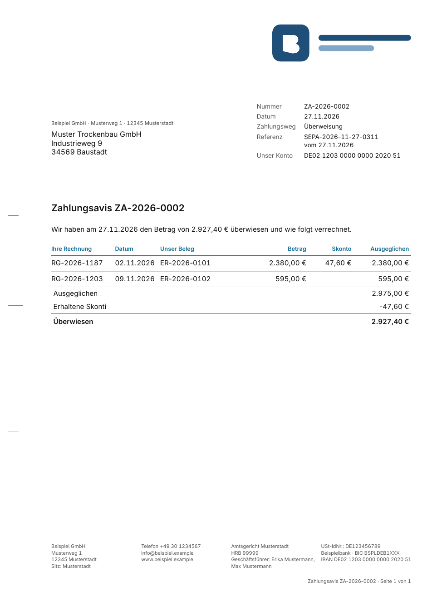

# Zahlungsavis

Beispiel aus den erfundenen Daten des Nachweises: [Zahlungsavis als PDF](beispiele/zahlungsavis.pdf).

Das Druckformat „Zahlungsavis“ meldet einem Lieferanten eine Zahlung (Payment Entry mit „Pay“ an einen Lieferanten): „Wir haben am … den Betrag von … überwiesen und wie folgt verrechnet.“, die Rechnungen, die die Zahlung ausgleicht, zuerst mit der Rechnungsnummer und dem Rechnungsdatum des Lieferanten, dann mit der eigenen Belegnummer, der Betrag jeder Rechnung, das Skonto je Rechnung, soweit der Zahlungsausgang es trägt, der ausgeglichene Betrag, die Abzüge und der gezahlte Betrag. Es ist das Gegenstück der [Zahlungsbestätigung](zahlungsbestaetigung.md) und druckt denselben Brief mit eigenen Spalten.

Die Regeln stehen in `briefbote/purchase/remittance.py`, das Lesen des Belegs in `briefbote/briefbote/receipt.py` (`briefbote_remittance`), das Layout in `briefbote/briefbote/print_format/zahlungsavis/` mit `payment_letter.html`, das auch Zahlungsbestätigung und Quittung drucken.

Die Quellen sind das GmbHG und das UStG in der Fassung von [gesetze-im-internet.de](https://www.gesetze-im-internet.de/), gelesen am 26.11.2026, und der Code von ERPNext im Zweig `version-16` (Commit `d770a3a`, Version 16.61.0), gelesen am 26.11.2026.

## Was ein Zahlungsavis ist

Ein Zahlungsavis ist eine Mitteilung an den Lieferanten, dass und wofür gezahlt wurde, damit er die Zahlung seinen offenen Rechnungen zuordnen kann. Briefbote kennt keine Vorschrift, die Form oder Inhalt eines Zahlungsavis regelt; die Angaben folgen dem, was der Lieferant zum Zuordnen braucht (siehe [Offen für die fachliche Prüfung](#offen-für-die-fachliche-prüfung)).

Das Avis geht an einen bestimmten Empfänger und trägt deshalb als Geschäftsbrief die Angaben zum Unternehmen im Fuß ([§ 35a Abs. 1 GmbHG](https://www.gesetze-im-internet.de/gmbhg/__35a.html), siehe [Geschäftsbrief](geschaeftsbrief.md)). Ob die Ausnahme des § 35a Abs. 2 GmbHG für „Mitteilungen oder Berichte, die im Rahmen einer bestehenden Geschäftsverbindung ergehen“ und auf Vordrucken stehen, greift, prüft Briefbote nicht; es druckt die Angaben immer.

Briefbote meldet nur einen **gebuchten** Zahlungsausgang an einen **Lieferanten**. Ein Entwurf oder ein stornierter Beleg trägt die Markierung „ENTWURF“ oder „STORNIERT“ und, wie ein Zahlungseingang eines Kunden, für den jemand „Zahlungsavis“ wählt, den Befund „Dieses Dokument meldet keine Zahlung“, ohne den Satz über die Zahlung und ohne das eigene Konto; ein Zahlungseingang druckt dazu weder Belege noch Summen, denn sie gehören keinem Lieferanten. Umgekehrt bestätigen Zahlungsbestätigung und Quittung für einen Zahlungsausgang nichts, listen weder Belege noch Summen und drucken den Befund „Dieses Dokument bestätigt nichts“ ([Zahlungsbestätigung](zahlungsbestaetigung.md#was-eine-quittung-ist)). In der Druckansicht eines Zahlungsausgangs stehen alle drei Formate zur Wahl, weil ein Druckformat zu einem DocType gehört und nicht zu einer Zahlungsrichtung; die falsche Wahl druckt den Befund und nichts, was als Avis oder Bestätigung gelesen werden kann.

## Angaben

| Angabe | Woher sie kommt |
|---|---|
| Nummer, Datum | Name und `posting_date` des Zahlungsausgangs |
| Lieferantennummer | `party`, wenn sie vom Namen abweicht |
| Zahlungsweg | `mode_of_payment` |
| Referenz | `reference_no` und `reference_date` als „… vom …“, etwa die Kennung der Überweisung |
| Unser Konto | IBAN des `bank_account`, nur wenn es das Konto ist, das der Fuß des Briefs ohnehin zeigt (das erste Bankkonto der Einstellungen Geschäftspost); sonst fehlt die Zeile |
| Ihre Rechnung, Datum | `bill_no` der Zeile von `references`, sonst `bill_no` der Eingangsrechnung; `bill_date` der Eingangsrechnung |
| Unser Beleg | `reference_name`, die eigene Nummer der Eingangsrechnung (oder der Bestellung bei einer Anzahlung) |
| Betrag | `total_amount` |
| Skonto | `payment_term_discount` der Zeile; die Spalte erscheint nur, wenn eine Zeile Skonto hat |
| Ausgeglichen | `allocated_amount` je Zeile, `total_allocated_amount` als Summe |
| Abzüge | jede Zeile von `deductions` außer Kursdifferenzen, mit Beschreibung oder dem Namen des Kontos, mit ihrem Vorzeichen |
| Keiner Rechnung zugeordnet | `unallocated_amount`, etwa eine Vorauszahlung |
| Überwiesen oder Bezahlt | `received_amount`; „überwiesen“, wenn die Zahlungsart vom Typ „Bank“ ist, sonst „gezahlt“ |

Eine Angabe ohne Wert fehlt ganz. Fehlt einer Eingangsrechnung die Rechnungsnummer des Lieferanten, druckt das Avis oben den Befund „Diesem Zahlungsavis fehlt etwas: Die Rechnung … trägt keine Rechnungsnummer des Lieferanten.“; der Lieferant findet seine Rechnungen an seinen eigenen Nummern.

## Wie ERPNext Skonto bucht

Die Summen rechnen so, wie ERPNext 16 den Zahlungsausgang bucht:

- Für einen Zahlungsausgang ist der Betrag an den Lieferanten `received_amount` = ausgeglichen + Abzüge + nicht zugeordnet (`get_base_unallocated_amount` in `erpnext/accounts/doctype/payment_entry/payment_entry.py`: für „Pay“ `base_received_amount - deductions - base_total_allocated_amount`).
- Skonto aus den Zahlungsbedingungen bucht ERPNext als Abzug mit negativem Betrag auf dem Skontokonto des Unternehmens (`set_pending_discount_loss` ebenda: `positive_negative = -1 if pe.payment_type == "Pay" else 1`). Das Avis druckt ihn mit diesem Vorzeichen: Ausgeglichen 2.975,00 €, Erhaltene Skonti -47,60 €, Überwiesen 2.927,40 €.
- Das Skonto je Rechnung schreibt ERPNext beim Buchen in `payment_term_discount` der Zeile (`set_payment_term_discounts` ebenda), nur für Zeilen mit einer Zahlungsbedingung, deren Skonto bis zum Skontodatum gilt, und nur, soweit ein Abzug auf dem Skontokonto, dem Rundungskonto oder einem Steuerkonto der Rechnung es deckt. Ein Abzug, den jemand ohne Zahlungsbedingung von Hand einträgt, steht in den Summen, aber bei keiner Rechnung; ERPNext ordnet ihn keiner zu.

Skonto mindert das Entgelt; die Umsatzsteuer berichtigt der Lieferant, den Vorsteuerabzug das Unternehmen ([§ 17 Abs. 1 Satz 1 und 2 UStG](https://www.gesetze-im-internet.de/ustg_1980/__17.html)). Das Avis nennt den Abzug je Rechnung, berichtigt aber nichts.

## Was ERPNext nicht abbildet

- **Kundennummer beim Lieferanten:** Der Lieferant hat in ERPNext kein Feld für die Nummer, unter der er das Unternehmen führt. Das Avis nennt deshalb nur die eigene Lieferantennummer, und nur, wo sie vom Namen abweicht.
- **Zahlungsauftrag (Payment Order):** Briefbote druckt das Avis aus dem gebuchten Zahlungsausgang, nicht aus dem Zahlungsauftrag, der mehrere Zahlungen an die Bank bündelt.
- **Fremdwährung:** Beträge der Rechnungen und die Zahlung stehen in der Währung des Kontos des Lieferanten (`paid_to_account_currency`), Abzüge in der Währung des Unternehmens, wie ERPNext sie führt. Weichen beide ab, rechnen die Summen nicht sichtbar auf; der Nachweis druckt nur Euro.

## Offen für die fachliche Prüfung

| Punkt | Was Briefbote druckt | Frage |
|---|---|---|
| Form und Inhalt | Nummer, Datum, Zahlungsweg, Referenz, Rechnungen des Lieferanten mit seiner Nummer und seinem Datum, eigene Belegnummer, Betrag, Skonto, Ausgeglichen, Abzüge, gezahlter Betrag | Gibt es eine Vorschrift oder einen anerkannten Standard für Form oder Inhalt eines Zahlungsavis? Briefbote hat keine gefunden. |
| Angaben im Fuß | Angaben zum Unternehmen nach § 35a Abs. 1 GmbHG | Fällt ein Avis unter die Ausnahme des § 35a Abs. 2 GmbHG? Briefbote druckt die Angaben in jedem Fall. |
| Skonto | Betrag je Rechnung und als Abzug in den Summen | Genügt das Avis dem Lieferanten als Mitteilung der Entgeltminderung nach § 17 Abs. 1 UStG, oder braucht es eine eigene Mitteilung mit Steuerbetrag? |
| Eigenes Konto | IBAN nur, wenn der Fuß sie zeigt | Soll das Avis das belastete Konto nennen, wenn es ein anderes ist als das im Fuß? |

## Nachweis

`briefbote/tests/print_documents_remittance.py` schreibt Eingangsrechnungen mit Rechnungsnummern der Lieferanten und Zahlungsausgänge, `briefbote/tests/print_proof_remittance.py` druckt sie mit beiden Generatoren: ZA-2026-0002 Überweisung auf zwei Rechnungen, eine mit 2 % Skonto, auf leerem und vorgedrucktem Papier; ZA-2026-0003 englisch, bar, an einen Lieferanten in Frankreich mit langem Namen und einem nicht zugeordneten Betrag; ZA-2026-0004 auf 42 Rechnungen über mehrere Seiten mit wiederholtem Tabellenkopf; ZA-2026-0005 mit einer Rechnung ohne Rechnungsnummer des Lieferanten; ZA-2026-0002 als Entwurf und ZA-2026-0004 storniert; „Zahlungsavis“ für den Zahlungseingang ZE-2026-0001 und „Zahlungsbestätigung“ für den Zahlungsausgang ZA-2026-0002. Gemessen wird, dass jeder Betrag der Summen an der rechten Kante der Spalte „Ausgeglichen“ endet. Die Frappe-Tests (`briefbote/tests/test_remittance_printing.py`) prüfen die Zeilen, Summen, Befunde und dass ein Entwurf, ein stornierter Beleg und ein Zahlungseingang keine Zahlung melden.
